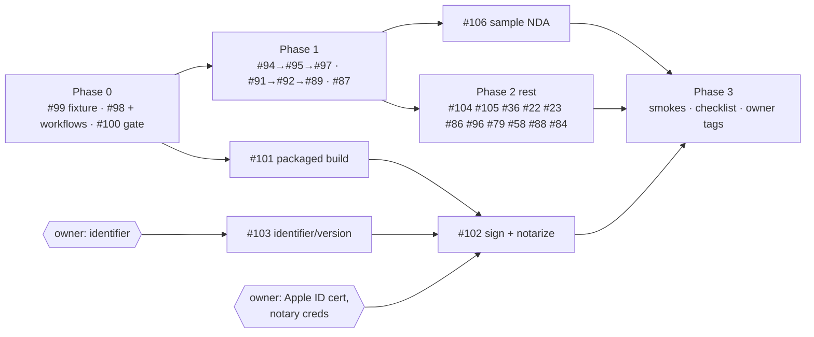

# Rumble launch wrap-up: plan and sequence (2026-10-13)

The owner asked for a plan to wrap up rumble for launch, organised into lanes the agent fleet can run. This plan was read from `main` d5a9e52, the open issues, and the eight open PRs. It builds on the launch round in #75, the program plan `agent_docs/2026-09-22-credible-delightful-local-first-plan.md` (cited below as "the 09-22 plan") and the release gate `agent_docs/2026-09-29-release-gate.md`. Nothing in this plan changes code.

## 1. What "launch" means

The repo is already public (Apache-2.0 since #77), so launch here means the first release a law firm can install. It is done when all five of the following hold. They combine #75's definition of done with the 09-22 plan §8.

1. **Installable.** A signed and notarized macOS (Apple Silicon) dmg is attached to a GitHub release that the owner tagged. Windows and Linux follow the 09-22 plan's D2 default: either an "unsigned preview" labelled as such, or left out.
2. **The core flow works end to end** on the recommended local model, offline after setup: install, Setup reports ready, review the sample NDA, draft a document from a template form, export a .docx, open it in Word.
3. **The copy is honest.** No claim in the UI, README or user docs lacks code behind it (#56, #36, release-gate claims audit).
4. **CI is green.** `main` passes Test, Contract Drift and WebDriver, and e2e is green, with any remaining failure marked `fixme` and linked to an open issue.
5. **Users can get help.** The app shows its version and a support path, and it keeps local logs that support can ask for.

The 09-22 plan §7 cut list keeps these out of scope: auto-update, Premium and cloud routes (#33, #60), sync (#21), encryption at rest, and Word Online.

**Assumption.** No `## OWNER DECISION` records D2 (Windows posture) or D3 (Apple enrolment) on an issue, so this plan uses the 09-22 defaults: macOS first, Windows as an honest unsigned preview, and the owner starts Apple enrolment.

## 2. State on 2026-10-13

- **CI runs again.** Test, Contract Drift and WebDriver ran real steps on `main` d5a9e52 (2026-10-12). CLAUDE.md and `docs/agents/working-with-the-fleet.md` still say Actions "runs zero steps in every job"; #100 corrects that.
- **The red test on `main` (#99) is a platform difference.** The intent question #99 raises (should live rows survive compaction?) does not apply. The failing line is the fixture's precondition, `tests/test_retention.py:140`: it asserts that a deleted row's text is still in the file before compaction. Ubuntu's SQLite turns `secure_delete` on by default, so the DELETE already wiped the text. Checked directly: `ubuntu:24.04` reports SQLite 3.45.1 with `secure_delete=1`, and macOS's uv Python reports 3.50.4 with `secure_delete=0`. The test passes on a Mac and fails on Linux. The fix is one line in the fixture: run `PRAGMA secure_delete=OFF` on the fixture's connection before the DELETE, which reproduces what an earlier build left behind on any platform. Production code does not change.
- **#98 turns three more jobs red.** On #98's head, Frontend, Contract Drift and Selenium fail with `pnpm/action-setup`: "Multiple versions of pnpm specified". The four workflows pin `version: 9`, and #98 adds `packageManager: pnpm@10.20.0`. #98's description calls this a later follow-up; it has to land in the same PR.
- **All eight open PRs are by one human author.** Under the TWO-WRITERS rule the fleet verifies and merges them but never pushes to their branches. The author does the rebases, or hands a branch over with an explicit comment.
- **Release.** No tag and no release exist. `build.yml` has never completed (two `workflow_dispatch` runs on 2026-04-03, both cancelled). There is no signing, no updater and no on-disk log. The identifier is `com.ielegante.rumble` and the version is 0.1.0.
- **Labels.** Only GitHub's defaults exist (see §7).



## 3. Phase 0: unblock CI

| # | Item | Files | Acceptance | Size | Depends |
|---|---|---|---|---|---|
| 0.1 | #99: fixture reproduces an earlier build's leftover on every platform | `src-tauri/sidecar/tests/test_retention.py` | `uv run pytest -q` passes on Ubuntu and on macOS. Removing the pragma makes line 140 fail again on Ubuntu (mutation ledger) | S | — |
| 0.2 | #98 plus dropping `version: 9` from the workflows (same PR, amended by its author) | `package.json`, `CLAUDE.md`, `.github/workflows/{test,build,contract-drift,webdriver}.yml` | Every Actions job on #98's head is green, except pytest until 0.1 lands | S | — |
| 0.3 | #100: one-command merge gate, and CLAUDE.md stops saying Actions is off | `scripts/premerge-check.sh`, `CLAUDE.md`, `docs/agents/working-with-the-fleet.md` | Prints the four tallies; exits non-zero on an injected failing test | M | 0.2 |

## 4. Phase 1: merge the open stack

The order below was checked by merging each PR in sequence onto d5a9e52 with `git merge`.

| Step | PR (issue) | Merges | Notes | Verify size |
|---|---|---|---|---|
| 1 | #94 (#61) hash navigation | clean | e2e 70/172 → 142/172 | S |
| 2 | #95 (#93) stale assertions | clean | Based on #94's branch. After #94 squash-merges, retarget to `main` and `rebase --onto main` so #94's commit is not replayed | S |
| 3 | #97 (#62) IPC mock | clean | Based on #95's branch; same retarget. Adds `tsc -p e2e/tsconfig.json` to `pnpm build`. Merges clean with #98's `package.json` | M |
| 4 | #91 (#49) review reads the contract | clean | Touches `routes/jobs.py` and `services/prompts.py`. ARBITER RULE: run pytest and the vitest that mocks the call | S |
| 5 | #92 (#90) JSON repair before retry | **conflicts with #91** in `src-tauri/sidecar/tests/test_jobs.py` (3 hunks; both PRs append tests) | The author rebases after #91. Its 60/60 batch used `main`'s prompt, so the verifier re-runs a small batch on #91's prompt | S |
| 6 | #89 (#46) draft in plain text | clean on top of 4 and 5 | The largest diff (+1091). Changes `sidecar-openapi.json`, the frozen spec: the verifier quotes the ruling it cites before MERGE | M |
| 7 | #87 (#56, #19, #20, #21) honest copy | **conflicts with #89** (`src/views/DocumentDraftView.vue`), **#91** (`tests/document-draft-view.test.ts`) and **#97** (`e2e/full-ux-walkthrough.spec.ts`); 35 commits behind `main` | Last on purpose: it shares the most files, so its author rebases once rather than three others each rebasing, and its copy is re-audited against the final views | M |

Each step needs `Verdict: MERGE @<sha>` from an independent verifier and the merge gate on `refs/pull/<N>/merge`. Steps 1 to 3 and 7 also run `pnpm test:e2e`. Steps 4 to 6 touch sidecar routes, so the ARBITER RULE applies to both sides of the wire.

## 5. Phase 2: launch gaps

| # | Item | Files | Acceptance (short; the full text is on the issue) | Size | Depends | Owner |
|---|---|---|---|---|---|---|
| 2.1 | #101 packaged build from a clean checkout; `build.yml` green | `build.yml`, `sidecar.spec`, README | dmg installs and reaches ready; dispatch run green | M | Phase 0 | — |
| 2.2 | #103 bundle identifier and a single version | `tauri.conf.json`, `Cargo.toml`, `package.json`, `lib.rs` | versions agree (checked); DB migrated if the identifier changes | S/M | — | **identifier, version** |
| 2.3 | #102 sign and notarize | `tauri.conf.json`, `Entitlements.plist`, `sidecar.spec`, `build.yml`, SECURITY/NETWORK | `spctl` says Notarized Developer ID; no Gatekeeper prompt on a second Mac | L | 2.1, 2.2 | **Apple cert, notary creds** |
| 2.4 | #104 local logs and "Open logs folder" (stands in for crash reporting) | `lib.rs`, `Cargo.toml`, `app.py`, `SettingsView.vue` | rotated logs on disk; no document text or secret in them; no new egress | M | — | — |
| 2.5 | #105 Help: version, support contact, Report a problem | `SidebarNav.vue`, `CommandPalette.vue`, `AppShell.vue` | links asserted in vitest; NETWORK.md row | S | — | **support address** |
| 2.6 | #106 first run: sample NDA with one-click Review | `SetupView.vue`, `DocumentReviewView.vue`, `src/assets/` | click → review queued (vitest + e2e); packaged screenshot | M | #91, #92, #97 | **sample text, model** |
| 2.7 | #36 claims audit, remaining gaps: README says "Proprietary" but LICENSE is Apache-2.0; platform line vs D2; stale test counts; getting-started's "right-click → Open" | `README.md`, `agent_docs/2026-03-05-getting-started.md` | every claim traced to code | S | #87, 2.3 | **D2** |
| 2.8 | Dead or false UI: #22 workspace path, #23 Browse, #86 Briefcases section (default: remove), #96 citation chips (default: remove) | `SettingsView.vue`, `DocumentReviewView.vue` | as on each issue | 4×S | #87 | — |
| 2.9 | Robustness: #79 hostile PDF hangs extraction, #58 30s host timeout, #88 abandoned jobs, #84 fsync on export | sidecar, `lib.rs` | as on each issue | M, M, M, S | — | #79 upstream report |

Priority if capacity is short: 2.1, 2.3, 2.6, 2.7, #79 and #58 decide whether launch is credible. 2.4, 2.5 and 2.8 are cheap and visible. #88 and #84 can follow launch.

Deferred, with no issue filed: an auto-updater (09-22 plan §7; it needs an owner-held update-signing key and a place to host it), a networked crash reporter (it contradicts NETWORK.md), Premium routes, and sync.

## 6. Phase 3: QA and release

These get issues once Phase 2 lands.

| # | Item | Acceptance | Size | Where |
|---|---|---|---|---|
| 3.1 | Automated packaged smoke: drive the packaged Linux build through `tauri-driver` (WebDriver) with real Ollama and a small model: ready → sample review completes → draft from a template → exported .docx parses | the smoke goes red when the export command is broken (injected) | M–L | Linux VM (`tauri-driver` does not support macOS) |
| 3.2 | macOS human smoke on the signed dmg, on a second Mac: Gatekeeper, keychain, export opens in Word, `scripts/egress-smoke.sh observe` reports no non-loopback peers after setup | checklist ticked, with screenshots | S | Mac mini + a human |
| 3.3 | Release checklist (`agent_docs/<date>-release-checklist.md`): version bump, dispatch the build, notarize, checksums, release notes, owner tags, closure pass | used once, end to end, for the release candidate | S | — |
| 3.4 | #75 item 4: the full e2e count, posted on #75 | count posted at a named SHA | S | either |

## 7. Fleet fit: one Mac mini for monorepo, word and rumble

**Labels.** rumble has only GitHub's defaults: `bug`, `documentation`, `duplicate`, `enhancement`, `good first issue`, `help wanted`, `invalid`, `question`, `wontfix`. The fleet relies on `P0`, `P1`, `P2`, `ready-for-agent`, `needs-triage`, `needs-info` and `ready-for-human`, and none of them exist. A lane never creates labels, so the owner (or someone with that permission) creates them. Until then the issues filed for this plan carry "Suggested priority" and "Ready for an agent lane" lines in their bodies.

**Briefs.** Issues #100 to #106 are already in brief shape: a SURFACE line with exact paths, acceptance criteria, size, dependencies and owner gates, each body about 1–1.4 KB. A rumble brief also names the branch pattern `codex/<issue>-<slug>`, `Refs #N` (never `Fixes`), and the PR template in `docs/agents/working-with-the-fleet.md`.

**Local CI gate.** No lint or format gate exists in any of the three languages. `cargo fmt --check`, `cargo clippy` and `ruff` stay advisory until a PR adds them to CI. #100 wraps the block below:

```sh
git fetch origin refs/pull/<N>/merge && git checkout -q FETCH_HEAD
corepack enable                                   # honours packageManager pnpm@10.20.0 once #98 lands
pnpm install --frozen-lockfile
pnpm build                                        # vue-tsc (+ e2e tsc after #97) + vite build
pnpm test                                         # vitest
(cd src-tauri/sidecar && uv sync --locked && uv run pytest -q)
mkdir -p src-tauri/binaries && touch src-tauri/binaries/rumble-sidecar-$(rustc -vV | sed -n 's/^host: //p')
(cd src-tauri && cargo test)
pnpm generate:api && pnpm generate:models && git diff --exit-code -- src/api/models src-tauri/sidecar/models/generated.py
pnpm test:e2e                                     # when views/components change; `pnpm exec playwright install chromium` once
```

**What runs where.**

| Work | Linux VM | Mac mini |
|---|---|---|
| vitest, pytest, cargo test, drift, e2e | yes (`cargo test` needs `libwebkit2gtk-4.1-dev`, `libappindicator3-dev`, `librsvg2-dev`, `patchelf`) | yes |
| A verdict on anything touching SQLite or the filesystem | not on its own | **also needed.** #99 passed on macOS and failed on Ubuntu, so a sidecar-storage verdict quotes both |
| `pnpm tauri build` for dmg/.app; `codesign`, `notarytool`, `stapler`; the keychain and WKWebView behaviour (#35 class) | no | **Mac mini only** |
| deb/AppImage builds; the `tauri-driver` packaged smoke (3.1) | yes | no (`tauri-driver` has no macOS support) |
| Windows msi/nsis | no | no; this is the GitHub Actions `windows-latest` leg of `build.yml` |

**Mac mini requirements.** Xcode Command Line Tools; Rust stable with the `aarch64-apple-darwin` target; Node 20 with corepack; uv and Python 3.12; Ollama with the recommended model pulled, for the human smoke. The owner installs the Developer ID certificate in a dedicated keychain on the mini and puts the notarization credentials in a keychain profile (`xcrun notarytool store-credentials`), so lanes refer to them by name only and never see the secret. Release builds run one at a time, because a Tauri release build plus PyInstaller is the heaviest job on the box. CLAUDE.md's rule of one `cargo test` at a time still applies. Keep a disk floor, since `src-tauri/target` grows by several GB per worktree.

**Unchanged.** The owner pushes the release tag. Signing credentials never reach a lane. The fleet never pushes to a human's branch.

## 8. Owner-only items

1. Apple Developer Program membership, the Developer ID Application certificate and notarization credentials, and whether they live on the Mac mini or in Actions secrets (#102).
2. D2: the Windows and Linux posture at launch (#36, #101).
3. Keep or change `com.ielegante.rumble`, and the launch version number (#103). Recommendation: change it before the first signed build.
4. The support address and whether public GitHub issues are the channel for users (#105). Default: ping@elefant.legal.
5. The sample NDA's text and the recommended model (#106).
6. Create the triage and priority labels (§7).
7. Push the release tag (Phase 3).
8. Confirm the upstream pypdf security report (#79).
