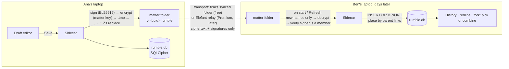

# Team sync: plan

This is a design plan, not code. Refs #21. It was read against `main` at 2641249 on 2026-11-17. Sizes are given as S/M/L, never as dates.

## 1. The problem, in the owner's words

> "how to keep docs synced within a team, but local only, and when different laptops come on at different times." (owner, 2026-11-17)

> "also need to have version changes tracked. that's crucial." (owner, 2026-11-17)

> "back in the day we went through how to sync decentralised. we looked at things like telegram and other protocols." … "yes signal is closer." (owner, 2026-11-17)

> "rumble-sync exists as an idea on the roadmap, not as a repo. The concept: users on local language models can still work with colleagues through a decentralised sync mechanism rather than syncing to a server, keeping infrastructure costs down. Researched but not built out." (owner, #21, 2026-09-17)

The product rule (owner, 2026-11-17) also applies: free and open source as a trust builder, Elefant's managed service for most people, a seamless upgrade, no pushiness.

Two things are hard:
- **Timing.** Laptops may never be on at the same moment, so nothing can depend on a live peer.
- **History.** Every change must stay attributable and comparable, including two changes made offline at the same time.

### The earlier design this builds on

`elefant_api_monorepo/agent_docs/2026-02-10-stub-implementation-plan.md` §12, "Briefcase sharing — Telegram-style E2E encrypted", is the research the owner recalls. It keeps:
- per-person X25519 keys;
- a per-briefcase symmetric key, "wrapped" (encrypted) separately for each sharee;
- a relay that "never sees plaintext";
- "revocation is best-effort";
- libsodium.

This plan keeps all five. It changes four things:

| §12 | Here | Why |
|---|---|---|
| AES-256-GCM plus HKDF ("Encryption Details") | libsodium `SecretBox` (XSalsa20 plus Poly1305) and sealed boxes | Composed, high-level libsodium calls; random nonces are safe (§4) |
| `permission` 'read' / 'read_write', `expires_at` | Dropped from the MVP: every member can save versions; there is no expiry | YAGNI until a pilot asks. Read-only members would need admin-signed roles (phase 3) |
| A server publishes public keys and stores blobs (`user_public_keys`, `briefcase_sync_blobs`) | The firm's synced folder carries both; an Elefant relay becomes an optional second transport | Local-only must work with no Elefant infrastructure |
| `version INTEGER` and `GET …/sync/latest` | Each version is an immutable file naming its parent versions | "latest" silently drops one of two offline edits, and keeps no history |
| No signatures | Every file is signed by its author's device key | Every change has a provable author: the audit |
| Revoke deletes the share record; the key stays the same | Removal starts a new matter key | A removed person cannot read anything written afterwards |

§12's open questions get answers here: "Group sharing" (§5), "Conflict resolution: … last-write-wins or CRDT?" (neither: a person reconciles, §5), "Key backup" (decision 8) and "Offline: how long can a client hold data offline" (indefinitely: §5.4; expiry is not in the MVP).

## 2. What a synced "doc" is

Today Rumble has no document or matter record. The sidecar database (`src-tauri/sidecar/services/db.py`, `SCHEMA`) has three tables:
- `chats` (UUIDv4 `id`, `title`) and `messages` (the seed message with the document text, then the Q&A);
- `jobs`, holding draft, review and research requests and results, purged after 30 days.

A draft is a job result. `DocumentDraftView.vue` shows it in a read-only `<pre>` and exports it with `export_draft_docx`. It cannot be edited, saved or reopened. A review's issues list is never stored; it lives in `session.messages` in memory. `src/api/sidecar.ts` has no call that lists chats. Templates are hardcoded, and the templates folder in Settings is unused (#144).

"Version changes tracked" only means something for a document people change. That is the draft, not the review. Options:

| | Rumble-native drafts | `.docx` edited in Word |
|---|---|---|
| What a version is | The draft's text, saved in Rumble | The whole `.docx`, checked back into Rumble after editing in Word |
| Redline | A word diff of two texts (stdlib `difflib`) | Needs text extraction from `.docx` (`python-docx` is already a dependency); formatting changes are invisible |
| Needs | A document and version model, plus an editable draft view | The same model, plus a check-in flow and file watching or manual import |
| Phase | **MVP** | Phase 4 |

**Definition.**
- A **doc** is a Rumble-native draft.
- A **version** is one immutable snapshot of its text, with its parents, author, time, content hash and signature.
- A **matter** is the unit of sharing and the ethical wall: a folder, a member list and a key.

The review-snapshot MVP from v1 of this plan is dropped. It would have shipped sharing without versions, and the version model would then have had to be retrofitted. A review can become a doc later: "save review as a doc".

## 3. Options compared

### 3a. Transport: getting bytes from A to B when they are never on together

| Option | Never on together? | New egress from Rumble | Elefant infra | Verdict |
|---|---|---|---|---|
| Put `rumble.db` in a synced folder | Corrupts the database (§4) | None | None | No |
| **(a) The firm's synced folder** (OneDrive/SharePoint, Dropbox, iCloud, SMB) used as a mailbox of signed, encrypted files | **Yes**: the folder service stores and forwards | **None**: Rumble does local file I/O, and the firm's sync client moves ciphertext | None | **v1, free** |
| (b) LAN P2P with mDNS | No: both must be awake on one network | A non-loopback listener, which breaks "Sidecar binds 127.0.0.1 only" (NETWORK.md) | None | No |
| (c) A P2P library with relays (iroh) | No: relays "don't store your application data" (§4) | Yes | Low | No |
| **(d) An Elefant relay**: a mailbox that stores the same files | Yes | Yes, to Elefant, opt-in | Ongoing | **Later, Premium** |

The transport is a small interface over one file format: `list names`, `read file`, `write file`. The folder implements it with the filesystem. The relay implements the same three operations over HTTPS and sees what the folder sees: ciphertext and file names. Switching transports changes no record and no key.

### 3b. Merging concurrent edits

| Approach | For legal text |
|---|---|
| Last write wins (§12's `sync/latest`) | Silently loses one person's work. Rejected |
| CRDT (Automerge, yrs, Loro; §4) | Interleaves both people's characters automatically, a merge nobody reviewed. Rejected for legal text, and unnecessary without live co-typing |
| **Version graph plus human reconcile** | Each save is a new version naming its parent(s). Two offline saves from one parent make a **fork**: two versions, shown with a redline. A person picks one, or combines them, and saves a version with both as parents. Nothing is merged automatically |

### 3c. Identity, keys and membership

| Option | Who wrote it? | Remove a person | Verdict |
|---|---|---|---|
| One shared matter code (v1 of this plan) | Claimed, not proved | Hand a new code to everyone who stays | Too weak for an audit trail |
| **Per-device identity keys; the matter key wrapped per device; every file signed** (§12 plus signatures, and Signal's identity and safety-number model) | Proved (Ed25519) | A new matter key, wrapped for those who stay; nobody passes codes around | **Recommended** |
| Signal protocol proper (X3DH/PQXDH plus Double Ratchet or sender-key ratchets) | Proved, plus forward secrecy | Protocol-managed | Rejected: forward secrecy conflicts with reading history years later and with new devices seeing past versions; it needs ordered delivery a folder cannot give; libsignal is AGPL-3.0 (§4) |
| MLS (e.g. OpenMLS) | Proved | Protocol commit | Rejected: needs ordered commits, so it is heavy for a folder |

## 4. Research: primary sources

Checked 2026-11-17. Quotes are verbatim; "silent" means the source does not say. Where a site refused automated fetches, that is stated.

**Why not just put `rumble.db` in the synced folder.** SQLite: "SQLite relies on exclusive locks for write operations, and those have been known to operate incorrectly for some network filesystems. This has led to database corruption." and "Rely upon it at your (and your customers') peril." ([useovernet](https://www.sqlite.org/useovernet.html)). A background copier can catch a database "in the middle of a transaction. The backup copy then might contain some old and some new content, and thus be corrupt" ([howtocorrupt §1.2](https://www.sqlite.org/howtocorrupt.html)). SQLite does not name Dropbox, OneDrive or iCloud; treating a sync client as that background copier is our inference. Either way, two laptops writing one database file is the wrong shape.

**Synced folders.**
- OneDrive/SharePoint ([restrictions](https://support.microsoft.com/en-us/office/restrictions-and-limitations-in-onedrive-and-sharepoint-64883a5d-228e-48f5-b3d2-eb39e07630fa)): names may not contain `" * : < > ? / \ |`, nor start with `~$`; "we recommend syncing no more than a total of 300,000 items across your cloud storage." Conflicts: "You might have sync conflicts if you upload multiple files on the OneDrive website at the same time." Microsoft does not document the conflict-copy naming (silent). `<uuid>.rumble` uses none of the forbidden characters. The same page: "Temporary TMP files don't sync to OneDrive", which suits write-to-temp-then-rename.
- OneDrive Files On-Demand ([Microsoft](https://support.microsoft.com/en-us/office/save-disk-space-with-onedrive-files-on-demand-for-windows-0e6860d3-d9f3-4971-b321-7092438fb38e)): "Online-only files don't take up space on your computer"; they download when opened. So reading a placeholder triggers a download by OneDrive, not by Rumble.
- Dropbox ([help](https://help.dropbox.com/organize/conflicted-copy)): "A conflicted copy is a file that Dropbox creates when multiple people edit the same file at the same time." "The editor's username, "conflicted copy", and the save date will be added to the filename."
- iCloud Drive ([Apple](https://support.apple.com/en-us/109344)): "Your files sync with iCloud each time your device connects to the internet." Apple is silent on how conflicts are resolved.
- Microsoft 365 is not end-to-end encrypted: SharePoint "decrypts the customer data before sending it to the user" ([Microsoft 365 encryption](https://learn.microsoft.com/en-us/compliance/assurance/assurance-encryption-for-microsoft-365-services)); "some cases require a Microsoft engineer to access your content" ([Customer Lockbox](https://learn.microsoft.com/en-us/purview/customer-lockbox-requests)). Hence Rumble encrypts before writing.
- Windows roaming: `FOLDERID_RoamingAppData` is "%APPDATA% (%USERPROFILE%\AppData\Roaming)" ([KNOWNFOLDERID](https://learn.microsoft.com/en-us/windows/win32/shell/knownfolderid)); Roaming User Profiles redirect "user profiles to a file share" ([overview](https://learn.microsoft.com/en-us/windows-server/storage/folder-redirection/folder-redirection-rup-overview)). That `AppData\Local` never roams is stated only in a Microsoft Q&A community answer, not in Learn docs: unverified as documentation. #57 already moved Rumble's data to `app_local_data_dir`.

**Merge libraries.** All checked against their own repos, crates.io and PyPI.

| | Licence | Latest | Python | Own words / status | Fit for a shared folder | SQLite |
|---|---|---|---|---|---|---|
| [Automerge](https://github.com/automerge/automerge) | MIT | crate 0.12.0, 2026-09-16 | PyPI `automerge` stable 0.1.2 (2022); newer only pre-release (0.2.0.dev4, 2026-04) | Rust API "is low level and not well documented" (README) | Changes save and load as files; `apply_changes` "is idempotent" ([docs.rs](https://docs.rs/automerge/latest/automerge/struct.Automerge.html)). Its sync protocol is a live exchange ("delivering messages and acknowledgements in both directions", [automerge-py sync.md](https://github.com/automerge/automerge-py/blob/main/docs/sync.md)) | silent |
| [yrs / Yjs](https://github.com/y-crdt/y-crdt) | MIT | `yrs` 0.28.1, 2026-11-04 | `pycrdt` 0.14.13, 2026-11-02; `ypy` archived: "This project is abandoned, please look at pycrdt." | 0.x, no stability claim | Updates are diffs applied later; the store holds "pending updates waiting to be applied once a missing update information arrives" ([docs.rs](https://docs.rs/yrs/latest/yrs/)) | silent |
| [Loro](https://github.com/loro-dev/loro) | MIT | 1.18.0, 2026-11-16 | `loro` 1.18.0 | "Loro 1.0 is out!" (README); format-stability page refused fetch: unverified | Export modes `Updates`, `Snapshot` ([docs.rs](https://docs.rs/loro/latest/loro/enum.ExportMode.html)) | silent |
| [cr-sqlite](https://github.com/vlcn-io/cr-sqlite) | MIT | v0.16.3, **2024-01-17** | loadable extension | Author, 2024-12-30: "I'm full time on https://zero.rocicorp.dev/ these days." and "I don't see that happening for at least 1-2 years" ([#444](https://github.com/vlcn-io/cr-sqlite/issues/444)) | n/a | "a run-time loadable extension for SQLite"; SQLCipher compatibility: silent |

All three CRDTs could carry their updates as files. None is needed while every record is immutable (§2).

**Peer-to-peer.**
- [iroh](https://github.com/n0-computer/iroh) (MIT OR Apache-2.0, v1.4.1, 2026-10-21): "Iroh hardcodes a set of public relays provided by n0.computer"; relays "don't store your application data; they just facilitate connections"; "Public relays are suitable for development and testing"; self-hosting supported ([relays](https://docs.iroh.computer/concepts/relays)). `iroh-blobs` README: "this version of iroh-blobs is not yet considered production quality." Iroh does not say whether peers must be online together (silent). Relays that store nothing imply they must be, which is our inference.
- Tauri: there is no official mDNS or LAN-discovery plugin among the 31 in [plugins-workspace](https://github.com/tauri-apps/plugins-workspace).

**Encryption library.**
- [PyNaCl](https://github.com/pyca/pynacl), the Python binding to libsodium, from the same maintainers as `cryptography` (pyca): 1.6.2 (2026-01-01), Apache-2.0, not archived, last push 2026-11-03 (PyPI and GitHub API).
  - [SecretBox](https://pynacl.readthedocs.io/en/latest/secret/) "encrypts and decrypts messages using the given secret key". It uses the XSalsa20 stream cipher with a Poly1305 MAC, and its docs say "You can safely generate random nonces" (24 bytes).
  - Sealed boxes ([libsodium](https://doc.libsodium.org/public-key_cryptography/sealed_boxes)) "are designed to anonymously send messages to a recipient given their public key… While the recipient can verify the integrity of the message, they cannot verify the identity of the sender." That is why every record is also signed (Ed25519, [PyNaCl signing](https://pynacl.readthedocs.io/en/latest/signing/)).
  - Each device holds two key pairs, one to sign and one to receive keys, for key separation. Whether to convert one into the other is irrelevant to this design.
- [`cryptography`](https://cryptography.io/en/latest/) is already locked (46.0.5, through `pypdf[crypto]`). Its X25519, Ed25519 and AEAD primitives sit under a module that calls itself "Hazardous Materials" and warns "You should **ONLY** use it if you're 100% absolutely sure that you know what you're doing" ([AEAD page](https://cryptography.io/en/latest/hazmat/primitives/aead/)). Wrapping a key for a recipient would mean composing X25519, HKDF and an AEAD by hand. libsodium's sealed box is that construction, already composed. Its high-level Fernet recipe is symmetric only.
- [age](https://github.com/C2SP/C2SP/blob/main/age.md) wraps a file key "for one or more _recipients_". The spec says nothing about sender authentication. Not chosen: it would still need a separate signature scheme.

**Signal: what to borrow** ([signal.org/docs](https://signal.org/docs/) lists XEdDSA, X3DH, PQXDH, Double Ratchet, Sesame and ML-KEM Braid; it has **no group or sender-key specification**).
- **Double Ratchet:** "used by two parties to exchange encrypted messages based on a shared secret key. The parties derive new keys for every Double Ratchet message so that earlier keys cannot be calculated from later ones" ([spec](https://signal.org/docs/specifications/doubleratchet/)). The design point is that old message keys cannot be recomputed. A matter must be readable years later, by members and devices added later, from files in a folder. A per-pair ratchet and its session state, in a folder with no ordered delivery, works against both requirements. Not borrowed.
- **Multiple devices (Sesame):** "With per-device identity keys, each device may have a different key pair." On identity change: "Whenever a change in identity keys is detected users must repeat the authentication process" ([spec §3.1, §6.1](https://signal.org/docs/specifications/sesame/)). Borrowed: per-device identity keys, and a key change is never silent.
- **Safety numbers** (Signal blog, [2016-11-17](https://signal.org/blog/safety-number-updates/)): they "allow Signal users to verify the privacy of their communication with a contact", and are checked by comparing a number or scanning one QR code. Signal moved from blocking on a key change, where users needed manual approval before "being able to send or receive any further messages", to an advisory notice. Signal's support article returned 403 to fetching, so current behaviour beyond that post is unverified. Borrowed: number and QR comparison. Blocking is decision 6.
- **Groups and sender keys.** In 2014 Signal "simply deliver[ed] a pairwise encrypted message to each member of the group" and described encrypting once with a random key sent pairwise as a future optimisation ([blog, 2014-05-05](https://signal.org/blog/private-groups/)). Today's sender keys exist in code, not in a spec: libsignal's `sender_keys.rs` and `group_cipher.rs` (`create_sender_key_distribution_message`, `group_encrypt`) ([libsignal](https://github.com/signalapp/libsignal/tree/main/rust/protocol/src)). Borrowed: the shape, encrypt once with a group key and hand that key to each member individually. Not borrowed: the per-sender chain ratchet (same reasoning as the Double Ratchet).
- **libsignal itself** is `SPDX-License-Identifier: AGPL-3.0-only` (header of `sender_keys.rs`; GitHub reports AGPL-3.0). Rumble is Apache-2.0, so linking it is a licensing decision, not a technical one. It is not proposed.

**Redline building blocks already in the stack.**
- Python's stdlib [`difflib`](https://docs.python.org/3/library/difflib.html), "Helpers for computing deltas", whose `SequenceMatcher` is "a flexible class for comparing pairs of sequences of any type". It works on word tokens.
- `docx-rs`, already a host dependency (0.4), has [`Insert`](https://docs.rs/docx-rs/latest/docx_rs/struct.Insert.html) with `author()` and `date()`, and references a `Delete` type. Those are the pieces for a tracked-changes `.docx` export. Whether Word renders them as tracked changes is unverified until a spike.
- Rumble has **no diff today**: no diff package in `package.json`, and the draft is shown in a read-only `<pre>` (`DocumentDraftView.vue`).

**Legal-sector duties** (what the design must respect, not legal advice; check against the firm's own jurisdiction):
- ABA Model Rule 1.6(c), as quoted in [Formal Opinion 477](https://docs.tbpr.org/pub/aba%20formal%20opinion%20477.authcheckdam.pdf) (the 2017 text, on a state bar's copy because americanbar.org refused the fetch; the 477R revision's wording is unverified): "A lawyer shall make reasonable efforts to prevent the inadvertent or unauthorized disclosure of, or unauthorized access to, information relating to the representation of a client." The opinion: "a lawyer should consider whether certain data should ever be stored in an unencrypted environment." The ABA definition of "screened" (Rule 1.0(k)) could not be fetched: unverified.
- Singapore, Law Society [Guidance Note 6.1.1](https://law-society-singapore-prod.s3.ap-southeast-1.amazonaws.com/2020/03/121.-Ethics-and-Information-Technology-GN-6.1.1.pdf): "Under rule 6(2) of the PCR 2015, a legal practitioner must not knowingly disclose any information which is confidential to his/her client…"; "Possible means of protecting confidentiality include the use of encrypted e-mail or secured lines." The PCR text itself (SSO refused the fetch) and the cloud-computing guidance note 3.4.1: unverified.
- England and Wales, [SRA Code for Solicitors](https://www.sra.org.uk/solicitors/standards-regulations/code-conduct-solicitors/) 6.3: "You keep the affairs of current and former clients confidential…"; 6.5 permits acting only where "effective measures have been taken which result in there being no real risk of disclosure of the confidential information".
- Hong Kong, [Solicitors' Guide ch. 8](https://www.hklawsoc.org.hk/-/media/HKLS/Home/Support-Member/Professional-Support/Vol-1-Eng/Chapter-8-English.pdf) 8.01: a duty "to hold in strict confidence all information concerning the business and affairs of his client"; commentary 31: "This Principle extends to cover electronic communication."

Together: encrypt before data reaches a third-party store, and make each matter separable (an information barrier). Neither duty asks for a server or a CRDT.

## 5. Recommendation

**Each version of a draft is one signed, encrypted, immutable file, written into a matter folder the firm already syncs. Laptops import the files they have not seen whenever they start or the user clicks Refresh. Each device has its own identity key, checked by safety number. The matter key is wrapped for each member device, and replaced whenever someone is removed. Forks are shown as two versions with a redline, for a person to reconcile.**

### 5.1 Files in a matter folder

Every file is `<kind>-<uuid>.rumble` and is written once, by one device. Two devices never write the same file, so the sync service never has a conflict to resolve. Each file is a signed statement; content files are also encrypted.

| Kind | Written by | Plaintext or encrypted | Says |
|---|---|---|---|
| `matter` (genesis) | The creator | Plaintext, signed | Matter name, the admin list (one device in the MVP UI), the creator's keys. **The matter id is the hash of this file**, so it cannot be swapped |
| `device` | A device joining | Plaintext, signed by itself | Name ("Ana Lim, MacBook"), Ed25519 signing key, X25519 receiving key |
| `member` | An admin | Plaintext, signed | Add or remove device D (by fingerprint), with a reason. A removal carries a cutoff: "D's versions with seq ≤ N stay valid" |
| `key` | An admin | Matter key epochs, each sealed to one device (libsodium sealed box) | On a new epoch: that epoch for every remaining device. On approval of a joiner: every epoch 1..n for the joiner (decision 5) |
| `version` | Any member device | Encrypted with the current matter key, signature inside | `doc_id`, `version_id`, `parents[]`, `seq`, `epoch`, `title`, `text`, `sha256(text)`, `created_at`, signer fingerprint |

Rules for every kind:
- **What is signed:** the canonical bytes of the whole record (`matter_id`, `kind`, file id, `seq`, `prev` and every field above). A signature therefore binds a file to its matter and position.
- **`seq` is per (device, matter)**, +1 for each file that device writes in that matter. Gaps are real gaps.
- **Admin files form one chain:** each `member` or `key` file names the previous admin file (`prev`). Membership for epoch *n* is the state at the admin file that created epoch *n*. Admin files are applied in chain order, never by clock. A gap in the chain blocks membership changes until the missing file arrives.

What the format guarantees:
- **Rejected on import:** a `version_id` that differs from its file name, a bad signature, or a signer who was not a member for that key epoch.
- **Skipped without opening:** names already seen. With OneDrive Files On-Demand, only new files download.
- **Retried:** a damaged or not-yet-openable file is retried on each Refresh, keyed by file name, and counted in the UI. A half-synced file only fails to decrypt. OneDrive's TMP rule is quoted in §4; whether Dropbox and iCloud skip `.tmp` is unverified and harmless.
- **Atomic writes:** write `.tmp` in the matter folder, then `os.replace`. OneDrive does not sync TMP files (§4).

### 5.2 Versions, ordering, forks, redline

- **Order** comes from parent links, never from clocks. `created_at` is only a label. History is the graph; the doc's current state is its **heads**, the versions nobody names as a parent.
- **One head:** the normal case.
- **Two or more heads: a fork.** Two people saved offline from the same parent (v3 → 4a and 4b). Rumble shows "Two versions of v3: Ana's (Tue) and Ben's (Wed)" with a redline of each against v3 and against each other. The user picks one to continue, or edits a combined text. Either way they save a version whose parents are [4a, 4b]. The fork is closed, and both branches stay in history.
- **A missing parent** (a file not yet synced) shows as "waiting for 1 earlier version from Ben". A **gap in a device's `seq`** shows as "Ben's #14 has not arrived". This catches withheld or deleted files.
- **Redline** between any two versions: a word-level diff with stdlib `difflib`, rendered as inserted and deleted spans. No new dependency. Phase 3 adds a tracked-changes `.docx` export via `docx-rs` `Insert`/`Delete` (already a dependency; a spike is needed).
- **Only an explicit Save makes a version.** Autosave stays local.
- **Storage:** full snapshots, not deltas. A draft is text, so tens of KB. 1,000 versions of a 50 KB draft is about 50 MB of ciphertext per matter, well under OneDrive's recommended 300,000 synced items. Compaction would break the audit trail, so there is none. Deltas only if real matters prove snapshots too large.

### 5.3 Identity, invites, safety numbers

Signal's model, cut down to what a folder can carry:
1. **First launch:** each device generates an Ed25519 signing key pair and an X25519 receiving key pair. They are kept separate on purpose, one key per job (key separation). They are stored in the SQLCipher database, which is unlocked by the keychain `db_key`. Each device is an identity, as in Sesame's per-device keys.
2. **Join:** the joiner picks the matter folder (the firm has already granted folder access) and Rumble writes a `device` file. The folder ACL is wall one.
3. **Approve, mutually:** the admin sees "Ben Tan, ThinkPad, asks to join". Both screens show the same **safety number**, derived from the admin's and Ben's public keys. They compare it in person or on a call (Signal's comparison, §4). A match proves Ben's key to the admin *and* the matter's admin key, from the genesis file, to Ben. A fake matter planted in the folder fails Ben's side of the check. QR comes later (phase 3). Only after a match does the admin sign a `member` file and wrap the matter keys for Ben's device. The key is wall two.
4. **Trust on first use, never re-trusted silently.** An approved device's keys are pinned. A device's keys never change: a reinstalled or new laptop is a **new device** that goes through steps 2–3. So there is no "key changed" state to accept by mistake. A second `device` file with an existing display name shows as a separate, unapproved device.
5. **Several devices per person:** each is approved separately and grouped under the person's name in the UI. Authorship shows person and device.

### 5.4 Removal, lost laptops, laptops back after months

- **Remove a person or one device:**
  - The admin writes a signed `member` remove file with a seq cutoff, "Ben's MacBook: seq ≤ N valid". N is the highest seq the admin has seen. Every laptop applies the same rule. A version from Ben above N is hidden from the history and shown in the audit as "arrived after removal, rejected", including one a laptop had already imported. Nothing is deleted.
  - The admin then writes a new `key` epoch, wrapped only for the devices that remain.
  - New versions use the new key.
  - Copy, verbatim in the UI: "Ben keeps everything he could already open. He can't open anything saved from now on." There is no remote wipe; §12 called revocation "best-effort", and that stays true.
  - The firm should also remove Ben's folder access, so he stops receiving files at all.
- **Lost or stolen laptop:** remove that device, which forces a new key. At-rest protection is unchanged: FDE plus SQLCipher. The person's other devices keep working.
- **A laptop back months later** imports everything in parent order, including new `key` epochs wrapped for it.
  - If it was removed while away, it sees the removal and new versions it cannot open, and says so.
  - Versions it wrote offline under an old epoch are accepted if it is still a member. If it was removed, only those within the removal's seq cutoff are accepted.
  - Its offline edits become a fork to reconcile, never an overwrite.

### 5.5 Withdraw, audit export

- **Withdraw a doc:** a signed tombstone from the doc's author or an admin. It is reversible: every laptop hides the doc, and laptops back later apply the tombstone. Rumble never deletes folder files, so history stays intact for audit, and the firm's own retention applies to the folder. Legal hold and in-app retention are not needed until Rumble deletes something; they are left out.
- **Audit export** per doc, as CSV: each version's id, parents, author, device fingerprint, time, SHA-256 and "signature verified". Anyone can re-check the hashes against the folder.

### 5.6 Where the code lives, and which library

- **Sidecar (Python)** owns the database, so it owns this work:
  - `services/matters.py`: records, sign and verify, seal and open, import;
  - `services/transport.py`: the folder implementation;
  - routes for matters, docs and versions.
- **Host (Rust):** generalise `pick_templates_folder` into one `pick_folder`. No new crate.
- **Frontend:** an editable draft (a plain `<textarea>`, Tailwind tokens, matching existing components), a history list, a redline view, and the fork reconcile view.
- **Schema:** additive tables only (`CREATE TABLE IF NOT EXISTS`): `devices`, `matters`, `matter_members`, `matter_keys`, `docs`, `versions`, `files` (names imported or failed). No change to `user_version`, which already means "compacted".
- **Library: PyNaCl** (libsodium, Apache-2.0, pyca; §4) is one new dependency. It provides `SecretBox` (random 24-byte nonces are safe), `SealedBox` for wrapping a key for one device, and Ed25519 signing, all as composed, high-level calls. The existing `cryptography` dependency would mean hand-composing X25519, HKDF and an AEAD from its "Hazardous Materials" module to wrap keys. That is the riskier choice. libsodium is also what §12 chose (decision 3).

## 6. Phases

Each phase ships on its own and leaves the app better.

| Phase | Scope | Proof | Size |
|---|---|---|---|
| **0. Shared templates** | #144: read the templates folder. Point it at a firm-synced folder, and templates are shared with no sync code | Two installs, one folder, same templates | S |
| **1. Versioned drafts, local** | Document and version model. The draft becomes editable; Save creates a version with its parent and hash. History list and redline between any two versions. Already useful to a single lawyer | pytest: versions chain by parent; the hash matches the text; the redline marks a changed clause | M |
| **2. MVP: one matter, two people, laptops never on together** | Devices with keys; create a matter (genesis file, creator is the admin); join, mutual safety-number check, approve (all epochs wrapped for the joiner); sync versions through the folder; import on start and Refresh; forks shown with pick or combine; seq and parent gaps shown | pytest with two data dirs and one folder, never running together: A saves v1–v2 and stops. B imports, sees v2 as Ana's, saves v3 and stops. A sees v3. Both edit v3 offline: each sees a fork, and combining closes it on both sides. Negative tests: tampered, replayed, foreign-matter, wrong-id, unapproved-signer and planted-genesis files are rejected; the folder holds no plaintext. Then two real laptops through OneDrive | L (three M slices: keys and approve; sync; fork view) |
| **3. Real teams** | Remove a device or person, with a seq cutoff and a new key epoch; several devices per person; several matters; a second admin; QR safety codes; withdraw; CSV audit export; tracked-changes `.docx` export of a redline (spike first) | A removed device cannot open versions saved after removal; a laptop back after removal is handled as in §5.4; the audit CSV re-verifies | M–L |
| **4. Word round trip** | Check a `.docx` out to Word and back in as a version; redline on extracted text | A Word edit becomes a version with the right parent | M |
| **5. Elefant relay (Premium)** | The same files through an HTTPS mailbox, for teams with no shared folder or working across firms | NETWORK.md row; the egress-block test still passes with it off | L |
| Not planned | CRDTs, LAN P2P, iroh, ratchets or forward secrecy, MLS, libsignal | Revisit if Rumble gets live co-typing (CRDT), or if clients demand forward secrecy, accepting that history becomes unreadable to new devices | — |

## 7. Threat model

**Assets:** client text, draft history, who changed what. Plaintext exists only in members' SQLCipher databases; the folder or relay holds signed ciphertext.

| Adversary | Can | Cannot | Response |
|---|---|---|---|
| Sync provider, firm IT, relay, anyone with folder access but no key | See file counts, sizes and times; see names and keys in `device` and `member` files (plaintext); delete, withhold or replay files | Read versions; forge any file (signatures); make a replay do anything (same id) | Seq and parent gaps make withholding and deletion visible. Folder backups are recovery. Deciding whether member names may be plaintext in the folder is decision 9 |
| Malicious current member | Write misleading versions under their own name; withdraw their own doc (reversible); fork endlessly | Write as anyone else; rewrite history (immutable, hash-chained by parents); add members (admin only) | Every version is signed and attributable, and the audit export shows it |
| Removed member | Keep everything they could open | Open or write anything after removal; backdate old-epoch versions (the removal lists the accepted ones) | Honest copy (§5.4); the firm removes folder access |
| Someone with folder access who plants a fake genesis or admin | Create a look-alike matter | Get a joiner to trust it: the joiner's half of the mutual safety-number check fails | Genesis hash is the matter id; mutual check (§5.3) |
| Rogue or compromised admin | Add a device, after a safety-number check that admin performs | Act silently: every `member` and `key` file is signed and shown in matter history | Phase 3: a second admin; member changes are shown to all members |
| Attacker who swaps a joiner's `device` file in the folder | Present their own key as "Ben" | Get approved if the admin compares the safety number with the real Ben | Approval requires the comparison (decision 6) |
| Lost or stolen laptop | Whatever FDE and SQLCipher fail to protect | — | Remove the device; new key epoch |
| Laptop back after months | Import and reconcile | Overwrite anyone's work | §5.4 |
| Lost `db_key` (#156) | Lose this device's identity and local copies | — | Rejoin as a new device. The folder restores the history once an admin approves it |
| Same-user malware, administrators | Out of scope, as in SECURITY.md | | |

**Legal-sector constraints (§4):**
- **Confidentiality:** encrypted before it reaches the folder or relay.
- **Ethical walls:** a matter is a folder ACL plus a key wrapped only for approved devices.
- **Audit:** signed, hash-linked, immutable versions, with an export.
- **Conflicts:** shown as two versions with a redline; never auto-merged.
- **Windows roaming:** keys and the database stay in `app_local_data_dir` (#57), and the folder picker refuses anything under `%APPDATA%`.

## 8. What changes in NETWORK.md and SECURITY.md

**NETWORK.md, phase 2:**
- A new section, "Local files, synced by others": "Matter sharing reads and writes signed, encrypted files in a folder you choose. Rumble opens no connection for it; if the folder is synced (OneDrive, Dropbox, an SMB share), the sync client sends the files."
- Separate small issues, not part of this work: the stale NETWORK.md bullet about the removed sync tab's "Test connection" mock (and `sync/test` in `backendClient.ts`), plus SECURITY.md's stale "sync options" row and its duplicated database bullet with conflicting Windows paths.

**NETWORK.md, phase 5:** a relay egress row, off by default.

**SECURITY.md, phase 2:**
- "Where data lives": device keys in `rumble.db`; the matter folder holds ciphertext, plus plaintext device and member files.
- A "Sharing threat model" section (§7), including "a removed colleague keeps what they could already open".
- Under the #19/#20/#56 honest-copy rule, claim "end-to-end encrypted" in the UI only once the phase-2 no-plaintext test passes.

## 9. Open owner decisions

1. **Transport.**
   - Options: (a) folder first, relay later as Premium; (b) relay first; (c) both at once.
   - **Recommend (a).** Local-only works free, there is no infrastructure, and the relay later carries the same files.
2. **What a doc is for the MVP.**
   - Options: (a) Rumble-native drafts; (b) `.docx` from Word; (c) review snapshots.
   - **Recommend (a)**, with (b) as phase 4. (c) has no versions to track.
3. **Crypto library.**
   - Options: (a) PyNaCl (libsodium, one new dependency); (b) the existing `cryptography`, composing hazmat primitives.
   - **Recommend (a).** Composed constructions beat hand-assembled ones, and it matches §12.
4. **Who can add or remove members.**
   - Options: (a) admins only; the genesis file holds an admin list from day one; the MVP UI allows one admin, phase 3 more; (b) any member.
   - **Recommend (a).** One admin chain means two people never make conflicting membership changes. The format is ready for a second admin.
5. **Do new members see past versions?**
   - Options: (a) yes, all history; (b) only from when they join (Signal's group behaviour).
   - **Recommend (a).** A matter team needs the file's history, as with a shared drive.
6. **Safety-number check.**
   - Options: (a) required before approval (blocking); (b) advisory.
   - **Recommend (a).** Approval happens once per device, and devices never change keys, so it is cheap, and it is the only defence against a swapped `device` file.
7. **Forks.**
   - Options: (a) always a person picks or combines; (b) auto-merge non-overlapping edits.
   - **Recommend (a)**, never auto-merge legal text, as the coordinator proposed.
8. **Lost keys.**
   - Options: (a) no backup: a lost device rejoins as new and the folder restores history; (b) a password-derived key backup.
   - **Recommend (a).** It answers §12's "Key backup" question without a new secret to protect.
9. **Names in the folder.**
   - Options: (a) person and device names in plaintext `device` and `member` files; (b) fingerprints only, with names inside encrypted files.
   - **Recommend (a)** for the MVP. A joiner has no key yet, and folder access is already limited to the matter team. Revisit for relay use (phase 5).
10. **Relay in Premium?**
    - Options: (a) yes; (b) a separate add-on; (c) never.
    - **Recommend (a).** The folder path stays free and complete; the relay only removes the need for a shared folder.

## 10. Rough edges, stated

- **No shared folder:** a firm without one waits for phase 5.
- **One admin:** until phase 3 (second admin), a lost admin laptop freezes membership **forever** for that matter: nobody can be added or removed. Content keeps syncing. The workaround is a new matter: re-share the current versions.
- **Every join needs the admin** for a live safety-number comparison.
- **Plaintext in the folder:** `device` and `member` files expose team names and device names to anyone with folder access (decision 9).
- **Redlines are text only:** a text redline cannot show formatting changes. Fine for Rumble-native drafts, a limit for phase 4 `.docx`.
- **Two instances (#169):** two Rumble instances on one data dir would import twice. That is harmless (`INSERT OR IGNORE`), but each could also save versions with the same device `seq`, so the single-instance guard becomes a prerequisite for phase 2.
