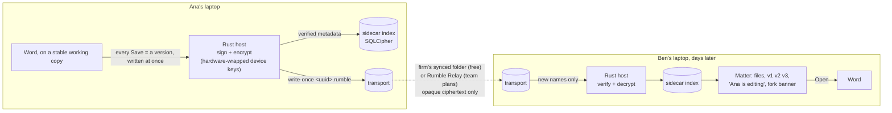

# Team sync: plan

This is a design plan, not code. Refs #21. It was read against `main` at 2641249 on 2026-11-17. Sizes are S/M/L, never dates.

## 1. The problem, in the owner's words

> "how to keep docs synced within a team, but local only, and when different laptops come on at different times."

> "also need to have version changes tracked. that's crucial."

> "back in the day we went through how to sync decentralised. we looked at things like telegram and other protocols." … "yes signal is closer."

> ".docx is pretty key"

> "3 also strikes me as the part that annoys people, we should aim to make it even more seamless and intuitive. so stuff like the foreign example you mentioned is a quality of life improvement, but needs to be made intuitive."

All of the above are from the owner, 2026-11-17. "3" is reconciling two offline edits. The earlier owner decision on #21 (2026-09-17) still stands: "decentralised sync mechanism rather than syncing to a server, keeping infrastructure costs down."

Product rule: free and open source as a trust builder, Elefant's managed service for most people, seamless upgrade, no pushiness.

The design has to handle three things:
- **Timing.** Laptops are rarely online at the same moment.
- **History.** Every change is attributable and comparable.
- **Friction.** None of this may feel like a document management system.

### The earlier design this builds on

`elefant_api_monorepo/agent_docs/2026-02-10-stub-implementation-plan.md` §12, "Briefcase sharing — Telegram-style E2E encrypted". It specifies:
- per-person X25519 keys;
- a per-briefcase symmetric key wrapped for each sharee;
- a relay that "never sees plaintext";
- "revocation is best-effort";
- libsodium.

| §12 | Here | Why |
|---|---|---|
| A server holds keys and blobs (`user_public_keys`, `briefcase_sync_blobs`) | One file format over a pluggable transport: the firm's synced folder (free), or Rumble Relay (hosted on team plans, §7) | Local-only must work with no Elefant infrastructure |
| `version INTEGER`, `GET …/sync/latest` | Immutable versions that name their parents; the relay is an append-only log | "latest" drops one of two offline edits and keeps no history |
| No signatures | Every file is signed by its author's device | Provable authorship, which is the audit trail |
| Revoke deletes the share record; the key stays the same | Removal starts a new matter key | A removed person cannot read anything written later |
| AES-256-GCM, HKDF, libsodium; per account | age plus Ed25519 in the Rust host (§5.6); per device | Keys stay out of the Python sidecar; a lost laptop is removed alone |
| `permission` read / read-write, `expires_at` | Not in the MVP | YAGNI until a pilot asks |

§12's open questions get answers here:
- "Group sharing": §5.
- "Conflict resolution: last-write-wins or CRDT?": neither. A person resolves forks in one step (§6).
- "Key backup": decision 9.
- "Offline: how long…": indefinitely (§5.3).

## 2. What a synced "doc" is

**A doc is any file. A matter is a set of versioned files.**

A version is an encrypted blob plus signed metadata. Sync, history, signatures and ethical walls never look inside the file, so `.docx`, PDF, `.msg`, spreadsheets and plain text are all treated the same way. The file type matters only when a person views or compares versions:

| Type | Open | Compare two versions |
|---|---|---|
| `.docx` | In Word | **Word's own Compare** (§6.3); Rumble builds no `.docx` diff engine |
| Plain text (`.txt`, `.md`) | In Rumble | Built-in word redline |
| Anything else | **Not opened by Rumble.** Only the extension allowlist opens (§5.4); everything else is "Show in folder" | Side by side, if on the allowlist |

Does a Rumble-native draft model still earn its place? **No.**
- Today a draft is a job result, shown in a read-only `<pre>` (`DocumentDraftView.vue`) and exported with `export_draft_docx`. The database has only `chats`, `messages` and `jobs` (`services/db.py`).
- A native editor would duplicate Word, which lawyers already use.
- "Save to matter" on a draft writes the `.docx` that `export_draft_docx` already produces as version 1. After that it is just a file.
- One model (matter → files → versions) is simpler than two.

### A matter is a briefcase

Owner, 2026-11-17: "The matter should match what a briefcase means on the main web app." What the web app has today (read-only, `monorepo` at the sprint checkout):

- **One entity.** `backend/src/elefant_api/core/briefcase_vocabulary.py:5-7`: "A matter, an in-house project and an intake room are not three entities — they are one briefcase with a different ``kind``".
  - `BriefcaseKind = Literal["research", "matter", "intake"]` (line 41).
  - The word on screen is per org: `BriefcaseLabel = Literal["briefcase", "matter", "project"]` (line 55). "A firm says 'Matter', an in-house team says 'Project', everyone else says 'Briefcase'" (lines 16-18).
- **What it holds:**
  - `briefcase` rows: name, `ownerId`, `org_id`, `kind`, `client_label` (`frontend/packages/db/src/schema/briefcase.ts`; migrations `2026_08_21`, `2026_08_22`, `2026_09_09`);
  - `briefcase_item`: saved *references* (legislation, cases, hansard, news), not files (`api_schemas.py:4701-4707`);
  - notes;
  - chats (`chat.briefcase_id`);
  - uploaded documents (`document.briefcase_id`, `files.gcs_path`).
- **Versions.** Uploaded files are versioned: "Immutable versioning (design §8.4): version_group_id is shared by every version of 'the same upload' … version is monotonic within a group", with `base_version_id` (`db/repositories/files.py:46-52`).
- **Sharing.**
  - `briefcase_shares` (sharer, sharee, `permission IN ('view', 'comment', 'full')`, accepted, revoked; `2026_08_19_share_permission_vocabulary.py:91-92`);
  - `briefcase_share_invitations` for emails without an account, with `expires_at` (`2026_09_02`);
  - routes `/briefcases/{id}/share`, `/shares`, `/shared-with-me`, `/claim` (`api/v1/external/briefcases.py:490-1258`);
  - an `/activity` feed and `/export`.
- **§12's E2E phases B–C are not built.** There is no `user_public_keys`, `sync_blob` or `encrypted_key` table.

How Rumble's matter aligns with that:

| Web briefcase | Rumble matter | Match? |
|---|---|---|
| Name, `kind = matter`, `client_label` | Name and client label inside the encrypted `info` record; `kind` fixed to `matter`. The UI uses "Matter" by default, and the org's label once linked to an Elefant account | Yes |
| Owner, org | Creator admin and second admin; the firm's folder access stands in for `org_id` | Partly: no org row-level security, because there is no server |
| Shares: view / comment / full, clamped by plan (`max_share_permission`: Lite, Explorer and Pro share view only; team plans full; `plan_defaults.py:602-737`) | Members. **MVP: everyone is `full`.** Phase 3 adds `view` as a role in the signed `member` record. Honest importers then drop records a view member may not write: `version`, `withdraw` and named-version records. `presence` is allowed, and `comment` comes later. A demotion uses the same record-hash cutoff as a removal. This is client-side enforcement: a view member still holds the epoch keys, so it filters the writes, it doesn't prevent them | `full` and `view` yes; `comment` later. **Folder matters are exempt from plan ceilings** (there is no server); relay matters follow them |
| Share invitations to an email, expiring | An invite link. There is no server-side expiry (no trusted clock) | Different by necessity |
| Uploaded documents, `version_group_id` and monotonic `version` | Files, each a version graph; a fork is the only non-linear case | Yes; same idea, plus forks |
| Saved references (legislation, cases) | Not in the MVP. They come from the cloud corpus; could sync later as small records | **No** |
| Notes, chats | Not in the MVP. Chats are local AI sessions | **No**, for now |
| Activity feed | The signed version and admin log | Yes, and tamper-evident |
| Export | Audit CSV, plus the stock-`age` exit path | Yes |

**Where a file-based matter can't match:**
- server-side access control and org RLS;
- revocation the server enforces (here a removed member keeps what they had);
- invitation expiry;
- items that are corpus references;
- the web app's retrieval and synthesis over a briefcase, which need the cloud.

**Naming.** The code, the format and the relay call the entity a **briefcase** (`briefcase_id`, `relay_briefcases`), as the web app does. The UI label defaults to "Matter", as the web app's `BriefcaseLabel` allows; this plan says "matter" for readability. **Later:** an Elefant account could link a Rumble briefcase to a web briefcase by storing the web briefcase's uuid in the encrypted `info` record. The ids differ in kind: web ids are uuids, Rumble's is the genesis hash. Only ciphertext and the transport would be shared, and only if the owner wants it. Not planned now.

## 3. Options compared

### 3a. Transport

| Option | Peers never on together? | New egress from Rumble | Verdict |
|---|---|---|---|
| Put `rumble.db` in a synced folder | Corrupts the database (§4) | None | No |
| **(a) The firm's synced folder** (OneDrive/SharePoint, Dropbox, iCloud, SMB) as a mailbox of files | Yes | None: the firm's sync client moves ciphertext | **Free, MVP** |
| (b) LAN P2P with mDNS | No | A non-loopback listener, which contradicts NETWORK.md | No |
| (c) iroh relays/hole-punching | No: relays "don't store your application data" (§4) | Yes | No |
| **(d) Elefant relay**, an append-only mailbox of the same files | Yes | Yes, opt-in | **Rumble Relay (§7), team plans; also self-hostable** |

A transport is three operations: `list`, `read`, `write`. The folder does them with the filesystem; the relay does them over HTTPS. A matter can use both at once, because the files are identical and named by id.

### 3a′. "Firm's synced folder" includes Google Drive and SharePoint

Owner, 2026-11-17: "Just to confirm this means Google Drive and SharePoint as well." Yes, with one precise meaning:
- **"Google Drive" and "SharePoint" mean the local folder that the vendor's desktop sync client keeps.** That is Google Drive for desktop, or OneDrive syncing a SharePoint library. It is never the vendor's web UI or its APIs.
- **Rumble never contacts Google or Microsoft servers itself.** It reads and writes files in a local folder; the sync client, not Rumble, makes the connections (NETWORK.md, §10).
- **On the web,** in drive.google.com or a SharePoint library, the matter's files appear as unreadable `<uuid>.rumble` blobs. That is by design: the web UI can't preview, search or open them, and neither can the provider.

Yes, then. Here is what each does with Rumble's small write-once files, from the vendors' current docs:

| | OneDrive / SharePoint | Google Drive for desktop |
|---|---|---|
| How a library or folder gets onto the laptop | "use the Sync button in the document library", or "add shortcuts to libraries and folders to OneDrive"; Microsoft: "We recommend using OneDrive shortcuts as the more versatile option" ([sync SharePoint](https://support.microsoft.com/en-us/office/sync-sharepoint-and-teams-files-with-your-computer-6de9ede8-5b6e-4503-80b2-6190f3354a88)) | **Stream**: "Files are only available online unless specifically made available offline". **Mirror**: "Mirrored files will always be stored on your computer and in the cloud" ([stream vs mirror](https://support.google.com/drive/answer/13401938)). Shared drives "are still streamable" but stream-only ([mirroring tips](https://support.google.com/drive/answer/13470231)) |
| Placeholders | "When you open an online-only file, it downloads to your device"; "You can't open online-only files when your device isn't connected to the Internet" ([Files On-Demand, Windows](https://support.microsoft.com/en-us/office/save-disk-space-with-onedrive-files-on-demand-for-windows-0e6860d3-d9f3-4971-b321-7092438fb38e)); on Mac, "File Provider is the only OneDrive Files On-Demand solution" ([Mac](https://support.microsoft.com/en-us/office/save-disk-space-with-onedrive-files-on-demand-for-mac-529f6d53-e572-4922-a585-e7a318c135f0)) | On macOS, "Downloaded and locally created files are accessible when Drive for desktop isn't running", so streamed-only files are not; "Drive for desktop uses macOS's File Provider technology", under `~/Library/CloudStorage` ([macOS](https://support.google.com/drive/answer/12178485)) |
| Detecting placeholders | Windows Cloud Files attributes: `FILE_ATTRIBUTE_RECALL_ON_DATA_ACCESS` ("not fully present locally"), `FILE_ATTRIBUTE_PINNED` ("should be kept fully present locally") ([attributes](https://learn.microsoft.com/en-us/windows/win32/fileio/file-attribute-constants)). Reading a placeholder hydrates it "without additional code changes", and a user can block an app's hydration through a toast ([cloud sync engine](https://learn.microsoft.com/en-us/windows/win32/cfapi/build-a-cloud-file-sync-engine)) | Google documents no programmatic check (unverified). On Windows the stream drive "uses a FAT file system" ([admin config](https://knowledge.workspace.google.com/admin/drive/advanced-drive-for-desktop-configuration)), so files are capped at 4 GB; whether rename is atomic there is unverified |
| Temp files, conflicts | "Temporary TMP files don't sync to OneDrive"; "Sync issues can also occur if you edit files offline." Conflict-copy naming is undocumented by Microsoft (unverified) | "Drive for desktop keeps both" when local and cloud differ ([mirroring tips](https://support.google.com/drive/answer/13470231)). Naming and temp-file rules are undocumented (unverified) |

**What Rumble must do so both work:**
1. **The matter folder must be available offline.** That means OneDrive "Always keep on this device", or Google "Available offline" (or Mirror for My Drive). At join and on every start, Rumble checks this: on Windows through the Cloud Files attributes above; on macOS through a File Provider check in a spike. If it fails, Rumble says "Make this folder available offline so Rumble can work when you're not connected", with the vendor's two-click instructions. Otherwise a laptop that goes offline can't read colleagues' versions, and a placeholder read while offline fails.
2. **Read every new file before use, then verify it.** Reading hydrates a placeholder. But Windows shows "an interactive toast" for app-triggered hydration, and a user who blocks it there stays blocked until they unblock it in Settings. So **"hydration blocked" is a named state**: "Windows is blocking Rumble from downloading this matter's files. Settings → Automatic file downloads → allow Rumble." A partial hydration fails verification and is retried, never trusted. Whether Google's "Available offline" also covers files colleagues add later is unverified; it is a spike item.
3. **Write `.tmp`, then rename,** so OneDrive never uploads half a file. On Google's FAT stream drive, rename atomicity needs a spike. Until it passes, recommend Mirror or a folder location rather than the G: drive.
4. **Ignore every name that isn't `<uuid>.rumble` or a restore name (§5.1).** Conflict copies, `desktop.ini` and `.DS_Store` are skipped. Rumble never writes one file from two devices, so a vendor conflict copy can only be a duplicate of a file Rumble already has.
5. **SharePoint libraries:** sync the matter's library or folder by OneDrive shortcut, as Microsoft recommends. **Google shared drives:** stream with "Available offline", because they can't be mirrored.

### 3b. Concurrent edits

| Approach | Verdict |
|---|---|
| A lock on check-out (iManage-style, §4) | Rejected. It blocks colleagues and needs an administrator to clear a stale lock. It also cannot work offline: a lock needs someone online to grant it |
| Last write wins | Rejected. It silently loses work |
| CRDT (§4) | Rejected. It cannot merge `.docx` meaningfully, and it auto-merges legal text nobody reviewed |
| **Versions with parents; forks resolved by a person in one step** | **Chosen** |

### 3c. Identity and keys

| Option | Verdict |
|---|---|
| One shared matter code | Too weak: authorship is unprovable, and removal means re-sharing a code |
| **Per-device identity keys (Signal-style), a matter key wrapped per device, every file signed** | **Chosen** |
| The Signal protocol proper (ratchets), MLS | Rejected. Forward secrecy conflicts with reading history for years. Both need ordered delivery. libsignal is AGPL-3.0 (§4) |

## 4. Research: primary sources

Checked 2026-11-17. Quotes are verbatim; "silent" means the source does not say. Where a site refused automated fetches, that is stated.

**Why not just put `rumble.db` in the synced folder.** SQLite: "SQLite relies on exclusive locks for write operations, and those have been known to operate incorrectly for some network filesystems. This has led to database corruption." and "Rely upon it at your (and your customers') peril." ([useovernet](https://www.sqlite.org/useovernet.html)). A background copier can catch a database "in the middle of a transaction. The backup copy then might contain some old and some new content, and thus be corrupt" ([howtocorrupt §1.2](https://www.sqlite.org/howtocorrupt.html)). SQLite does not name Dropbox, OneDrive or iCloud; treating a sync client as that background copier is our inference. Either way, two laptops writing one database file is the wrong shape.

**Synced folders.**
- OneDrive/SharePoint ([restrictions](https://support.microsoft.com/en-us/office/restrictions-and-limitations-in-onedrive-and-sharepoint-64883a5d-228e-48f5-b3d2-eb39e07630fa)): names may not contain `" * : < > ? / \ |`, nor start with `~$`; "we recommend syncing no more than a total of 300,000 items across your cloud storage." Conflicts: "You might have sync conflicts if you upload multiple files on the OneDrive website at the same time." Microsoft does not document the conflict-copy naming (silent). `<uuid>.rumble` uses none of the forbidden characters. The same page: "Temporary TMP files don't sync to OneDrive", which suits write-to-temp-then-rename, and "Sync issues can also occur if you edit files offline." This is why Rumble never lets two devices write one file.
- OneDrive Files On-Demand ([Microsoft](https://support.microsoft.com/en-us/office/save-disk-space-with-onedrive-files-on-demand-for-windows-0e6860d3-d9f3-4971-b321-7092438fb38e)): "Online-only files don't take up space on your computer"; they download when opened. So reading a placeholder triggers a download by OneDrive, not by Rumble.
- Dropbox ([help](https://help.dropbox.com/organize/conflicted-copy)): "A conflicted copy is a file that Dropbox creates when multiple people edit the same file at the same time." "The editor's username, "conflicted copy", and the save date will be added to the filename."
- iCloud Drive ([Apple](https://support.apple.com/en-us/109344)): "Your files sync with iCloud each time your device connects to the internet." Apple is silent on how conflicts are resolved.
- Microsoft 365 is not end-to-end encrypted: SharePoint "decrypts the customer data before sending it to the user" ([Microsoft 365 encryption](https://learn.microsoft.com/en-us/compliance/assurance/assurance-encryption-for-microsoft-365-services)); "some cases require a Microsoft engineer to access your content" ([Customer Lockbox](https://learn.microsoft.com/en-us/purview/customer-lockbox-requests)). Hence Rumble encrypts before writing.
- Windows roaming: `FOLDERID_RoamingAppData` is "%APPDATA% (%USERPROFILE%\AppData\Roaming)" ([KNOWNFOLDERID](https://learn.microsoft.com/en-us/windows/win32/shell/knownfolderid)); Roaming User Profiles redirect "user profiles to a file share" ([overview](https://learn.microsoft.com/en-us/windows-server/storage/folder-redirection/folder-redirection-rup-overview)). That `AppData\Local` never roams is stated only in a Microsoft Q&A community answer, not in Learn docs: unverified as documentation. #57 already moved Rumble's data to `app_local_data_dir`.

**Merge libraries.** All checked against their own repos, crates.io and PyPI.

| | Licence | Latest | Python | Own words / status | Fit for a shared folder | SQLite |
|---|---|---|---|---|---|---|
| [Automerge](https://github.com/automerge/automerge) | MIT | crate 0.12.0, 2026-09-16 | PyPI `automerge` stable 0.1.2 (2022); newer only pre-release (0.2.0.dev4, 2026-04) | Rust API "is low level and not well documented" (README) | Changes save and load as files; `apply_changes` "is idempotent" ([docs.rs](https://docs.rs/automerge/latest/automerge/struct.Automerge.html)). Its sync protocol is a live exchange ("delivering messages and acknowledgements in both directions", [automerge-py sync.md](https://github.com/automerge/automerge-py/blob/main/docs/sync.md)) | silent |
| [yrs / Yjs](https://github.com/y-crdt/y-crdt) | MIT | `yrs` 0.28.1, 2026-11-04 | `pycrdt` 0.14.13, 2026-11-02; `ypy` archived: "This project is abandoned, please look at pycrdt." | 0.x, no stability claim | Updates are diffs applied later; the store holds "pending updates waiting to be applied once a missing update information arrives" ([docs.rs](https://docs.rs/yrs/latest/yrs/)) | silent |
| [Loro](https://github.com/loro-dev/loro) | MIT | 1.18.0, 2026-11-16 | `loro` 1.18.0 | "Loro 1.0 is out!" (README); format-stability page refused fetch: unverified | Export modes `Updates`, `Snapshot` ([docs.rs](https://docs.rs/loro/latest/loro/enum.ExportMode.html)) | silent |
| [cr-sqlite](https://github.com/vlcn-io/cr-sqlite) | MIT | v0.16.3, **2024-01-17** | loadable extension | Author, 2024-12-30: "I'm full time on https://zero.rocicorp.dev/ these days." and "I don't see that happening for at least 1-2 years" ([#444](https://github.com/vlcn-io/cr-sqlite/issues/444)) | n/a | "a run-time loadable extension for SQLite"; SQLCipher compatibility: silent |

All three CRDTs could carry their updates as files. None fits: they cannot merge `.docx` meaningfully, and legal text should not be auto-merged (§3b).

**Peer-to-peer.**
- [iroh](https://github.com/n0-computer/iroh) (MIT OR Apache-2.0, v1.4.1, 2026-10-21): "Iroh hardcodes a set of public relays provided by n0.computer"; relays "don't store your application data; they just facilitate connections"; "Public relays are suitable for development and testing"; self-hosting supported ([relays](https://docs.iroh.computer/concepts/relays)). `iroh-blobs` README: "this version of iroh-blobs is not yet considered production quality." Iroh does not say whether peers must be online together (silent). Relays that store nothing imply they must be, which is our inference.
- Tauri: there is no official mDNS or LAN-discovery plugin among the 31 in [plugins-workspace](https://github.com/tauri-apps/plugins-workspace).

**Crypto.** The chosen stack, its sources and the runners-up are in §5.6. Two facts drive its rules. age's spec says nothing about sender authentication. libsodium's sealed boxes doc states the same lesson in general: the recipient "can verify the integrity of the message" but "cannot verify the identity of the sender" ([libsodium](https://doc.libsodium.org/public-key_cryptography/sealed_boxes)).

**Signal: what to borrow** ([signal.org/docs](https://signal.org/docs/) lists XEdDSA, X3DH, PQXDH, Double Ratchet, Sesame and ML-KEM Braid; it has **no group or sender-key specification**).
- **Double Ratchet:** "used by two parties to exchange encrypted messages based on a shared secret key. The parties derive new keys for every Double Ratchet message so that earlier keys cannot be calculated from later ones" ([spec](https://signal.org/docs/specifications/doubleratchet/)). The design point is that old message keys cannot be recomputed. A matter must be readable years later, by members and devices added later, from files in a folder. A per-pair ratchet and its session state, in a folder with no ordered delivery, works against both requirements. Not borrowed.
- **Multiple devices (Sesame):** "With per-device identity keys, each device may have a different key pair." On identity change: "Whenever a change in identity keys is detected users must repeat the authentication process" ([spec §3.1, §6.1](https://signal.org/docs/specifications/sesame/)). Borrowed: per-device identity keys, and a key change is never silent.
- **Safety numbers** (Signal blog, [2016-11-17](https://signal.org/blog/safety-number-updates/)): they "allow Signal users to verify the privacy of their communication with a contact", and are checked by comparing a number or scanning one QR code. Signal moved from blocking on a key change, where users needed manual approval before "being able to send or receive any further messages", to an advisory notice. Signal's support article returned 403 to fetching, so current behaviour beyond that post is unverified. Borrowed: number and QR comparison. Blocking is decision 6.
- **Groups and sender keys.** In 2014 Signal "simply deliver[ed] a pairwise encrypted message to each member of the group" and described encrypting once with a random key sent pairwise as a future optimisation ([blog, 2014-05-05](https://signal.org/blog/private-groups/)). Today's sender keys exist in code, not in a spec: libsignal's `sender_keys.rs` and `group_cipher.rs` (`create_sender_key_distribution_message`, `group_encrypt`) ([libsignal](https://github.com/signalapp/libsignal/tree/main/rust/protocol/src)). Borrowed: the shape, encrypt once with a group key and hand that key to each member individually. Not borrowed: the per-sender chain ratchet (same reasoning as the Double Ratchet).
- **libsignal itself** is `SPDX-License-Identifier: AGPL-3.0-only` (header of `sender_keys.rs`; GitHub reports AGPL-3.0). Rumble is Apache-2.0, so linking it is a licensing decision, not a technical one. It is not proposed.

**Word Compare: how to produce a redline without building one.**
- Manual path, four steps ([Microsoft support](https://support.microsoft.com/en-us/office/compare-and-merge-two-versions-of-a-document-f5059749-a797-4db7-a8fb-b3b27eb8b87e)): "Open one of the two versions of the document that you want to compare." "On the Review tab, select Compare > Compare Documents." "In the Original document list, select the original document." "In the Revised document list, browse to the other version of the document, and then select OK." The page names Word 2019 for Mac and is silent on Word for the web.
- Windows automation ([VBA `Application.CompareDocuments`](https://learn.microsoft.com/en-us/office/vba/api/word.application.comparedocuments)): "Compares two documents and returns a Document object that represents the document that contains the differences between the two documents, marked using tracked changes." It takes `OriginalDocument`, `RevisedDocument`, and `RevisedAuthor`, "the name of the person to whom to attribute changes". This is COM on Windows; whether macOS Word exposes the same through AppleScript is unverified.
- Word add-in (Office.js):
  - [`Document.compare(filePath, options)`](https://learn.microsoft.com/en-us/javascript/api/requirement-sets/word/word-api-desktop-1.1-requirement-set?view=common-js-preview) is in WordApiDesktop 1.1, and `compareFromBase64(base64File, options)` is in [WordApiDesktop 1.2](https://learn.microsoft.com/en-us/javascript/api/requirement-sets/word/word-api-desktop-1-2-requirement-set?view=word-js-preview). Both "Displays revision marks that indicate where the current document differs from a specified document". Their options include `compareTarget` and `authorName`, which is "the reviewer name associated with the differences generated by the comparison": **one name for all differences**. A two-way compare therefore cannot attribute Ana's changes to Ana and Ben's to Ben. Doing that needs a three-way combine from the common base (VBA `MergeDocuments`, unverified here), and Office.js has no combine. How Rumble would hand base64 to the hosted add-in is also unverified; it likely needs a loopback listener, which is a NETWORK.md decision.
  - Microsoft says these sets are "only available for Word on Windows, on Mac, and on iPad" and are "'preview' APIs for other platforms (web)".
  - Elefant already ships a Word add-in (`word_plugin`).
- Word's owner file. A Microsoft Q&A answer (community, not documentation) describes `~$`-prefixed "owner files", which Word uses "to know that the corresponding document file is open" ([Q&A](https://learn.microsoft.com/en-us/answers/questions/4822723/what-are-doc-and-docx-can-you-open-them-or-delete)). Using it as the "Word closed the file" signal needs a spike.
- Plain text needs no Word. Python's stdlib [`difflib`](https://docs.python.org/3/library/difflib.html) offers "Helpers for computing deltas", and Rust has equivalents. Rumble has no diff code today (no diff package; the draft is a read-only `<pre>`).

**Word automation: the four open questions, resolved where the docs allow.**
- **(i) Handing a file to the Word add-in without a network listener.**
  - Office URI schemes take only "a URI to the document, based on the http or https scheme" ([Office URI schemes](https://learn.microsoft.com/en-us/office/client-developer/office-uri-schemes)), so they cannot carry a local file, and they don't launch an add-in with a payload.
  - Inside a running add-in, `Application.openDocument(filePath)` (WordApi 1.6) works with local paths: "Word on the web only supports remote (cloud) locations, while Word on Windows, on Mac, and on iOS support local and remote locations" ([Word.Application](https://learn.microsoft.com/en-us/javascript/api/word/word.application)).
  - `Document.compare(filePath)` (WordApiDesktop 1.1) also takes a path.
  - The no-listener channel is therefore **a path on disk**: Rumble writes both versions locally, and the add-in compares by path. How the add-in learns which path to use is undocumented. One idea is for Rumble to write it into the working copy's custom XML part for the add-in to read on open; it needs a spike. Microsoft says nothing about add-ins reading arbitrary local files (unverified).
- **(ii) Mac automation.**
  - Word for Mac's AppleScript dictionary has `compare` ("Compares this document with another.", with `path`, `author name`, `target`) and `merge` ("Merges the changes marked with revision marks from one document to another."). This was read from the installed Word 16.115 `Word.sdef`, which is first-party but not a web page.
  - There is no `compare documents` or `merge documents` command.
  - An outside app sending Apple Events to Word needs the user's one-time consent; Apple's page could not be fetched (unverified).
  - `AppleScriptTask` is the other direction, VBA inside Word calling scripts in `~/Library/Application Scripts/com.microsoft.Word/` ([Microsoft](https://learn.microsoft.com/en-us/office/vba/office-mac/applescripttask)).
- **(iii) Three-way combine.**
  - Office.js has `compare` (WordApiDesktop 1.1) and `compareFromBase64` (1.2). `Document.merge` is "WordApi BETA (PREVIEW ONLY)": "Do not use this API in a production environment."
  - COM `Application.MergeDocuments` takes `OriginalDocument`, `RevisedDocument`, `OriginalAuthor` ("the name of the author of the original document") and `RevisedAuthor` ("the person to use for unattributed changes after merging two documents") ([MergeDocuments](https://learn.microsoft.com/en-us/office/vba/api/word.application.mergedocuments)). That is two inputs, not three.
  - Word's own Combine is also two at a time: "Click Review > Compare > Combine." "Under Original document … choose the document you sent for review." "Under Revised document, choose the document you want to merge." ([Combine revisions](https://support.microsoft.com/en-us/word/combine-document-revisions)).
  - A three-way result (v3 base; Ana's and Ben's v4s, each attributed) is therefore **two chained combines**: combine(v3, Ana's), then combine(result, Ben's). This is inferred, not documented, and goes in the spike.
- **(iv) Outlook attachments.**
  - Windows moves non-file items with `CFSTR_FILEDESCRIPTOR`/`CFSTR_FILECONTENTS`, "the preferred way to transfer Shell objects that are not stored as file-system files … a group of email messages as individual files" ([Shell clipboard formats](https://learn.microsoft.com/en-us/windows/win32/shell/clipboard)).
  - Which formats Outlook offers for an attachment drag is undocumented (unverified).
  - Tauri v2's drop event carries only `paths: string[]` ([Tauri webview API](https://v2.tauri.app/reference/javascript/api/namespacewebview/)). A virtual-file drop therefore likely yields nothing; that is inferred, and tauri [#15861](https://github.com/tauri-apps/tauri/issues/15861) on changing drag handling is open.
  - **Plan change:** the MVP accepts files from disk. "Drop from Outlook" is a phase-2 spike (a native Windows drop target, or the webview's own HTML5 drop). Until then the copy says "Save the attachment, then drop it here."

**iManage, for contrast.** Only two facts were verified, both from iManage Control Center help ([Containers and Documents](https://docs.imanage.com/cc-help/10.5.2/en-US/Containers_and_Documents.html)): while a document is checked out, "other users can't check it out or edit it", and unlocking needs either the document owner with a role that has "the library role Document Unlock privilege enabled", or someone who has "at least Tier 1 iManage Work system administrator privileges". Everything else said about iManage here is general knowledge and **unverified**: profile forms on save, a "new version or replace" prompt, and a server or cloud dependency.

**Legal-sector duties** (what the design must respect, not legal advice; check against the firm's own jurisdiction):
- ABA Model Rule 1.6(c), as quoted in [Formal Opinion 477](https://docs.tbpr.org/pub/aba%20formal%20opinion%20477.authcheckdam.pdf) (the 2017 text, on a state bar's copy because americanbar.org refused the fetch; the 477R revision's wording is unverified): "A lawyer shall make reasonable efforts to prevent the inadvertent or unauthorized disclosure of, or unauthorized access to, information relating to the representation of a client." The opinion: "a lawyer should consider whether certain data should ever be stored in an unencrypted environment." The ABA definition of "screened" (Rule 1.0(k)) could not be fetched: unverified.
- Singapore, Law Society [Guidance Note 6.1.1](https://law-society-singapore-prod.s3.ap-southeast-1.amazonaws.com/2020/03/121.-Ethics-and-Information-Technology-GN-6.1.1.pdf): "Under rule 6(2) of the PCR 2015, a legal practitioner must not knowingly disclose any information which is confidential to his/her client…"; "Possible means of protecting confidentiality include the use of encrypted e-mail or secured lines." The PCR text itself (SSO refused the fetch) and the cloud-computing guidance note 3.4.1: unverified.
- England and Wales, [SRA Code for Solicitors](https://www.sra.org.uk/solicitors/standards-regulations/code-conduct-solicitors/) 6.3: "You keep the affairs of current and former clients confidential…"; 6.5 permits acting only where "effective measures have been taken which result in there being no real risk of disclosure of the confidential information".
- Hong Kong, [Solicitors' Guide ch. 8](https://www.hklawsoc.org.hk/-/media/HKLS/Home/Support-Member/Professional-Support/Vol-1-Eng/Chapter-8-English.pdf) 8.01: a duty "to hold in strict confidence all information concerning the business and affairs of his client"; commentary 31: "This Principle extends to cover electronic communication."

Together: encrypt before data reaches a third-party store, and make each matter separable (an information barrier). Neither duty asks for a server or a CRDT.

## 5. Recommendation: mechanics

**Every version of every file in a matter is one signed, encrypted, write-once file in the matter's transport. Devices import the files they haven't seen, and parent links, never clocks, decide the order.**



### 5.1 Records

Every record is a file named `<uuid>.rumble` (or a write-once restore name, `<uuid>-<hash8>.rumble`, §5.1): opaque, with its kind inside the envelope. Each file is written once, by one device. The single exception: a device may delete its own expired presence files. So the sync service never sees two writers.

| Kind | Content | Readable by |
|---|---|---|
| `genesis` | A random 32-byte nonce and the creator's admin key. **The matter id is the SHA-256 of this file**, and invite links carry all 32 bytes of it. No names | Anyone with folder access (keys only) |
| `request` | A join request: the joiner's `device` record and the admin-signed link it answers. **It carries no keys and no link writes any file** (§5.2) | Members (encrypted to the epoch's public recipient) |
| `device` | Display name and public keys | Members (encrypted) |
| `member` / `key` / `invite` | Approve or remove a device; issue or revoke an invite. A removal names the **hash** of the device's last accepted record, or "none" for a device with no records. New epoch identities are wrapped per device. Admin-signed and chained by `parents[]` (two parents after an admin branch merges) | Members |
| `info` | The matter's name and settings | Members |
| `version` | Header: `file_id`, `version_id`, `parents[]`, `seq`, `epoch`, file name, media type, size, `sha256(content)`, `created_at`, signer. Body: the file bytes | Members |
| `presence` | "D is editing F since T, based on V"; expires after `PRESENCE_TTL_MINUTES` | Members |

Rules for every kind:
- **One signature definition for every kind.** The Ed25519 signature covers every header field in a canonical encoding: `briefcase_id`, `kind`, the blob uuid, the signer's public key, `seq`, `parents` (admin records), `admin_head` and the kind's own fields. For versions those are `file_id`, `version_id`, `parents`, `epoch`, file name, media type, size, `created_at` and `sha256(content)`. The signature sits inside the encryption. Import rejects a record whose uuid differs from its file name. Any member holds the epoch identity and could otherwise decrypt Ana's file, change an unsigned field and re-encrypt it under a new uuid; Filippo's warning is that "the recipient can decrypt the file, keep your signature, and encrypt it to a different recipient" ([age authentication](https://words.filippo.io/age-authentication/)).
- **`admin_head`.** Every record carries the hash of the newest admin file its writer has seen. A withheld removal or `key` file then shows up as a gap, as soon as anyone writes after it.
- **Equivocation.** Two different records with the same (device, seq) mean the device is compromised. It is flagged to admins, and its later records are held until an admin decides.
- **`seq`** is counted per (device, matter).
- **Membership is judged at the record's `admin_head`:** the admin chain as the writer had seen it, with removal cutoffs still applied. A joiner approved at admin file A is a member for every record whose `admin_head` is A or later.
- **A record whose `admin_head` names an admin file this device hasn't seen** blocks this device's *new writes* to the matter at once ("Waiting for a membership update"), **but only if its signer is a member at this device's own head.** Imports continue. There is no grace period, because a missing admin file is exactly what a removed member would delete. From anyone else, the record is held silently. This matters because anyone holding a link can encrypt to the epoch, and a fake `admin_head` must not freeze the matter. Each import fetches the admin chain first, so a genuine block clears as soon as the missing admin file syncs. If a member's record still names an unseen admin file after `GAP_GRACE_HOURS`, the signer is flagged to admins; **the block stays**. Residual: a removed member who still looks like a member to a stale device (one that never saw the removal) can freeze that device's writes with a bogus `admin_head`, until a device holding the removal comes online and restores it. That fails safe: writes stop, nothing leaks.
- **Import rejects** a bad signature, a mismatched id, a foreign matter, or a signer who is not a member at that record's `admin_head`. **Join requests** are separate: they go to the admins' inbox only, and only for invites that are open (§5.2).
- **Every device keeps a local copy of every ciphertext it has imported** (genesis, the admin chain and all versions) under `app_local_data_dir`. The store is keyed by (uuid, ciphertext hash). A copy is written back when it is missing from the transport, under a **restore name**, `<uuid>-<first 8 hex of its ciphertext hash>.rumble`. That name is write-once and accepted on import when its uuid prefix matches the record. So a member who overwrites Ana's file with a different record under her uuid can't erase it, and two devices never fight over one name. A differing copy that verifies is imported alongside and flagged; it never overwrites. Exclusions: expired presence files, `.tmp` files, and everything in a matter its admins have deleted. Every file is self-authenticating, so any member can restore it. Deleting or overwriting files therefore can't destroy history while any device that has them comes online. Cost: each device stores the matter's full ciphertext a second time, roughly the matter's size in the synced folder (§13 gives sizes).
- **Import skips** (uuid, ciphertext hash) pairs already seen, and every name that isn't `<uuid>.rumble` or a restore name. If two different files carry one uuid, every copy that verifies is imported, up to `MAX_COPIES_PER_ID`, and the conflict is flagged to admins, so an earlier upload can't hide the real one. Copies whose signed record is identical, such as an honest re-encryption, are one record, not equivocation. A damaged or half-synced file is retried on the next refresh.
- **Identical resolutions collapse.** Two versions with the same parents and the same `sha256` are one version. If two people click "Use Ana's" offline, that is not a new fork.
- **Gaps** (a missing parent or seq) are shown only after `GAP_GRACE_HOURS`. Synced folders deliver files out of order.
- **Writes** go to `.tmp` in the same folder, then rename. OneDrive does not sync TMP files (§4).

### 5.2 Identity and joining (Signal-shaped, minus the ceremony)

- **Keys.** Each device has a signing key pair and a receiving key pair, kept by the Rust host as an item that **must not leave the device**. **The existing `keyring` 3 crate does not give that.** In v3.6.3, Windows writes `CRED_PERSIST_ENTERPRISE` (`windows.rs:246`), a persistence type that, Microsoft says is "visible … to logon sessions for this user on other computers" ([CREDENTIALW](https://learn.microsoft.com/en-us/windows/win32/api/wincred/ns-wincred-credentialw)). macOS uses the legacy login keychain (`macos.rs:32`), which backups and Migration Assistant copy. **Phase-1 requirement, on both platforms: wrap the device secrets with a hardware key and store only the wrapped blob, in a folder that doesn't roam (§12c; machines without a chip: decision 14).**
  - **Windows**, the owner's own platform: a TPM-held RSA key in the Microsoft Platform Crypto Provider, with the blob in `%LOCALAPPDATA%`.
  - **macOS:** a Secure Enclave P-256 key created with `.privateKeyUsage`, as in Apple's own example, but with `kSecAttrAccessibleAfterFirstUnlockThisDeviceOnly` instead of Apple's `…WhenUnlocked…`. Under `WhenUnlocked`, a save flushed at sleep or while the screen is locked couldn't unwrap the signing key. The trade-off is that the key is usable while the Mac is locked but has been unlocked once since boot ([Apple](https://developer.apple.com/documentation/security/protecting-keys-with-the-secure-enclave)), with the blob in the app's local data directory. Apple: "Only … a Mac with the Touch Bar and Touch ID or with an M1 or later processor support this feature."
  - Neither uses Credential Manager or `keyring` for these keys. Keys never change, so a reinstalled laptop is a new device, and there is never a "key changed" prompt to wave through.
- **Invite: no keys in any link** (owner, 2026-11-17, superseding the instant join).
  - **Issuing.** An admin issues an invite by writing an `invite` record to the admin chain, so every admin sees it and can revoke it.
  - **The link** holds, all signed by the admin:
    - the invite id;
    - the matter id (all 32 bytes);
    - the current epoch's *public* recipient;
    - the admin's public key and display name;
    - the invitee's name as the admin typed it.

    It holds **no matter name**, because that could identify the client. **A leaked link opens nothing.**
  - **Joining.** Ben opens the link and picks the matter folder (the firm has already granted folder access). His Rumble writes a **join request**: the signed link bytes and his `device` record, encrypted to the epoch's public recipient so only members can read it, and self-signed.
  - **Which requests reach an admin.** Requests go to the admins' inbox, and are never folded into matter state. An admin's Rumble ignores any request whose link isn't signed by an admin of this matter, or whose invite is not open: already used, revoked, or older than `INVITE_TTL_DAYS` by that admin's own clock.
  - **The safety number, one definition:** `SHA-256("rumble-safety-v1" ‖ signed link bytes ‖ Ben's Ed25519 key)`, shown as 12 groups of 5 digits.
    - Ben computes it from the link he holds.
    - The admin computes it from **its own stored `invite` record**, not from what the request claims.
    - So a swapped link gives a different number. Comparing it needs no one to be online at the same time.
  - **Both sides confirm.** The admin and Ben compare the number on a call to a number they already know, or in person (about 30 seconds; QR in phase 2). **Both tap "Numbers match".**
    - Only after the admin's tap does the admin's Rumble wrap the epochs to Ben's device, closing the invite in the same admin record.
    - Only after Ben's tap does Ben's Rumble treat the matter as trusted and allow writes.
  - **Two requests for one invite** mean someone else holds the link. **Neither can be approved:** the admin sees "Two people answered this invite", revokes it and issues a fresh one. That costs one more link in a rare case, and stops an attacker grinding keys towards a partial number match.
  - **Any admin** can approve.
- **The wait, made gentle.** Through a folder, joining has two sync hops: the request reaching the admin, and the approval coming back. That can take minutes or, if the admin is away, a day. Rumble says so plainly. While Ben waits, nothing of the matter opens. The copy below is PROPOSED:
  - Ben sees: **"Waiting for Ana Lim to let you in.** Ana will see your request the next time Rumble is open on her laptop. When you talk, read this number to each other: `48213 90557 …`. We'll tell you when you're in, the next time you open Rumble."
  - Ana sees a notification: **"Ben Tan is waiting to join *Acme NDA*.** Call Ben on a number you already know, and check you both see the same number." It has two buttons: **Numbers match: let Ben in**, and **Not now**.
  - Once the approval arrives, Ben confirms the number on his side if he hasn't already, and sees **"You're in *Acme NDA*."** He can read the name now, because he holds the keys.
  - Through Rumble Relay, both hops are instant.
- **Request flooding.** An admin's Rumble ignores requests for invites that aren't open. Beyond that, the real control is the folder's access list: only people the firm let into the folder can write requests at all. A flood would also run into OneDrive's recommended 300,000 items.
- **Verify** is the approval step above: required for every joiner, inside a firm or across firms (decision 8). Two existing members can also compare numbers at any time to mark each other "verified".
- **Admins.**
  - The creator is the first admin. Once a colleague has joined, Rumble asks the creator to make them a second admin; this is an admin file. Skipping is an explicit choice: "If this laptop is lost, nobody can add or remove people in this matter."
  - Any admin can approve, remove or rotate.
  - **A second admin before a second invite.** The matter can't invite its third member until it has two admins. A creator who skipped the second-admin prompt is asked again at that point.
  - **Two offline admins can branch the admin chain.** The merge rule:
    - Versions under either sibling epoch are accepted.
    - A removal in either branch counts.
    - The next admin file names both branches as parents and **creates a fresh epoch**. It is wrapped only to devices approved in either branch and removed in neither, so a device removed in one branch can't read the other branch's epoch beyond what it already had.
  - **Never zero admins.** A removal of an admin is valid only if at least one admin remains in the merged chain. If two admins remove each other concurrently, both removals are void and both admins are flagged to every member. This is the simplest rule that can't strand a matter. Residual: an honest admin can't remove a compromised admin who counter-removes while offline; the flag to every member is the only protection, so the firm then starts a new matter.
  - **Merges converge.** If two merge files themselves branch, the next admin file merges them by the same rule, as many times as needed. Every rule is a union of removals plus a fresh epoch, so the order doesn't matter.
  - **A revoke in either branch wins** over an approval of the same invite in another.

### 5.3 Removal, lost laptops, laptops back after months

- **Remove a device or person.**
  - An admin signs a removal naming the **hash of D's last accepted record**: everything in D's chain up to that record stays valid. A new key epoch is wrapped only for the remaining devices.
  - Anything D writes later is hidden, and the audit trail marks it "arrived after removal", on every laptop alike.
  - The UI says: "Ben keeps everything he could already open. He can't open anything saved from now on."
  - **Step 2 of the Remove flow:** "Now remove Ben from the matter folder in SharePoint or Google Drive." A checkbox confirms it, with the vendor's steps linked. Until it is done, Ben can still delete files: other devices restore them (§5.1), but devices that have never seen the removal keep writing under the old epoch, which Ben can read, until a device holding the removal comes online and restores it.
- **Lost laptop:** remove that device. The person's other devices carry on.
- **Back after months:** the laptop imports in parent and chain order. Its offline saves become forks, never overwrites. If it was removed while away, it can tell, and says so.

### 5.4 Working copies and versions from Word

- **Where the working copy lives.** Each file in a matter has one stable working copy at `app_local_data_dir/work/<briefcase>/<file_id>/<basename>`.
  - **The path is built from `file_id`.** The signed file name supplies only a **sanitised basename**, built by *allowing* a fixed character set (letters, digits, space, `-`, `_`, `(`, `)`, one `.` before the extension) and replacing everything else. That removes `:`, which would otherwise reach an NTFS alternate data stream such as the one holding the Mark of the Web, along with `\ / < > " | ? *`, `..` and control characters. Windows reserved names (`CON`, `NUL` and so on) are prefixed, and the length is capped. A malicious member therefore can't write outside the working folder.
  - **Extension allowlist:** `.docx`, `.xlsx`, `.pptx`, `.pdf`, `.txt`, `.md`, all macro-free formats. Anything else, including `.docm`, `.lnk`, `.html` and `.exe`, is never opened by Rumble: it is "Show in folder" only.
  - **Mark of the Web on every released file from another member** (Windows): a `Zone.Identifier` stream with `ZoneId=3`. Microsoft: "Mark of the Web is added by Windows to files from an untrusted location", and "only applies to files saved on an NTFS file system" (`%LOCALAPPDATA%` is NTFS); Office then blocks macros in such files ([macros from the internet](https://learn.microsoft.com/en-us/microsoft-365-apps/security/internet-macros-blocked)). Office says files from "potentially unsafe locations are opened as read only or in Protected View" ([Protected View](https://support.microsoft.com/en-us/office/what-is-protected-view-d6f09ac7-e6b9-4495-8e43-2bbcdbcb6653)).
    - **The friction cost:** Word opens a colleague's version in Protected View, and the user clicks Enable Editing once.
    - The user's own versions carry no mark.
    - macOS: the macro change "doesn't affect Office on a Mac" (same page), so on Mac the allowlist is the only control. Using the quarantine attribute is unverified. Residual: a `.docx` with an injected remote template has no mark protecting it on Mac.
    - That ZoneId 3 makes Word use Protected View is **expected, not quoted**: the Protected View page doesn't mention the Mark of the Web. Confirming it is a spike item.
  - It is local and never roaming. It is deliberately not in Documents, which OneDrive Known Folder Move may sync in plaintext.
  - Word's Recent list keeps working.
  - The copy is always watched and is pruned after `WORKING_COPY_IDLE_DAYS`.
- **Open** writes the head version there if the copy is older, then opens it in Word (the opener plugin is already a dependency). On first open, Rumble shows: **"Press Save in Word to share your changes."** The copy is outside OneDrive, so Word's AutoSave is off there.
- **Every save is a version, written at once.**
  - Owner, 2026-11-17: "Follow Google Drive's example. After a few idle minutes someone might close their laptop after an update."
  - When Word saves the working copy, the host records a version immediately and writes it to the transport straight away. Nothing waits for idle.
  - A save whose content hash equals **the version Rumble last wrote into this working copy** is not a new version. That way a working copy refreshed from a colleague's head is never re-signed as one's own, while a real revert, such as v2's content saved over v5, still becomes a version.
  - **`seq` at startup** continues from the highest of this device's `seq` found locally or in the transport, so restoring a disk snapshot doesn't look like equivocation. Rumble waits for one full sync before a device's first write after a restore. Residual: a restore made fully offline can still trip a false flag, which an admin clears.
- **Flush on sleep and quit.** On the OS sleep or power notification, and on quit, the host finishes any pending write before allowing them. The exact macOS and Windows notifications are a spike item. At startup, Rumble also writes a version for any working copy whose hash differs from its last version, so a Word crash or a dead battery loses nothing.
- **Grouping is display only.** It follows Google's history panel: Google Docs lets you "Find grouped versions: In the right panel, click Expand", "Name this version", and "turn on Only show named versions" ([Docs version history](https://support.google.com/docs/answer/190843)).
  - Rumble groups consecutive saves by the same person into one row, e.g. "v12–v17 · Priya · 10:02–10:40", expandable to each save.
  - **Name this version** writes a small signed record, so "Sent to client 18 Nov" shows for everyone.
  - The toggle **Only show named versions**.
  - What Rumble does *not* copy: Google Drive's retention for uploaded files ("A version might be permanently deleted after 30 days or if there are 100 newer versions", unless "Keep forever"; [Drive versions](https://support.google.com/drive/answer/2409045)). Legal history is kept, and every version is effectively "Keep forever".
- **Parent.** A version's parent is the last version this working copy produced, or the version it was opened from, so later saves in the same Word session continue your line instead of forking you from yourself.
- **Someone else saves while you edit.** A notice appears at once: "Ben saved v5 while you were editing. Your next save will sit alongside it as your own version." The fork banner then appears on your next save. Later saves extend your branch, and you combine whenever you choose.
- **Dragging in an existing file.** Rumble remembers the source path. If that file changes later: "nda.docx on your Desktop changed. Add as v5?" One click. A Save As to somewhere else cannot be seen; that is a stated limit.
- **Plaintext on disk** exists in working copies and in Word's temp files, covered by full-disk encryption (SECURITY.md).

### 5.5 Withdraw and audit

- **Withdraw** is a signed, reversible tombstone from the file's author or an admin. Folder files are never deleted. Retention and legal hold wait until Rumble deletes something.
- **Audit CSV per file:** version, parents, person, device fingerprint, time, SHA-256, signature verified.

### 5.6 Where the code lives; the crypto stack

- **Rust host.** Hardware-wrapped device keys, signing, encryption, verification, transport I/O and the working-copy watcher. Generalise `pick_templates_folder` into `pick_folder`.
- **Sidecar.** The metadata index only, in SQLCipher. **No keys, no file contents.** The host posts each record after verifying it.
- **Frontend.** Matters, files, versions, presence, the fork banner.

**Stack.** Pure Rust, no native libraries, two new direct crates:
- [`age`](https://crates.io/crates/age) `0.12.1`, `default-features = false`, MIT OR Apache-2.0 ([str4d/rage](https://github.com/str4d/rage/tree/main/age)). It is the standard [age format](https://github.com/C2SP/C2SP/blob/main/age.md): streaming ChaCha20-Poly1305 in 64 KiB chunks, so files of any size never sit whole in memory.
- [`ed25519-dalek`](https://crates.io/crates/ed25519-dalek) `2.2.0` with `rand_core`, BSD-3-Clause. It is pinned to 2.2 rather than the current 3.0.0 so it shares `curve25519-dalek` 4 with age's `x25519-dalek` 2.

Two existing crates are reused:
- `sha2` 0.10, already in the lockfile, for content hashes;
- device keys wrapped by the TPM (Windows, through the `windows` crate's NCrypt bindings) or the Secure Enclave (macOS), **not** through `keyring` 3 (§5.2; it roams on Windows and backs up on macOS). **`db_key` moves too:** it sits in `keyring` today, and so roams on Windows and is copied by macOS backups. It protects the index, which holds plaintext names. Phase 1 wraps it with the same hardware key. This needs a migration from the existing keychain entry, which is a follow-up issue against the shipped app.

**Design.**
- **Device keys.** Each device has an age X25519 identity (receiving) and an Ed25519 key (signing). A signed `device` record binds the two together.
- **Epoch keys.** Each matter key epoch is itself an age X25519 identity. Versions are encrypted to the epoch's recipient.
- **`key` files.** A `key` file is the epoch identity, age-encrypted to every member device. A joiner gets epochs 1..n; a removal creates a new epoch.
- **Exit path.** A firm can decrypt everything with stock `age` or `rage`, without Rumble:
  `age -d -i device.key keyfile > epoch.key; age -d -i epoch.key blob > doc.docx`

**Rules the crypto needs.**
- **Sign, then encrypt.** One Ed25519 signature covers every header field (§5.1 has the single definition), including the blob uuid and the signer's key. Verify with `verify_strict`, and never use signature bytes as an id or a dedup key.
- **Verify before release.** Decrypt to a temp file **in `app_local_data_dir` only**, never in the transport folder. Check the hash and the signature, then rename it into the working copy. Delete it on failure, and clear leftovers in the startup sweep. age authenticates chunks, not the sender.
- **`key` files must be signed by an authorised admin device**, with the signature inside the payload, binding `briefcase_id`, the epoch and the epoch's public key. After decrypting, the host checks that the identity's derived public key equals the signed one. Two reasons, both from age's author ([age authentication](https://words.filippo.io/age-authentication/)): anyone with folder write access can encrypt to an epoch, and multiple recipients of one file can forge for each other. In his words, encrypting to two recipients means "you just gave a blank check to Alice and Bob to encrypt files to each other."
- **Removal cutoff and rollback.** The cutoff is a record hash in the signed chain (`parents`, `seq`), because there is no trusted clock. `admin_head` reveals deleted or withheld files once a later record arrives, and devices restore them from their local copies (§5.1). **Withholding the tail of a chain** (the newest removal, before anyone writes after it) **cannot be detected** without a trusted channel. The relay's append-only log narrows that window only if the relay is honest; a relay could show different clients different views, and clients can catch that only by comparing heads across transports.
- **Safety number:** the single definition is in §5.2. It is shown as 60 digits, Signal's length, and specified with test vectors in the public spec; Signal publishes no spec for its safety numbers.
- **Blob names.** A uuid or the ciphertext hash. Never the plaintext hash, which would let anyone holding the file confirm it.

**Risks, stated.**
- age is pre-1.0, and no published audit of the Rust crate was found.
- The age `ssh` feature stays off (it pulls in `rsa`, per crates.io), as does `plugin` ([RUSTSEC-2024-0433](https://rustsec.org/advisories/RUSTSEC-2024-0433.html): "Malicious plugin names, recipients, or identities can cause arbitrary binary execution").
- Pin `age = "=0.12.1"`. age's unreleased main moves to `curve25519-dalek` 5, which would break sharing with `ed25519-dalek` 2.2.
- age 0.12.1 makes `hpke`, `ml-kem`, `p256`, `sha3`, `i18n-embed` and `rust-embed` required dependencies (crates.io), so the transitive count is well above 22. `cargo tree` in the spike gives the real number. All are pure Rust as far as known.
- **Post-quantum gap.** age 0.12.0 added an ML-KEM-based recipient (`tagpq`), but only for encryption; the crate has no native post-quantum identity that the epoch design could use. So long-lived files face harvest-now-decrypt-later. We adopt one when the crate ships it.
- A removed member keeps the old epoch keys.

**Runners-up, and why each lost.**
| Candidate | Why not |
|---|---|
| RustCrypto primitives | Composing them ourselves would reinvent age |
| rpgp | Large surface, including RSA "vulnerable to the Marvin attack" |
| Sequoia | LGPL, and a C backend |
| OpenMLS | RFC 9420 conflicts with history access and needs ordered delivery |
| dryoc | No audit |
| sodiumoxide | Deprecated |
| ring | Its X25519 is ephemeral only |
| hpke (direct) | A building block only, and unaudited. age already pulls it in transitively, so the dependency is accepted inside age's use of it, not as our API |
| minisign | Deferred (YAGNI) |

**Spike checklist** (the first slice of phase 1, size S):
1. Round-trip Rust age ↔ Go age through the epoch chain.
2. Stream a 50 MB `.docx`: memory, time, verify-then-rename.
3. `cargo tree`: exactly one `curve25519-dalek`, no new `-sys` or `cc` crates; record the binary size.
4. macOS notarisation and library validation; a signed Windows build.
5. Canonical record encoding and safety-number test vectors.
6. Negative tests: a forged `key` file; a `key` file whose identity doesn't match its signed public key; a non-member blob; a removed device's record after its cutoff hash; a re-encrypted record under a new uuid; equivocating records with the same seq; two claims on one invite.
7. Check whether age has shipped a post-quantum identity.
8. Hardware wrap. macOS: whether Secure Enclave keys need the data-protection keychain entitlement or a provisioning profile in a Tauri Developer ID build (unverified); which Macs qualify (Touch Bar and Touch ID, or M1 and later); whether `kSecAttrAccessibleAfterFirstUnlockThisDeviceOnly` combines with `.privateKeyUsage` in `SecAccessControl` for an enclave key, and a sleep-time save succeeding. Windows first: a PCP RSA key with OAEP wrapping 32 bytes on real TPM 2.0 hardware and on a Hyper-V vTPM; the no-TPM probe and its message; the blob in `%LOCALAPPDATA%` failing to open on a second PC under a roaming profile. macOS: Secure Enclave ECIES; a backup restored onto a second Mac fails to unwrap.

## 6. Recommendation: the experience

### 6.1 Principles

Matters are the only organising concept. The common path needs no ceremony. An exception gets one plain sentence and one obvious step.

### 6.2 Against iManage (only the lock facts are verified, §4)

| iManage habit | Rumble |
|---|---|
| A checked-out document: others "can't check it out or edit it". A stale lock needs the owner with an unlock privilege, or an administrator with "at least Tier 1 … privileges" (verified) | **No locks.** Presence warns, never blocks. Two edits become two versions, not a refusal |
| Check-in dialogs, "new version or replace?" (unverified) | **Save in Word.** Each save is a version, recorded at once. No dialog |
| A profile form on save (unverified) | **Drop a file into a matter.** Name, type, author and time are already known |
| Workspaces, folders, filters (unverified) | **Matters, then files** |
| Needs the server or service to reach anything (unverified) | Works offline, from a folder the firm already syncs |
| An administrator adds people (unverified) | **Invite link plus a 30-second number check** on a call. The wait is explained, and both sides are notified |

### 6.3 The common path

1. Click a file in the matter. Word opens.
2. Edit, then Save. The matter shows **"v4 · Priya · just now"** at once on her laptop, and on colleagues' laptops as soon as the folder syncs. Ten saves in a morning show as one expandable row.
3. Colleagues see **"Priya is editing"** while she works (phase 2). Through a synced folder it arrives minutes late; through the relay, at once. Opening it anyway is allowed: "Priya is editing this. If you both save, you'll be asked to combine." There is no lock.
4. **Versions are numbered 1, 2, 3**, by depth in the parent graph, so every laptop shows the same number. If two branches have different lengths, the version that joins them takes the next number after the longest, so numbers can skip on the shorter side. That is stated, and harmless.

### 6.4 When work really diverged (the only exception)

Two versions with the same parent are labelled with **depth plus initials**, which never change: **"4-AL"** and **"4-BT"**. "See 4-BT" in an email stays unambiguous. Both laptops show one banner on the file:

> **You and Ana each edited v3.**
> [ **Combine in Word** ]  [ Use mine ]  [ Use Ana's ]

- **Use mine** or **Use Ana's** makes v5 from that content, with both as parents. The other stays in history, one click away. Identical choices made on two laptops collapse into one v5 (§5.1).
- **Combine in Word** opens your version as the working copy, with Ana's beside it. In the MVP, you bring her changes across, using Word's Compare if you like (Microsoft's four steps are shown inline). Saving then makes v5, with both parents.
  - **Phase 2 automates this** (decision 3). Word's comparison is written into your working copy, by one of three routes: the add-in's `compare(path)` with `compareTarget` set to the current document, AppleScript `compare` on Mac, or COM `CompareDocuments`/`MergeDocuments` with `Destination` on Windows. The banner then reads "Accept or reject the marked changes, then save."
  - All differences carry one author name ("Ana's version"), because a two-way compare cannot attribute each change (§4). Per-author attribution needs Word's three-way combine from v3, which is a spike.
- **Clicking Open on a forked file** shows the banner first, so a third branch can't start by accident.
- **Other allowlisted types:** "Open both side by side". Types not on the allowlist get "Show in folder" only.

### 6.5 Rough edges in the experience

- **Forks still happen,** because presence is only as fresh as the folder. That is why the fork path is cheap.
- **Joining waits for an admin.** That is the price of links that open nothing. The copy says who is being waited for and why, and both sides get a notification. Rumble Relay makes it instant.
- **Outlook attachments** may arrive as virtual files, and Tauri's drop event delivers only paths (§4). The MVP copy says "Save the attachment, then drop it here"; a direct drop is a phase-2 spike.

## 7. Rumble Relay (hosted, team plans) and the self-hosted relay

**What it is.** An append-only mailbox of the same opaque `.rumble` files. Elefant never holds keys, never decrypts, and cannot forge a file (every file is signed). It is built from §12's tables, with a log in place of latest-only:

```sql
CREATE TABLE relay_briefcases (id TEXT PRIMARY KEY, created_by TEXT NOT NULL, next_seq BIGINT NOT NULL DEFAULT 1,
                            created_at TIMESTAMPTZ NOT NULL);
CREATE TABLE relay_members (briefcase_id TEXT REFERENCES relay_briefcases(id), account_id TEXT NOT NULL,
                            added_at TIMESTAMPTZ NOT NULL, removed_at TIMESTAMPTZ, PRIMARY KEY (briefcase_id, account_id));
CREATE TABLE relay_files   (briefcase_id TEXT REFERENCES relay_briefcases(id), seq BIGINT NOT NULL, name TEXT NOT NULL,
                            size BIGINT NOT NULL, uploaded_by TEXT NOT NULL, created_at TIMESTAMPTZ NOT NULL,
                            object_key TEXT NOT NULL, -- sha256 of the ciphertext
                            expires_at TIMESTAMPTZ, PRIMARY KEY (briefcase_id, seq));
```

- **Write-once:** `PUT /briefcases/{id}/files/{name}`. It locks the matter row, takes `next_seq`, and stores the blob in object storage under `RELAY_MAX_FILE_MB`. Names are not unique: each body is stored under its own ciphertext hash, and readers import every copy that verifies (§5.1), flagging duplicates. So a member who uploads first under someone else's uuid blocks nothing. Seq is allocated under that lock, so a reader's `?after=` cursor never skips a late commit.
- **Read:** `GET /briefcases/{id}/files?after={seq}` returns everything since your cursor. It replaces `sync/latest`.
- **Live updates:** `GET /briefcases/{id}/events` streams them over SSE.
- **Presence** is ordinary write-once files with `expires_at`. The relay garbage-collects them.
- **Access:** `relay_members` controls who may read and write the mailbox, and invites add an account. Cryptographic membership stays in the signed files.

**Why pay:**
- **No shared drive needed.**
- **Cross-firm and external counsel**, who will never get access to the firm's SharePoint.
- **Instant notification and presence.**
- **No setup:** sign in and send an invite link.

**What Elefant can see:** which accounts are in which opaque matter, and which account uploaded each file (`uploaded_by`); connection times and IP addresses; file count, sizes and times. On a folder transport, the provider likewise records which account uploaded each file. File names are random, and kinds, names, members and content are all inside the encryption. Phase 4 adds padding to size buckets, so sizes reveal less.

**Self-hosted relay.** The same code, open source under Apache-2.0 like Rumble, runs as one container on Postgres with any S3-compatible store. A firm can run it itself: anyone can audit it, and anyone can avoid Elefant entirely. The hosted copy is the managed convenience on the team plans (decision 11). Upgrading is "Sign in to use Elefant relay" in matter settings; nothing in the matter changes.

**Size: M.** Three tables, three routes, existing Elefant account auth, and the host's second transport.

## 8. Phases

| Phase | Scope | Proof | Size |
|---|---|---|---|
| **0. Shared templates** | #144: read the templates folder; point it at a synced folder | Two installs, same templates | S |
| **1. MVP: a matter of versioned files, two people, laptops never on together. Windows first:** the owner's platform, so sync is built and tested on Windows 11 before macOS | Crypto spike (§5.6), then host keys with the TPM wrap (Windows) and the Secure Enclave wrap (macOS), and the format; create a matter (second-admin prompt); a keyless invite link, join request, safety number and Approve, with the waiting copy and notifications; add files by drag and drop (any type); the matter-folder offline check (OneDrive, SharePoint, Google Drive; §3a′); stable working copies with Open in Word; a version on every save, written at once, flushed on sleep and quit, plus the startup sweep; v1, v2, v3 with authors, grouped by person in display; the fork banner with Use mine, Use theirs and Combine in Word (manual) | Two data dirs and one folder, never running together. A adds `nda.docx` (v1), invites B and stops. B opens the link, requests, sees "Waiting for Ana" and the number, and stops. A starts, sees the request with the same number, approves and stops. B starts, is in, saves v2. A starts and sees v2 by Ben. Both edit v2 offline: banner on both; "Use Ana's" on both collapses to one v3. Kill Word straight after a save: the version is in the folder. A **per-version "uploaded" state** is read from the Windows Cloud Files in-sync state, or from File Provider upload status on macOS (spike). The proof is that a colleague receives a version saved just before the author's laptop slept, after the author's laptop wakes. Rumble cannot make OneDrive or Drive upload sooner; it can only show "not uploaded yet". Run on OneDrive and on Google Drive (Mirror, and Stream with Available offline). Negative tests: tampered, replayed, foreign-matter, planted-genesis, a stolen link (opens nothing); a swapped link (Ben's number differs, so Ben can't confirm); two requests on one invite (neither approved; the invite is revoked); a request for an expired, approved or revoked invite (dropped); a file name with `..\..\` or a `.lnk`/`.docm`/`.html`/`.exe` type (sanitised, and "Show in folder" only); a deleted removal or `key` file (restored by any device that has it, and new writes blocked on devices that lack it); a deleted or overwritten version (restored from the local copy); concurrent mutual admin removal (both void); re-encrypted records, equivocation and records past a removal cutoff are rejected or flagged; no plaintext, names included, in the folder; no keys in the sidecar DB. Then two real laptops on OneDrive | L (four slices: keys and format M; folder sync and index M; working copies and versioning M; versions and fork UI S) |
| **2. Less friction** | Presence; automated Compare into the working copy (spike first: add-in by path, AppleScript or COM, and two chained combines; §4); QR Verify; named versions; drop from Outlook (spike); a built-in text redline; "Save draft to matter"; gap notices | Presence shows within one sync interval and expires; Combine opens with marks in the working copy | M |
| **3. Real teams** | Removal with a new key epoch; several devices per person; several matters; view-only members; withdraw; audit CSV | A removed device cannot open new versions; a returning removed laptop is handled per §5.3 | M |
| **4. Rumble Relay and self-host** | §7, plus size padding | NETWORK.md row; the egress-block test passes with it off | M |
| **Committed with phase 1 (§12a)** | The public sync spec (`docs/sync-spec.md`) with test vectors; cargo-fuzz in CI from the first parser commit; an OSS-Fuzz application at public launch | A second, independent reader passes the test vectors; fuzzing runs nightly with no open crashes | M (spec), S (fuzzing) |
| Not planned | CRDTs, LAN P2P, iroh, ratchets, MLS, a `.docx` diff engine, a native editor, locks | Revisit if Rumble gains live co-typing, or clients demand forward secrecy | — |

## 9. Threat model

Assets are client files, their history, and who changed what. Plaintext exists in working copies, Word's temp files and the sidecar index (metadata only). The transport holds opaque ciphertext and the genesis public keys.

| Adversary | Can | Cannot | Response |
|---|---|---|---|
| Sync provider, IT, relay operator, anyone with folder access but no key | See counts, sizes, times; read genesis public keys; delete, withhold, replay | Read anything else (names included); forge; make a replay matter | Gap notices after the grace period; folder backups |
| Someone who gets an invite link (mail archive, forwarded Teams message) | Send a join request | Read anything: links carry no keys; get approved without the admin and the real invitee comparing numbers | Required safety-number check; two requests void the invite. A stray request voids an invite sent over a leaked channel, and so does Ben answering from two devices; the admin re-issues |
| Someone with folder access who plants a fake genesis | Create a look-alike matter | Make it match an invite: the link carries the full 32-byte matter id (the genesis hash, nonce included) | — |
| A non-member with folder write access, or a web user of the drive | Delete, download or flood files; flood the admin inbox with join requests (DoS) | Get any record into matter state: every record needs a member's signature, and requests stay in the inbox until both sides confirm a number | Backups; invites must be open; the folder's access list; the relay rate-limits |
| Malicious member | Misleading versions under their own name; forks; withdraw their own files (reversible); equivocate (two records, same seq); withhold or delete others' files | Write as anyone else (the signer key is signed); re-wrap someone's signed record (the uuid is signed); rewrite history; add members | Signed and audited; equivocation flags the device; gaps show through `admin_head` |
| Removed member | Keep what they could open. **While they keep folder write access:** delete the removal and `key` files before other laptops import them, so laptops that never saw the removal keep encrypting to an epoch the removed member holds | Backdate past the cutoff; stop the removal permanently: any device holding it restores it, and the first record naming it blocks writes on devices that lack it | Remove-flow step 2: remove folder access. Devices restore admin files (§5.1). Residual: a window until a device holding the removal is online |
| Rogue admin | Approve or remove | Do it invisibly: admin files are signed and shown to all | The second admin sees it |
| Lost or stolen laptop | If logged in, or (on Mac) locked but unlocked since boot: everything the user can see, and on Mac the signing key too, since the hardware wrap doesn't stop a logged-in thief. If powered off: nothing, provided BitLocker or FileVault is on | Copy device keys off the machine through backups, roaming profiles or Migration Assistant: the wrapped blob only opens with this machine's chip | Remove the device; new epoch. BitLocker or FileVault is required (SECURITY.md) |
| Laptop back after months | Import; reconcile forks | Overwrite anyone | §5.3, §6.4 |
| TPM cleared, firmware TPM reset, motherboard or Mac logic board replaced; or `db_key` lost (#156), which loses the local index but not the device keys | A chip reset loses this device's identity permanently, because the wrapped blob can't be opened. A firmware update that resets fTPMs fleet-wide makes the whole firm rejoin. If every admin device is lost, membership freezes | — | Remove the device and rejoin with a new invite; history returns from the transport. Keep the two admins on different machines. A lost `db_key` rebuilds the index from the local ciphertext copy. The copy says so: "This PC's security chip was reset, so Rumble needs to rejoin your matters." |
| Same-user malware, administrators | Out of scope, as in SECURITY.md | | |

Legal-sector constraints (§4):
- **Confidentiality:** everything except genesis public keys is encrypted before it reaches any transport.
- **Ethical walls:** a matter is its folder access plus keys held only by its devices.
- **Audit:** signed, hash-linked versions, exported as CSV.
- **Conflicts:** two labelled versions resolved in Word, never auto-merged.
- **Windows roaming:** device keys are TPM-wrapped blobs in `%LOCALAPPDATA%`; working copies and the index are in `app_local_data_dir` (#57); the picker refuses `%APPDATA%`.

## 10. What changes in NETWORK.md and SECURITY.md

**NETWORK.md**
- **Phase 1:** a "Local files, synced by others" section. Matter files are signed and encrypted, and Rumble opens no connection for them.
- **Phase 2, if the Compare spike picks the add-in:** a loopback listener row.
- **Phase 4:** a relay egress row, off by default, naming the hosted and self-hosted endpoints and the metadata in §7.

**SECURITY.md, phase 1**
- **"Where data lives":**
  - hardware-wrapped device keys (TPM or Secure Enclave), blobs in local app data;
  - the sidecar index (metadata only);
  - stable working copies, pruned after idle;
  - the transport (opaque ciphertext).
- **A sharing threat model (§9),** including that invite links carry no keys, and that joining waits for an admin's safety-number check.
- **Honest copy (#19, #20, #56):** say "end-to-end encrypted" only once the no-plaintext test passes.

**Separate small issues:**
- the stale NETWORK.md "sync Test connection" bullet and the `sync/test` mock;
- SECURITY.md's stale "sync options" row and its duplicated Windows-path bullet.

## 11. Owner decisions

Decided 2026-11-17, recorded verbatim where quoted:

1. **Unit of sharing: DECIDED.** A matter is a set of versioned files, and "The matter should match what a briefcase means on the main web app." Alignment and gaps are in §2.
2. **Transport: DECIDED.** "Yes, firms folder followed by relay in phase 4. Just to confirm this means Google Drive and SharePoint as well." It does; the requirements are in §3a′.
3. **How "Combine in Word" is automated: DECIDED for now.** "Yes agree with the other recommendations": the MVP ships the manual Combine; automation waits for the spike.
   - Options: (a) the Elefant Word add-in; (b) OS automation; (c) stay manual.
   - Recommendation: a spike choosing between (a) and (b); the MVP ships (c).
   - New facts for that discussion are in §4: the add-in can compare by **path**, so no listener is needed; Mac has an AppleScript `compare`; true three-way needs two chained combines.
4. **When a version is recorded: DECIDED.** "Follow Google Drive's example." Every save is a version, written at once, and flushed on sleep and quit. Grouping and named versions are display only (§5.4).
5. **Presence: DECIDED.** "Yes, same as [Google]. Shouldn't inconvenience anyone." Automatic and advisory, never a lock.
6. **Joining: DECIDED, then tightened.** Owner, 2026-11-17: no keys in invite links, even inside a firm; keys are released only after the safety-number check. This supersedes the instant join, so the wait must be clear and gentle (§5.2).
7. **Admins: DECIDED** (yes).
8. **Verify: DECIDED.** Required for every joiner (§5.2).
9. **New members see history: DECIDED** (yes).
10. **Key backup: DECIDED** (yes, none).
11. **Who gets the hosted Rumble Relay: DECIDED.** Business and Enterprise create relay matters; any plan can join; self-hosting is free. "Yes but don't use the word 'premium'. It has to match the subscription plans on the web app." The plans, from `backend/src/elefant_api/core/subscription_plans.py`:

    | Plan | Category | `has_team_features` |
    |---|---|---|
    | Lite | individual | False |
    | Explorer | individual | False |
    | Pro | individual | False |
    | Business | team (min 5 seats) | **True** |
    | Enterprise | team (min 5 seats) | **True** |
    | API | api | False |
    | Academia | academia | **True** |

    - Options: (a) Business and Enterprise create relay matters; any Elefant account, on any plan, may *join* one as a member or as external counsel; (b) every plan with `has_team_features`, so Business, Enterprise and Academia; (c) every paid plan.
    - **Decided: (a).** It follows the coordinator's lean and the team plans' purpose. Letting any account join keeps external counsel free of a purchase, which avoids pushiness. Academia can be added by changing one rule if wanted.
    - The self-hosted relay is free for anyone, on any plan.
12. **Maximum assurance: DECIDED.**
    - **Committed:** a public spec with test vectors, and continuous fuzzing (§12a).
    - **Post-quantum:** adopt `age1pq` epochs as soon as Rust age ships them (§12b).
    - **Device keys wrapped by hardware on both platforms in phase 1:** the Secure Enclave on macOS, the TPM on Windows (§12c). Owner: "Windows safe. I've always used Windows instead of Mac."
    - **No keys in invite links** (§12d).
    - **SLSA provenance, `cargo-deny`, `cargo-vet` and `cargo-auditable`** (§12e).
    - **Deferred:** audit-funding programmes, a bug bounty, a paid audit of the crypto core.
13. **Name: DECIDED.** "Let's just stick to Rumble Relay."
14. **Machines without a usable TPM or Secure Enclave: OPEN.**
    - Who it affects: older PCs, Intel Macs without Touch ID, and **non-persistent VDI and Citrix desktops, which firms use often**, unless they provide a vTPM (Hyper-V's "Virtual TPM 2.0 is emulated in the guest VM"; [Windows 11 requirements](https://learn.microsoft.com/en-us/windows/whats-new/windows-11-requirements)).
    - The wrap protects against copying, not against a logged-in thief (row c), so refusing these machines gains little.
    - A non-persistent desktop can't keep a device key at all unless it travels with the user's profile.
    - Options:
      - (a) No chip, no sync.
      - (b) A **labelled software key** on such machines: per-user DPAPI. §12c rules DPAPI out for hardware machines precisely because it roams with the profile; on a non-persistent desktop, roaming is what's needed. Every member sees the device marked "software key". Each matter has a setting, **"Allow software-key devices"**, off by default; an admin can turn it on per matter or refuse a request.
      - (c) A software key allowed everywhere, unlabelled.
    - **Recommend (b).** It keeps VDI firms in, keeps the stricter default, and makes the weaker device visible rather than hidden. (a) also creates a firm-wide rejoin risk after an fTPM-resetting firmware update, with no way to recover except new invites.

## 12. Maximum assurance

Owner, 2026-11-17: "Is that the most secure? There's been a whole slate of recent cybersecurity incidents and we want to be extra, extra, extra sure."

| # | Measure | What the sources say | Friction | Size | Recommendation |
|---|---|---|---|---|---|
| a | **Committed (owner, 2026-11-17: "Go with 1 and 2 for now"). 1: a public spec with test vectors. 2: continuous fuzzing** | **1.** The spec, `docs/sync-spec.md` in the Rumble repo, Apache-2.0, covers the record format, canonical encoding, signature scope, epochs and `key` files, the admin chain, removal cutoffs, the safety number, and import rules. Its test vectors are canonical bytes, signatures, an age epoch chain decryptable with stock `age`, and negative cases. Anyone can check our claims, and anyone can write a second implementation. **2.** cargo-fuzz targets for record parsing, canonical encoding, import and the admin-chain fold, run in CI on every PR plus a nightly long run. Rust integration with OSS-Fuzz "is expected to use cargo fuzz to build fuzzers" ([Rust guide](https://google.github.io/oss-fuzz/getting-started/new-project-guide/rust-lang/)). **Applying to OSS-Fuzz:** Google accepts "an open-source project [that] must have a significant user base and/or be critical to the global IT infrastructure"; the application is "a pull request with a new `projects/<project_name>/project.yaml` file", and the contact must be "an established project committer (according to VCS logs)", "associated with a Google account" ([acceptance](https://google.github.io/oss-fuzz/getting-started/accepting-new-projects/)). Rumble is Apache-2.0, but its user base is small today, so expect a no until adoption grows. Apply anyway; CI fuzzing doesn't depend on the answer | None for users | Spec: M (written alongside phase 1, which needs the encoding anyway). Fuzzing: S | **Both are part of building sync.** The spec and vectors ship with phase 1. Fuzzing runs from the first parser commit. The OSS-Fuzz application goes in at public launch |
| b | **Post-quantum hybrid** | The age spec defines "The MLKEM768-X25519 (i.e. X-Wing) hybrid post-quantum recipient type" (`age1pq`, `AGE-SECRET-KEY-PQ-`) ([age spec](https://github.com/C2SP/C2SP/blob/main/age.md)). Go age v1.3.0 ships it: "age now has native post-quantum recipients based on HPKE with a hybrid ML-KEM-768 KEM". **The Rust crate does not.** 0.12.0 added `tag` and `tagpq` (P-256 and ML-KEM-768 + P-256), both "encryption-only" ( [CHANGELOG](https://github.com/str4d/rage/blob/main/age/CHANGELOG.md)), and native `pq` is open PR [#632](https://github.com/str4d/rage/pull/632). The `ml-kem` crate says "has never been independently audited! USE AT YOUR OWN RISK!" ([RustCrypto](https://github.com/RustCrypto/KEMs/tree/master/ml-kem)) | None | S once rage ships it (epoch identities switch type; new epochs only) | **Don't roll our own** with `ml-kem`. Design epochs so the identity type can change, and adopt `age1pq` epochs when rage releases it. Owner note: PR #632 has no date, so gating GA on it could block GA indefinitely. The fallback is the hardware route in (c): the age spec says its tagged types (`p256tag`, `mlkem768p256tag`) are designed for hardware keys, but the Rust crate can only encrypt to them today. **Decided:** not a hard gate; adopt `age1pq` as soon as it releases. Files written under classical epochs before then stay classical; say so |
| c | **Hardware-wrapped device keys, Windows and macOS** (decided; owner: "Windows safe. I've always used Windows instead of Mac.") | **Neither chip can hold our keys.** Microsoft documents no Curve25519 anywhere: "The TPM protects certificates and RSA keys" ([TPM fundamentals](https://learn.microsoft.com/en-us/windows/security/hardware-security/tpm/tpm-fundamentals)); "TPM key attestation only works for RSA keys … Microsoft Platform Crypto Provider KSP must be used" ([attestation](https://learn.microsoft.com/en-us/windows-server/identity/ad-ds/manage/component-updates/tpm-key-attestation)). The Platform Crypto Provider "Identifies the TPM key storage provider" ([NCryptOpenStorageProvider](https://learn.microsoft.com/en-us/windows/win32/api/ncrypt/nf-ncrypt-ncryptopenstorageprovider)); "private keys are securely stored and cannot be extracted" ([KSPs](https://learn.microsoft.com/en-us/windows/win32/seccertenroll/cng-key-storage-providers)), though Microsoft publishes no algorithm table for it. Apple's enclave "Works only with NIST P-256 elliptic curve keys" ([Apple](https://developer.apple.com/documentation/security/protecting-keys-with-the-secure-enclave)). **Wrapping is documented:** TPMs "can create cryptographic keys and encrypt them, so that the keys can only be decrypted by the TPM… 'wrapping' or 'binding'" (TPM fundamentals). `NCryptEncrypt` takes `NCRYPT_PAD_OAEP_FLAG` ([NCryptEncrypt](https://learn.microsoft.com/en-us/windows/win32/api/ncrypt/nf-ncrypt-ncryptencrypt)). Apple documents enclave keys for "eciesEncryptionCofactorX963SHA256AESGCM". **What not to use on Windows:** DPAPI, because "a user with a roaming profile can decrypt the data from another computer" ([CryptProtectData](https://learn.microsoft.com/en-us/windows/win32/api/dpapi/nf-dpapi-cryptprotectdata)); DPAPI-NG, which is designed to share secrets "on different computers" ([CNG DPAPI](https://learn.microsoft.com/en-us/windows/win32/seccng/cng-dpapi)); Credential Manager `CRED_PERSIST_ENTERPRISE`, "visible … to logon sessions for this user on other computers" ([CREDENTIALW](https://learn.microsoft.com/en-us/windows/win32/api/wincred/ns-wincred-credentialw)); and Windows Hello key credentials, which are RSA 2048 for **signing only** (`RequestSignAsync`) and can't unwrap ([KeyCredentialManager](https://learn.microsoft.com/en-us/uwp/api/windows.security.credentials.keycredentialmanager)). **Where the blob lives:** `%LOCALAPPDATA%`. Only an archived Vista guide says "Local and LocalLow folders [hold] application data that does not roam" ([archived](https://learn.microsoft.com/en-us/previous-versions/windows/it-pro/windows-vista/cc766489(v=ws.10))); a current Microsoft statement is unverified. Even if it roamed, the blob opens only with this machine's TPM. **No TPM:** Windows 11 requires "Trusted Platform Module (TPM) version 2.0" ([requirements](https://learn.microsoft.com/en-us/windows/whats-new/windows-11-requirements)), and Hyper-V VMs get an emulated vTPM. Microsoft documents no error for a missing TPM, so Rumble probes by creating a key. **macOS:** Only "a Mac with the Touch Bar and Touch ID or with an M1 or later processor" supports enclave keys ([Apple](https://developer.apple.com/documentation/security/protecting-keys-with-the-secure-enclave)) | None in daily use; one message on a PC without a usable TPM | M per platform | **Phase 1, Windows first.** Windows: an RSA-2048 key in the Platform Crypto Provider, non-exportable, wrapping the Ed25519 and X25519 secrets with OAEP-SHA256. A 32-byte secret fits, though PCP's OAEP support needs a hardware test. macOS: a Secure Enclave P-256 key, ECIES. The blob goes in local app data. Key flags: a per-user key (no `NCRYPT_MACHINE_KEY_FLAG`), no `NCRYPT_ALLOW_EXPORT_FLAG`, `NCRYPT_SILENT_FLAG`. Wrapping uses the public key in software; only unwrapping needs the TPM. **Machines without a usable chip: decision 14.** Honest scope: this protects keys **against copying**, through backups, roaming profiles and Migration Assistant. It does not protect against a logged-in thief; BitLocker or FileVault covers a powered-off laptop. They are unwrapped into process memory to sign and decrypt, and same-user malware on the running machine can ask the chip to unwrap. An alternative to keep evaluating is a P-256 device key inside the hardware, with age's hardware-oriented tagged types; it needs in-process decryption the Rust crate lacks |
| d | **Invite links carry no keys, even inside a firm** | This removes the critical finding: a leaked link from a mail archive opens nothing | **Real cost:** through a folder, a join needs several hops: Ben's request syncs to the admin, the admin's Rumble sees it, and the admin's `key` file syncs back. That can take hours. The owner chose this, with Verify required everywhere. The wait is softened by copy and notifications (§5.2). Through Rumble Relay the round trip is instant | S | **Decided.** Verify is required inside a firm too (owner) |
| e | **Supply chain and transparency** | Tauri: "you cannot fully rely on reproducible builds by default, and sadly need to fully trust your build systems" ([Tauri security lifecycle](https://v2.tauri.app/security/lifecycle/)). "Artifact attestations by itself provides SLSA v1.0 Build Level 2" ([GitHub](https://docs.github.com/en/actions/concepts/security/artifact-attestations)). Tools: cargo-vet ("supply-chain security for Rust"), cargo-auditable, cargo-deny. Key-transparency precedents: WhatsApp's "record of public key changes" ([Meta](https://engineering.fb.com/2023/04/13/security/whatsapp-key-transparency/)), Apple's Contact Key Verification ([Apple](https://support.apple.com/en-us/118246)), and the IETF KEYTRANS WG ([charter](https://datatracker.ietf.org/wg/keytrans/about/)) | None | S each | **Yes, before sync ships:** SLSA build provenance on releases, targeting L3, since GitHub says reusable workflows "can provide isolation between the build process and the calling workflow" (alongside the existing signed updater, macOS notarisation #102 and Windows signing #129); `cargo-auditable` binaries; `cargo-deny` with a ban list and `cargo-vet` for the crypto crates. **Key transparency: no.** Each matter's signed admin chain is already its own append-only membership log. A global directory needs a server, so YAGNI until Rumble Relay, and then only if cross-firm use asks for it |

Taken together, all are decided: (a), (d) and (e) are built with sync; (c) is a phase-1 requirement on Windows and macOS; (b) is adopted on release. Each one either removes a risk we would otherwise have to explain, or replaces a claim with something a client's security team can check.

**Deferred options** (not committed; revisit as adoption or client demand grows):
- **Open-source audit-funding programmes.**
  - OSTIF facilitates security audits. It notes that "initial audits could range anywhere from $30k to $200k" and that "we have helped many projects raise funds and source sponsors to cover the entire costs or to split them". Intake is a form, then an RfP OSTIF drafts. No eligibility criteria are published ([OSTIF](https://ostif.org/get-an-audit/)).
  - The Open Technology Fund's Security Lab (apply at `apply.opentech.fund/security-lab/`) funds "software security audits" and "security architecture and design reviews" for tools that contribute "to internet freedom anywhere in the world" ([OTF Security Lab](https://www.opentech.fund/labs/security-lab/)). A legal-AI app is unlikely to fit that mission; that is our reading.
  - **Recommend:** apply to OSTIF once the public spec exists. OTF only if a fit appears.
- **A bug bounty.** Cheap to start as a published scope plus a safe-harbour statement on `SECURITY.md` (dpo@elefant.legal is already the private channel). Paid rewards come later.
- **A paid audit of the crypto core only:** the spec plus the Rust record, verify and import modules, a few thousand lines. It is the cheapest audit that covers the part where a mistake is silent.
  - **Recommend:** this is the first paid audit, if and when one is bought.
  - It becomes a gate if a client contract requires an audit report.

## 13. Rough edges, stated

- **No shared drive:** a firm without one waits for phase 4.
- **Combine in Word** relies on desktop Word. Word for the web is not covered. Per-author marks need the three-way spike.
- **Plaintext working copies** persist until pruned. Full-disk encryption is required, as SECURITY.md already says.
- **Save As to another folder** can't be tracked. Drag-in source tracking covers the common case.
- **Storage and item counts:** every save is a full copy, so a 2 MB `.docx` saved 300 times is 600 MB **per file**. Item counts bind sooner: 50 matters × 20 files × 300 saves = 300,000 items, OneDrive's recommended ceiling, plus one presence file per editing session (each deleted presence file also lands in the recycle bin). Saves with an unchanged hash are skipped. Deltas are not planned; revisit if pilots show real matters near OneDrive's recommended 300,000 items or their quota.
- **Linkable admins:** an admin's key appears in plaintext in every genesis they create, so a sync provider or relay can tell which opaque matters share an admin. A per-matter admin key would fix this, but is deferred (YAGNI).
- **#169:** the single-instance guard must land before phase 1. Two instances would share a device `seq`.
