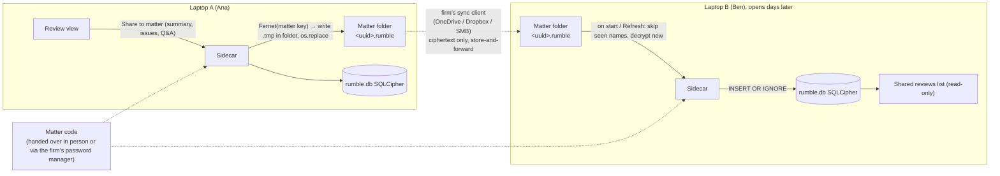

# Team sync: plan

This is a design plan, not code. Refs #21. It was read against `main` at 2641249 on 2026-11-17. Sizes are S/M/L; there are no dates.

## 1. The problem, in the owner's words

> "how to keep docs synced within a team, but local only, and when different laptops come on at different times." (owner, 2026-11-17)

> "rumble-sync exists as an idea on the roadmap, not as a repo. The concept: users on local language models can still work with colleagues through a decentralised sync mechanism rather than syncing to a server, keeping infrastructure costs down. Researched but not built out." (owner, #21, 2026-09-17)

The product rule (owner, 2026-11-17) also applies: free and open source as a trust builder, Elefant's managed service for most people, a seamless upgrade, no pushiness.

The hard part is the last clause of the first quote. Two laptops may never be on at the same moment, so nothing can depend on a live peer.

## 2. What a synced "doc" is, in the code today

Rumble has no "document" or "matter" record. The sidecar database (`src-tauri/sidecar/services/db.py`, `SCHEMA`) has three tables. Schema changes so far are only `CREATE TABLE IF NOT EXISTS` plus one `user_version` marker, which already means "compacted" (`SCHEMA_VERSION_COMPACTED`).

| Table | What it holds today |
|---|---|
| `chats` (`id` UUIDv4, `title`, timestamps) | One per review session. `DocumentReviewView.vue` calls `createChat(file.name)` after a review |
| `messages` (`id` UUIDv4, `chat_id`, `role`, `content`, `created_at`) | The seed user message (the **full document text** and the review summary) and the follow-up Q&A (`routes/chat.py` `send_message`) |
| `jobs` (`request`, `result`) | Draft, review and research inputs and outputs, purged after 30 days (`DEFAULT_JOB_RETENTION_DAYS`) |

What is *not* stored:
- **The review's issues list.** It is never saved. The summary and issues are pushed only onto the in-memory `session.messages` (`DocumentReviewView.vue`, "Build assistant messages from the review result").
- **A way back into a session.** `src/api/sidecar.ts` has `createChat`, `getChat` and `sendMessage`, but no list call. Sessions live in the view's memory, so a past review cannot be reopened.
- **Templates.** They are hardcoded in `DocumentDraftView.vue` (`templates = [employment, nda, service]`). The Settings templates folder is saved, but nothing reads it (#144).
- **Drafts.** A draft is a job result exported to Word (`export_draft_docx`). Editing and co-authoring happen in Word, not in Rumble.

A colleague needs **the review session**: the document text, the AI's summary and issues, and the Q&A so far, with who shared it and when. A review is finished work product, not a text two people type into at once.

**Definition used below.** A **synced doc** is a *shared review*: an immutable snapshot of one review session, placed in a **matter**. A matter is a named folder plus a key, shared by the people working on it. Sharing again creates a new snapshot; nothing is ever edited in place.

## 3. Options compared

### 3a. Transport: how bytes get from laptop A to laptop B when they are never on together

| Option | Works when peers are never online together? | New egress from Rumble | Infra cost to Elefant | Fits Rumble's current claims |
|---|---|---|---|---|
| (a0) Put `rumble.db` itself in a synced folder | Corrupts the database (§4, SQLite) | None | None | No |
| **(a) The firm's synced folder** (OneDrive/SharePoint, Dropbox, iCloud, SMB) used as a mailbox of encrypted files | **Yes.** The folder service stores and forwards | **None.** Rumble reads and writes local files; the firm's sync client moves them | None | Yes: Rumble stays "offline after setup" |
| (b) LAN peer-to-peer with mDNS | **No.** Both laptops must be awake on one network | A non-loopback listener, against "Sidecar binds `127.0.0.1` only" (NETWORK.md) | None | No |
| (c) A P2P library with relays (iroh) | **No**, by itself. Its relays store nothing (§4) | Yes, to relays | Low | No |
| (d) An Elefant-hosted relay (mailbox) | Yes | Yes, to Elefant | Ongoing | Only as an opt-in mode with its own NETWORK.md row |

Only (a) and (d) solve "different times". Option (a) needs no server and no network code. It uses storage the firm already trusts, permissions and backs up. That is the owner's "decentralised … rather than syncing to a server", built on infrastructure firms already run.

### 3b. Merge: do we need a CRDT?

| Library | What it would buy | Why not |
|---|---|---|
| Automerge, Yjs/`yrs`, Loro | Concurrent editing of one text | Nothing in Rumble is co-edited. Shared reviews are immutable snapshots, and drafts are edited in Word |
| cr-sqlite | Row-level CRDT merge inside SQLite | A native extension stacked on SQLCipher and PyInstaller. It has had no release since 2024 (§4) |

Without in-place edits, merging is just the union of snapshots by id. A CRDT would only become relevant if Rumble gained an editor that two people type into (see §6, "Not planned").

### 3c. Encryption and membership

| Option | Joining | Removing | Proof of sender | Complexity |
|---|---|---|---|---|
| Folder ACL only, plaintext files | The firm grants folder access | The firm revokes access | Folder service logs | Lowest. But the provider, and anyone with folder access, can read client documents (§4, Microsoft 365) |
| **One key per matter, handed over as a code** (Fernet) | A member gives the code to the new person | The firm revokes folder access. A member rotates the key and gives the new code to the people who stay | Inside the team, authorship is claimed, not proved. Outsiders cannot write anything that imports | Low |
| Per-person keypairs, encrypting to each member and signing (age plus Ed25519) | Exchange public keys | Stop encrypting to them | Yes | Medium: a signed roster, and conflicts over the roster |
| An MLS group (e.g. OpenMLS) | A protocol handshake | A protocol commit | Yes, plus forward secrecy | High. It needs ordered delivery of commits, which a folder does not provide |

## 4. Research: primary sources

Checked 2026-11-17. Quotes are verbatim; "silent" means the source does not say. Where a site refused automated fetches, that is stated.

**Why not just put `rumble.db` in the synced folder.** SQLite: "SQLite relies on exclusive locks for write operations, and those have been known to operate incorrectly for some network filesystems. This has led to database corruption." and "Rely upon it at your (and your customers') peril." ([useovernet](https://www.sqlite.org/useovernet.html)). A background copier can catch a database "in the middle of a transaction. The backup copy then might contain some old and some new content, and thus be corrupt" ([howtocorrupt §1.2](https://www.sqlite.org/howtocorrupt.html)). SQLite does not name Dropbox, OneDrive or iCloud; treating a sync client as that background copier is our inference. Either way, two laptops writing one database file is the wrong shape.

**Synced folders.**
- OneDrive/SharePoint ([restrictions](https://support.microsoft.com/en-us/office/restrictions-and-limitations-in-onedrive-and-sharepoint-64883a5d-228e-48f5-b3d2-eb39e07630fa)): names may not contain `" * : < > ? / \ |`, nor start with `~$`; "we recommend syncing no more than a total of 300,000 items across your cloud storage." Conflicts: "You might have sync conflicts if you upload multiple files on the OneDrive website at the same time." Microsoft does not document the conflict-copy naming (silent). `<uuid>.rumble` uses none of the forbidden characters. The same page: "Temporary TMP files don't sync to OneDrive", which suits write-to-temp-then-rename.
- OneDrive Files On-Demand ([Microsoft](https://support.microsoft.com/en-us/office/save-disk-space-with-onedrive-files-on-demand-for-windows-0e6860d3-d9f3-4971-b321-7092438fb38e)): "Online-only files don't take up space on your computer"; they download when opened. So reading a placeholder triggers a download by OneDrive, not by Rumble.
- Dropbox ([help](https://help.dropbox.com/organize/conflicted-copy)): "A conflicted copy is a file that Dropbox creates when multiple people edit the same file at the same time." "The editor's username, "conflicted copy", and the save date will be added to the filename."
- iCloud Drive ([Apple](https://support.apple.com/en-us/109344)): "Your files sync with iCloud each time your device connects to the internet." Apple is silent on how conflicts are resolved.
- Microsoft 365 is not end-to-end encrypted: SharePoint "decrypts the customer data before sending it to the user" ([Microsoft 365 encryption](https://learn.microsoft.com/en-us/compliance/assurance/assurance-encryption-for-microsoft-365-services)); "some cases require a Microsoft engineer to access your content" ([Customer Lockbox](https://learn.microsoft.com/en-us/purview/customer-lockbox-requests)). Hence Rumble encrypts before writing.
- Windows roaming: `FOLDERID_RoamingAppData` is "%APPDATA% (%USERPROFILE%\AppData\Roaming)" ([KNOWNFOLDERID](https://learn.microsoft.com/en-us/windows/win32/shell/knownfolderid)); Roaming User Profiles redirect "user profiles to a file share" ([overview](https://learn.microsoft.com/en-us/windows-server/storage/folder-redirection/folder-redirection-rup-overview)). That `AppData\Local` never roams is stated only in a Microsoft Q&A community answer, not in Learn docs: unverified as documentation. #57 already moved Rumble's data to `app_local_data_dir`.

**Merge libraries.** All checked against their own repos, crates.io and PyPI.

| | Licence | Latest | Python | Own words / status | Fit for a shared folder | SQLite |
|---|---|---|---|---|---|---|
| [Automerge](https://github.com/automerge/automerge) | MIT | crate 0.12.0, 2026-09-16 | PyPI `automerge` stable 0.1.2 (2022); newer only pre-release (0.2.0.dev4, 2026-04) | Rust API "is low level and not well documented" (README) | Changes save and load as files; `apply_changes` "is idempotent" ([docs.rs](https://docs.rs/automerge/latest/automerge/struct.Automerge.html)). Its sync protocol is a live exchange ("delivering messages and acknowledgements in both directions", [automerge-py sync.md](https://github.com/automerge/automerge-py/blob/main/docs/sync.md)) | silent |
| [yrs / Yjs](https://github.com/y-crdt/y-crdt) | MIT | `yrs` 0.28.1, 2026-11-04 | `pycrdt` 0.14.13, 2026-11-02; `ypy` archived: "This project is abandoned, please look at pycrdt." | 0.x, no stability claim | Updates are diffs applied later; the store holds "pending updates waiting to be applied once a missing update information arrives" ([docs.rs](https://docs.rs/yrs/latest/yrs/)) | silent |
| [Loro](https://github.com/loro-dev/loro) | MIT | 1.18.0, 2026-11-16 | `loro` 1.18.0 | "Loro 1.0 is out!" (README); format-stability page refused fetch: unverified | Export modes `Updates`, `Snapshot` ([docs.rs](https://docs.rs/loro/latest/loro/enum.ExportMode.html)) | silent |
| [cr-sqlite](https://github.com/vlcn-io/cr-sqlite) | MIT | v0.16.3, **2024-01-17** | loadable extension | Author, 2024-12-30: "I'm full time on https://zero.rocicorp.dev/ these days." and "I don't see that happening for at least 1-2 years" ([#444](https://github.com/vlcn-io/cr-sqlite/issues/444)) | n/a | "a run-time loadable extension for SQLite"; SQLCipher compatibility: silent |

All three CRDTs could carry their updates as files. None is needed while every record is immutable (§2, §5).

**Peer-to-peer.**
- [iroh](https://github.com/n0-computer/iroh) (MIT OR Apache-2.0, v1.4.1, 2026-10-21): "Iroh hardcodes a set of public relays provided by n0.computer"; relays "don't store your application data; they just facilitate connections"; "Public relays are suitable for development and testing"; self-hosting supported ([relays](https://docs.iroh.computer/concepts/relays)). `iroh-blobs` README: "this version of iroh-blobs is not yet considered production quality." Iroh does not say whether peers must be online together (silent). Relays that store nothing imply they must be, which is our inference.
- Tauri: there is no official mDNS or LAN-discovery plugin among the 31 in [plugins-workspace](https://github.com/tauri-apps/plugins-workspace).

**Encryption.**
- [Fernet](https://cryptography.io/en/latest/fernet/) (`cryptography`, already locked at 46.0.5): "Fernet guarantees that a message encrypted using it cannot be manipulated or read without the key." "AES in CBC mode with a 128-bit key … HMAC using SHA256 for authentication." "The encrypted message contains the current time when it was generated in plaintext." "Fernet is ideal for encrypting data that easily fits in memory." It is the library's high-level recipe; the AEAD primitives sit under a module that calls itself "Hazardous Materials" ([AEAD](https://cryptography.io/en/latest/hazmat/primitives/aead/)), which is why they are not used directly.
- [age](https://github.com/C2SP/C2SP/blob/main/age.md) wraps the file key "for one or more _recipients_". The spec says nothing about sender authentication. Rust `age` 0.12.1 and `pyrage` 1.4.0 exist. Kept for the per-person-key variant if it is ever needed.

**Legal-sector duties** (what the design must respect, not legal advice; check against the firm's own jurisdiction):
- ABA Model Rule 1.6(c), as quoted in [Formal Opinion 477](https://docs.tbpr.org/pub/aba%20formal%20opinion%20477.authcheckdam.pdf) (the 2017 text, on a state bar's copy because americanbar.org refused the fetch; the 477R revision's wording is unverified): "A lawyer shall make reasonable efforts to prevent the inadvertent or unauthorized disclosure of, or unauthorized access to, information relating to the representation of a client." The opinion: "a lawyer should consider whether certain data should ever be stored in an unencrypted environment." The ABA definition of "screened" (Rule 1.0(k)) could not be fetched: unverified.
- Singapore, Law Society [Guidance Note 6.1.1](https://law-society-singapore-prod.s3.ap-southeast-1.amazonaws.com/2020/03/121.-Ethics-and-Information-Technology-GN-6.1.1.pdf): "Under rule 6(2) of the PCR 2015, a legal practitioner must not knowingly disclose any information which is confidential to his/her client…"; "Possible means of protecting confidentiality include the use of encrypted e-mail or secured lines." The PCR text itself (SSO refused the fetch) and the cloud-computing guidance note 3.4.1: unverified.
- England and Wales, [SRA Code for Solicitors](https://www.sra.org.uk/solicitors/standards-regulations/code-conduct-solicitors/) 6.3: "You keep the affairs of current and former clients confidential…"; 6.5 permits acting only where "effective measures have been taken which result in there being no real risk of disclosure of the confidential information".
- Hong Kong, [Solicitors' Guide ch. 8](https://www.hklawsoc.org.hk/-/media/HKLS/Home/Support-Member/Professional-Support/Vol-1-Eng/Chapter-8-English.pdf) 8.01: a duty "to hold in strict confidence all information concerning the business and affairs of his client"; commentary 31: "This Principle extends to cover electronic communication."

Together: encrypt before data reaches a third-party store, and make each matter separable (an information barrier). Neither duty asks for a server or a CRDT.

## 5. Recommendation

**One encrypted file per shared review, written once into a matter folder that the firm already syncs. Each laptop imports the files it has not yet seen when Rumble starts or the user clicks Refresh.**

- **Transport** is the firm's own synced folder, option (a). Rumble opens no connection; the sync client carries ciphertext. Laptops coming online at different times is exactly what a sync folder already handles.
- **One immutable file per shared review**, named `<uuid>.rumble` and written once by its author. Two laptops never write the same file, so the sync service has nothing to conflict over. A stray conflict copy (`… (1).rumble`) decrypts to an id that is already known, and is skipped.
- **Merge** is a union by id. Import is idempotent and resumable: running it twice changes nothing, and an interrupted run resumes where it stopped.
- **Encryption** uses Fernet from `cryptography`. It authenticates as well as encrypts, and it is already in `uv.lock` at 46.0.5 through `pypdf[crypto]`, so it adds no dependency. Each matter has one key, and that key *is* the matter code people hand each other.
- **What it avoids:** no CRDT, no peer-to-peer, no server. The phase-4 Elefant relay is the same files in a different mailbox, so the upgrade is a change of transport, not a rewrite.



### Record format

Each file is one record, `<uuid>.rumble`, at the top of the matter folder. The file holds the key fingerprint (the first 8 hex characters of the SHA-256 of the key) and a Fernet token. The token's plaintext is JSON:

```json
{"v": 1, "kind": "review", "id": "<uuid, equal to the file name>", "title": "NDA - Acme.pdf",
 "shared_by": "Ana Lim", "shared_at": "2026-11-17T09:12:03Z", "model": "qwen3:8b",
 "document_text": "...", "summary": "...", "issues": [...], "qa": [{"role": "user", "content": "..."}]}
```

What the format guarantees and what it leaks:
- **Leaks:** a file name is a random UUID. The file's size and Fernet's plaintext timestamp reveal roughly how big the record is and when it was written.
- **Id check:** a record whose `id` differs from its file name is rejected, so a member cannot pre-empt someone else's id.
- **Wrong key:** a file whose fingerprint matches no code you hold is recorded once and counted ("2 items need a newer matter code"). It is not re-read on every start.
- **Damaged file:** a file with a known fingerprint that fails to decrypt is retried only when its size or mtime changes.
- **Downloads:** files already seen are skipped by name, without being opened. With OneDrive Files On-Demand, only new files are downloaded.
- **Atomic writes:** write `<uuid>.rumble.tmp` in the matter folder, then `os.replace` it to its final name. OneDrive does not sync TMP files (§4), and readers ignore `*.tmp`.

### Where the code lives

- **Sidecar (Python).**
  - `services/sharing.py`: seal, open, write one record, import a folder.
  - `routes/matters.py` with four routes: create a matter, join with a code, share a review, refresh.
  - The sidecar owns the database, so it owns this work too. It is local file I/O only.
- **Host (Rust).** Generalise `pick_templates_folder` into one `pick_folder` command, used by templates and matters. No new crate.
- **Frontend.** The review view sends its in-memory session (summary, issues, Q&A) to the share route. This also fixes "issues are never saved" for shared reviews. A "Shared reviews" list renders a snapshot read-only, with "Continue in a new chat", which copies it into a private local chat. This means building a read-only viewer, not chat history.
- **Schema.**
  - Two new tables, `matters(id, name, folder, key, member_name)` and `shared_reviews(id, matter_id, shared_by, shared_at, body, hidden)`, plus `skipped_files(name, size, mtime, reason)`.
  - The change is additive, using `CREATE TABLE IF NOT EXISTS`. It neither alters existing tables nor touches `user_version`.

## 6. Phases

Each phase ships on its own and leaves the app better.

| Phase | Scope | Proof | Size |
|---|---|---|---|
| **0. Shared templates, with no sync code** | Fix #144 so the templates folder is actually read. Point it at a firm-synced folder and every laptop sees the same templates. Templates are the firm's precedents, already kept on shared drives, so plaintext matches current practice | Two installs pointed at one folder list the same templates | S (as part of #144) |
| **1. MVP: shared reviews in one matter, between two laptops that are never on together** | Create a matter (pick a folder, name it, show the code). Join one (pick the folder, paste the code, give your name). "Share to matter" on a finished review. Import on sidecar start and on Refresh. A read-only "Shared reviews" list with "Continue in a new chat". "Hide" is local only | pytest, with two data dirs and one folder, never running together: A shares and stops. B starts, imports, and sees A's review with its issues and A's name. B shares a second review and stops. A starts and sees it. Also tested: re-importing is a no-op; a hidden review stays hidden after re-import; a truncated file and a wrong-code file are counted and not imported; a `… (1).rumble` duplicate is skipped; a record whose id differs from its file name is rejected; no plaintext from the document appears in the folder. Then a human smoke test on two real laptops through OneDrive | M |
| **2. Real teams** | Several matters, each with its own folder and code: the ethical wall. Rotate the code using `MultiFernet` (the new key encrypts; old keys still decrypt; never pass `ttl`). "Leave matter". Withdraw a review with a tombstone record, authenticated by the matter key; any member can withdraw, and laptops back after months apply it. A per-matter retention setting | A tombstone imported after its review removes the review. A laptop holding only the old code shows "N items need the new code" | M |
| **3. Comfort** | Import when the window gains focus (no file watcher). Per-matter status ("last shared by Ben, 3 days ago"). Gap detection, if pilots ask for it: a per-member `seq` number, shown as "Ben's #14 is missing" | Unit tests on the status text | S |
| **4. Optional Elefant relay (paid)** | For teams without a shared folder, or working across firms: an Elefant mailbox that stores the same `.rumble` files. Rumble uploads and downloads ciphertext; Elefant never holds the code | A new NETWORK.md row. The egress-block test still passes with the relay off | L |
| Not planned | A CRDT library, LAN P2P, iroh, per-person keys, MLS | Revisit if Rumble gains a co-edited editor (CRDT); if firms need proof of authorship inside a team (per-person signing keys); or if matters have dozens of members and frequent removals (MLS) | — |

## 7. Threat model

**Assets:** client document text, AI analysis, Q&A. Ciphertext sits wherever the firm's folder syncs. Plaintext exists only in each member's SQLCipher database.

| Adversary | Can | Cannot | Response |
|---|---|---|---|
| Sync provider, firm IT, anyone with folder access but no code | See the file count, sizes and write times. Delete or withhold files without anyone noticing (gap detection is phase 3). Replay old files | Read content. Write a record that imports (Fernet authenticates) | Replays are no-ops (same id). Folder backups are the recovery path |
| Removed member, before rotation | Read new records. Write records under any name, including fake "AI" summaries and issues. Withdraw anyone's review (phase 2) | — | The firm revokes folder access, so they stop receiving files at all. Phase 2 adds rotation |
| Removed member, after rotation | Keep everything imported while they were a member | Read or write anything new | Say so plainly: there is no remote wipe, just as with a printed file |
| Current member | Claim another member's name, or present edited text as the AI's output | Read other matters | Accepted for v1: within a team, authorship is claimed, as on a shared drive today. Per-person signing is a "Not planned" trigger |
| Lost or stolen laptop | — | — | At rest: FDE plus SQLCipher, unchanged. Rotate the code; the firm revokes folder access |
| Laptop back after months | Import everything since. If the code has rotated, see "N items need the new code" | — | The count is shown, never swallowed |
| Lost `db_key` (#156) | Lose the local matter codes and copies | — | Recovery needs the code again: from where the firm keeps it (decision 3) or from a colleague. The folder then restores every shared review |
| Same-user malware, administrators | Out of scope, as in SECURITY.md | | |

**Legal-sector constraints (§4) and how the design meets them:**
- **Confidentiality:** records are encrypted before they reach the folder. The provider holds only ciphertext.
- **Ethical walls:** one folder and one code per matter, so there are two independent walls: the firm's folder permissions and the code. Someone not on the matter has neither.
- **Audit:** every record carries who shared it, when, and with which model, and it is never edited. The matter folder is an append-only log that the firm already backs up. Who wrote each file is the sync service's own log; we have not checked what each provider records.
- **Conflicts users can understand:** in-place edits never happen, so there are none. Two colleagues sharing offline produce two shared reviews, each with its author and time.
- **Windows roaming:** the matter folder is one the user picks and the firm already syncs. The database and codes stay in `app_local_data_dir` (#57). The folder picker refuses anything under `%APPDATA%`, which roams.

## 8. What changes in NETWORK.md and SECURITY.md

**NETWORK.md, phase 1:**
- New section "Local files, synced by others": "Matter sharing reads and writes encrypted files in a folder you choose. Rumble opens no connection for it. If that folder is synced (OneDrive, Dropbox, an SMB share), the sync client, not Rumble, sends the files, encrypted with a code only your team holds."
- Remove the stale bullet "Settings' sync 'Test connection' is a mock and makes no request". The tab went in #87; the `sync/test` mock in `src/modules/backend/backendClient.ts` can go with it.
- Phase 4 only: an egress row for the relay, off by default.

**SECURITY.md, phase 1:**
- "Where data lives": a matter-folder row (ciphertext only; who can read it; "Delete all local data" does not remove what you shared).
- A "Sharing threat model" section: §7, plainly. Include "a removed colleague keeps what they already had" and "authorship within a matter is not cryptographically proved".
- Fix while there: "sync options" in the Settings row is stale, and the database bullet is duplicated with conflicting Windows paths (`%APPDATA%` vs `%LOCALAPPDATA%`).
- The honest-copy rule from #19, #20 and #56: claim "end-to-end encrypted" in the UI only once the phase-1 test proves the folder holds no plaintext.

## 9. Open owner decisions

1. **Transport for v1.**
   - Options: (a) the firm's synced folder; (b) the Elefant relay first; (c) both.
   - **Recommend (a).** It needs no infrastructure and adds no egress. The relay becomes the paid convenience in phase 4, with no rewrite.
2. **The first shared doc.**
   - Options: (a) review snapshots; (b) templates; (c) drafts; (d) live shared chat threads.
   - **Recommend (a)** for phase 1, with templates as phase 0 because #144 makes them free. Drafts stay in Word. Live threads, (d), bring ordering, authorship of AI replies and merge rules: none of that is needed for "keep docs synced".
3. **How the code is handed over and kept.**
   - Options: (a) shown to copy, with copy that says "keep it in your firm's password manager; give it in person or through a secure channel"; (b) (a) plus a QR code; (c) the key stored in the folder (folder access alone admits you; no end-to-end encryption).
   - **Recommend (a).** Option (c) gives up the claim that the provider cannot read client documents.
4. **Does a shared review include the full document text?**
   - Options: (a) yes; (b) summary and issues only.
   - **Recommend (a).** Without it, a colleague's local model has nothing to answer follow-up questions from.
5. **What deleting does.**
   - Options: (a) "Hide" is local, and "Withdraw" propagates as a tombstone (phase 2); (b) local deletion only, forever; (c) deleting removes the file from the folder.
   - **Recommend (a).** Option (c) silently fails for colleagues who already imported the review, which is a false promise.
6. **Retention of shared reviews.**
   - Options: (a) none until withdrawn; (b) the 30-day job rule; (c) a per-matter setting.
   - **Recommend (a)** in phase 1 and (c) in phase 2, because legal retention is set per matter, not per app.
7. **Is the relay part of Premium?**
   - Options: (a) yes, in the Elefant subscription; (b) a separate add-on; (c) never.
   - **Recommend (a).** The folder path stays free and complete, and the relay only removes the need for a shared folder: an upgrade, not a push.

## 10. Rough edges, stated

- **Firms with no synced folder at all** cannot use phase 1. Phase 4 is for them.
- **Withheld or deleted files go unnoticed** until gap detection lands (phase 3).
- **Memory:** Fernet holds a whole record in memory. A record is at most one document's text plus Q&A, so this is fine. It would not suit large binary attachments, and phase 1 has none.
- **Item limits:** one file per shared review keeps far below OneDrive's recommended 300,000 synced items.
- **Two Rumble instances** on one data directory (#169) would import twice. That is harmless (`INSERT OR IGNORE`), but the single-instance guard is still wanted.
