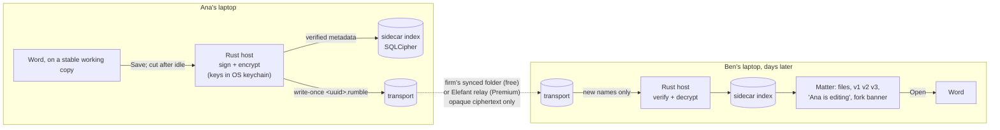

# Team sync: plan

This is a design plan, not code. Refs #21. It was read against `main` at 2641249 on 2026-11-17. Sizes are S/M/L, never dates.

## 1. The problem, in the owner's words

> "how to keep docs synced within a team, but local only, and when different laptops come on at different times."

> "also need to have version changes tracked. that's crucial."

> "back in the day we went through how to sync decentralised. we looked at things like telegram and other protocols." … "yes signal is closer."

> ".docx is pretty key"

> "3 also strikes me as the part that annoys people, we should aim to make it even more seamless and intuitive. so stuff like the foreign example you mentioned is a quality of life improvement, but needs to be made intuitive."

All of the above are from the owner, 2026-11-17. "3" is reconciling two offline edits. The earlier owner decision on #21 (2026-09-17) still stands: "decentralised sync mechanism rather than syncing to a server, keeping infrastructure costs down."

Product rule: free and open source as a trust builder, Elefant's managed service for most people, seamless upgrade, no pushiness.

The design has to handle three things:
- **Timing.** Laptops are rarely online at the same moment.
- **History.** Every change is attributable and comparable.
- **Friction.** None of this may feel like a document management system.

### The earlier design this builds on

`elefant_api_monorepo/agent_docs/2026-02-10-stub-implementation-plan.md` §12, "Briefcase sharing — Telegram-style E2E encrypted". It specifies:
- per-person X25519 keys;
- a per-briefcase symmetric key wrapped for each sharee;
- a relay that "never sees plaintext";
- "revocation is best-effort";
- libsodium.

| §12 | Here | Why |
|---|---|---|
| A server holds keys and blobs (`user_public_keys`, `briefcase_sync_blobs`) | One file format over a pluggable transport: the firm's synced folder (free), or the Elefant relay (working name: Trail; Premium, §7) | Local-only must work with no Elefant infrastructure |
| `version INTEGER`, `GET …/sync/latest` | Immutable versions that name their parents; the relay is an append-only log | "latest" drops one of two offline edits and keeps no history |
| No signatures | Every file is signed by its author's device | Provable authorship, which is the audit trail |
| Revoke deletes the share record; the key stays the same | Removal starts a new matter key | A removed person cannot read anything written later |
| AES-256-GCM, HKDF, libsodium; per account | age plus Ed25519 in the Rust host (§5.6); per device | Keys stay out of the Python sidecar; a lost laptop is removed alone |
| `permission` read / read-write, `expires_at` | Not in the MVP | YAGNI until a pilot asks |

§12's open questions get answers here:
- "Group sharing": §5.
- "Conflict resolution: last-write-wins or CRDT?": neither. A person resolves forks in one step (§6).
- "Key backup": decision 9.
- "Offline: how long…": indefinitely (§5.4).

## 2. What a synced "doc" is

**A doc is any file. A matter is a set of versioned files.**

A version is an encrypted blob plus signed metadata. Sync, history, signatures and ethical walls never look inside the file, so `.docx`, PDF, `.msg`, spreadsheets and plain text are all treated the same way. The file type matters only when a person views or compares versions:

| Type | Open | Compare two versions |
|---|---|---|
| `.docx` | In Word | **Word's own Compare** (§6.3); Rumble builds no `.docx` diff engine |
| Plain text (`.txt`, `.md`) | In Rumble | Built-in word redline |
| Anything else | In its default app | Side by side, plus "open both" |

Does a Rumble-native draft model still earn its place? **No.**
- Today a draft is a job result, shown in a read-only `<pre>` (`DocumentDraftView.vue`) and exported with `export_draft_docx`. The database has only `chats`, `messages` and `jobs` (`services/db.py`).
- A native editor would duplicate Word, which lawyers already use.
- "Save to matter" on a draft writes the `.docx` that `export_draft_docx` already produces as version 1. After that it is just a file.
- One model (matter → files → versions) is simpler than two.

## 3. Options compared

### 3a. Transport

| Option | Peers never on together? | New egress from Rumble | Verdict |
|---|---|---|---|
| Put `rumble.db` in a synced folder | Corrupts the database (§4) | None | No |
| **(a) The firm's synced folder** (OneDrive/SharePoint, Dropbox, iCloud, SMB) as a mailbox of files | Yes | None: the firm's sync client moves ciphertext | **Free, MVP** |
| (b) LAN P2P with mDNS | No | A non-loopback listener, which contradicts NETWORK.md | No |
| (c) iroh relays/hole-punching | No: relays "don't store your application data" (§4) | Yes | No |
| **(d) Elefant relay**, an append-only mailbox of the same files | Yes | Yes, opt-in | **Premium (§7); also self-hostable** |

A transport is three operations: `list`, `read`, `write`. The folder does them with the filesystem; the relay does them over HTTPS. A matter can use both at once, because the files are identical and named by id.

### 3b. Concurrent edits

| Approach | Verdict |
|---|---|
| A lock on check-out (iManage-style, §4) | Rejected. It blocks colleagues and needs an administrator to clear a stale lock. It also cannot work offline: a lock needs someone online to grant it |
| Last write wins | Rejected. It silently loses work |
| CRDT (§4) | Rejected. It cannot merge `.docx` meaningfully, and it auto-merges legal text nobody reviewed |
| **Versions with parents; forks resolved by a person in one step** | **Chosen** |

### 3c. Identity and keys

| Option | Verdict |
|---|---|
| One shared matter code | Too weak: authorship is unprovable, and removal means re-sharing a code |
| **Per-device identity keys (Signal-style), a matter key wrapped per device, every file signed** | **Chosen** |
| The Signal protocol proper (ratchets), MLS | Rejected. Forward secrecy conflicts with reading history for years. Both need ordered delivery. libsignal is AGPL-3.0 (§4) |

## 4. Research: primary sources

Checked 2026-11-17. Quotes are verbatim; "silent" means the source does not say. Where a site refused automated fetches, that is stated.

**Why not just put `rumble.db` in the synced folder.** SQLite: "SQLite relies on exclusive locks for write operations, and those have been known to operate incorrectly for some network filesystems. This has led to database corruption." and "Rely upon it at your (and your customers') peril." ([useovernet](https://www.sqlite.org/useovernet.html)). A background copier can catch a database "in the middle of a transaction. The backup copy then might contain some old and some new content, and thus be corrupt" ([howtocorrupt §1.2](https://www.sqlite.org/howtocorrupt.html)). SQLite does not name Dropbox, OneDrive or iCloud; treating a sync client as that background copier is our inference. Either way, two laptops writing one database file is the wrong shape.

**Synced folders.**
- OneDrive/SharePoint ([restrictions](https://support.microsoft.com/en-us/office/restrictions-and-limitations-in-onedrive-and-sharepoint-64883a5d-228e-48f5-b3d2-eb39e07630fa)): names may not contain `" * : < > ? / \ |`, nor start with `~$`; "we recommend syncing no more than a total of 300,000 items across your cloud storage." Conflicts: "You might have sync conflicts if you upload multiple files on the OneDrive website at the same time." Microsoft does not document the conflict-copy naming (silent). `<uuid>.rumble` uses none of the forbidden characters. The same page: "Temporary TMP files don't sync to OneDrive", which suits write-to-temp-then-rename, and "Sync issues can also occur if you edit files offline." This is why Rumble never lets two devices write one file.
- OneDrive Files On-Demand ([Microsoft](https://support.microsoft.com/en-us/office/save-disk-space-with-onedrive-files-on-demand-for-windows-0e6860d3-d9f3-4971-b321-7092438fb38e)): "Online-only files don't take up space on your computer"; they download when opened. So reading a placeholder triggers a download by OneDrive, not by Rumble.
- Dropbox ([help](https://help.dropbox.com/organize/conflicted-copy)): "A conflicted copy is a file that Dropbox creates when multiple people edit the same file at the same time." "The editor's username, "conflicted copy", and the save date will be added to the filename."
- iCloud Drive ([Apple](https://support.apple.com/en-us/109344)): "Your files sync with iCloud each time your device connects to the internet." Apple is silent on how conflicts are resolved.
- Microsoft 365 is not end-to-end encrypted: SharePoint "decrypts the customer data before sending it to the user" ([Microsoft 365 encryption](https://learn.microsoft.com/en-us/compliance/assurance/assurance-encryption-for-microsoft-365-services)); "some cases require a Microsoft engineer to access your content" ([Customer Lockbox](https://learn.microsoft.com/en-us/purview/customer-lockbox-requests)). Hence Rumble encrypts before writing.
- Windows roaming: `FOLDERID_RoamingAppData` is "%APPDATA% (%USERPROFILE%\AppData\Roaming)" ([KNOWNFOLDERID](https://learn.microsoft.com/en-us/windows/win32/shell/knownfolderid)); Roaming User Profiles redirect "user profiles to a file share" ([overview](https://learn.microsoft.com/en-us/windows-server/storage/folder-redirection/folder-redirection-rup-overview)). That `AppData\Local` never roams is stated only in a Microsoft Q&A community answer, not in Learn docs: unverified as documentation. #57 already moved Rumble's data to `app_local_data_dir`.

**Merge libraries.** All checked against their own repos, crates.io and PyPI.

| | Licence | Latest | Python | Own words / status | Fit for a shared folder | SQLite |
|---|---|---|---|---|---|---|
| [Automerge](https://github.com/automerge/automerge) | MIT | crate 0.12.0, 2026-09-16 | PyPI `automerge` stable 0.1.2 (2022); newer only pre-release (0.2.0.dev4, 2026-04) | Rust API "is low level and not well documented" (README) | Changes save and load as files; `apply_changes` "is idempotent" ([docs.rs](https://docs.rs/automerge/latest/automerge/struct.Automerge.html)). Its sync protocol is a live exchange ("delivering messages and acknowledgements in both directions", [automerge-py sync.md](https://github.com/automerge/automerge-py/blob/main/docs/sync.md)) | silent |
| [yrs / Yjs](https://github.com/y-crdt/y-crdt) | MIT | `yrs` 0.28.1, 2026-11-04 | `pycrdt` 0.14.13, 2026-11-02; `ypy` archived: "This project is abandoned, please look at pycrdt." | 0.x, no stability claim | Updates are diffs applied later; the store holds "pending updates waiting to be applied once a missing update information arrives" ([docs.rs](https://docs.rs/yrs/latest/yrs/)) | silent |
| [Loro](https://github.com/loro-dev/loro) | MIT | 1.18.0, 2026-11-16 | `loro` 1.18.0 | "Loro 1.0 is out!" (README); format-stability page refused fetch: unverified | Export modes `Updates`, `Snapshot` ([docs.rs](https://docs.rs/loro/latest/loro/enum.ExportMode.html)) | silent |
| [cr-sqlite](https://github.com/vlcn-io/cr-sqlite) | MIT | v0.16.3, **2024-01-17** | loadable extension | Author, 2024-12-30: "I'm full time on https://zero.rocicorp.dev/ these days." and "I don't see that happening for at least 1-2 years" ([#444](https://github.com/vlcn-io/cr-sqlite/issues/444)) | n/a | "a run-time loadable extension for SQLite"; SQLCipher compatibility: silent |

All three CRDTs could carry their updates as files. None fits: they cannot merge `.docx` meaningfully, and legal text should not be auto-merged (§3b).

**Peer-to-peer.**
- [iroh](https://github.com/n0-computer/iroh) (MIT OR Apache-2.0, v1.4.1, 2026-10-21): "Iroh hardcodes a set of public relays provided by n0.computer"; relays "don't store your application data; they just facilitate connections"; "Public relays are suitable for development and testing"; self-hosting supported ([relays](https://docs.iroh.computer/concepts/relays)). `iroh-blobs` README: "this version of iroh-blobs is not yet considered production quality." Iroh does not say whether peers must be online together (silent). Relays that store nothing imply they must be, which is our inference.
- Tauri: there is no official mDNS or LAN-discovery plugin among the 31 in [plugins-workspace](https://github.com/tauri-apps/plugins-workspace).

**Crypto.** The chosen stack, its sources and the runners-up are in §5.6. Two facts drive its rules. age's spec says nothing about sender authentication. libsodium's sealed boxes doc states the same lesson in general: the recipient "can verify the integrity of the message" but "cannot verify the identity of the sender" ([libsodium](https://doc.libsodium.org/public-key_cryptography/sealed_boxes)).

**Signal: what to borrow** ([signal.org/docs](https://signal.org/docs/) lists XEdDSA, X3DH, PQXDH, Double Ratchet, Sesame and ML-KEM Braid; it has **no group or sender-key specification**).
- **Double Ratchet:** "used by two parties to exchange encrypted messages based on a shared secret key. The parties derive new keys for every Double Ratchet message so that earlier keys cannot be calculated from later ones" ([spec](https://signal.org/docs/specifications/doubleratchet/)). The design point is that old message keys cannot be recomputed. A matter must be readable years later, by members and devices added later, from files in a folder. A per-pair ratchet and its session state, in a folder with no ordered delivery, works against both requirements. Not borrowed.
- **Multiple devices (Sesame):** "With per-device identity keys, each device may have a different key pair." On identity change: "Whenever a change in identity keys is detected users must repeat the authentication process" ([spec §3.1, §6.1](https://signal.org/docs/specifications/sesame/)). Borrowed: per-device identity keys, and a key change is never silent.
- **Safety numbers** (Signal blog, [2016-11-17](https://signal.org/blog/safety-number-updates/)): they "allow Signal users to verify the privacy of their communication with a contact", and are checked by comparing a number or scanning one QR code. Signal moved from blocking on a key change, where users needed manual approval before "being able to send or receive any further messages", to an advisory notice. Signal's support article returned 403 to fetching, so current behaviour beyond that post is unverified. Borrowed: number and QR comparison. Blocking is decision 6.
- **Groups and sender keys.** In 2014 Signal "simply deliver[ed] a pairwise encrypted message to each member of the group" and described encrypting once with a random key sent pairwise as a future optimisation ([blog, 2014-05-05](https://signal.org/blog/private-groups/)). Today's sender keys exist in code, not in a spec: libsignal's `sender_keys.rs` and `group_cipher.rs` (`create_sender_key_distribution_message`, `group_encrypt`) ([libsignal](https://github.com/signalapp/libsignal/tree/main/rust/protocol/src)). Borrowed: the shape, encrypt once with a group key and hand that key to each member individually. Not borrowed: the per-sender chain ratchet (same reasoning as the Double Ratchet).
- **libsignal itself** is `SPDX-License-Identifier: AGPL-3.0-only` (header of `sender_keys.rs`; GitHub reports AGPL-3.0). Rumble is Apache-2.0, so linking it is a licensing decision, not a technical one. It is not proposed.

**Word Compare: how to produce a redline without building one.**
- Manual path, four steps ([Microsoft support](https://support.microsoft.com/en-us/office/compare-and-merge-two-versions-of-a-document-f5059749-a797-4db7-a8fb-b3b27eb8b87e)): "Open one of the two versions of the document that you want to compare." "On the Review tab, select Compare > Compare Documents." "In the Original document list, select the original document." "In the Revised document list, browse to the other version of the document, and then select OK." The page names Word 2019 for Mac and is silent on Word for the web.
- Windows automation ([VBA `Application.CompareDocuments`](https://learn.microsoft.com/en-us/office/vba/api/word.application.comparedocuments)): "Compares two documents and returns a Document object that represents the document that contains the differences between the two documents, marked using tracked changes." It takes `OriginalDocument`, `RevisedDocument`, and `RevisedAuthor`, "the name of the person to whom to attribute changes". This is COM on Windows; whether macOS Word exposes the same through AppleScript is unverified.
- Word add-in (Office.js):
  - [`Document.compare(filePath, options)`](https://learn.microsoft.com/en-us/javascript/api/requirement-sets/word/word-api-desktop-1.1-requirement-set?view=common-js-preview) is in WordApiDesktop 1.1, and `compareFromBase64(base64File, options)` is in [WordApiDesktop 1.2](https://learn.microsoft.com/en-us/javascript/api/requirement-sets/word/word-api-desktop-1-2-requirement-set?view=word-js-preview). Both "Displays revision marks that indicate where the current document differs from a specified document". Their options include `compareTarget` and `authorName`, which is "the reviewer name associated with the differences generated by the comparison": **one name for all differences**. A two-way compare therefore cannot attribute Ana's changes to Ana and Ben's to Ben. Doing that needs a three-way combine from the common base (VBA `MergeDocuments`, unverified here), and Office.js has no combine. How Rumble would hand base64 to the hosted add-in is also unverified; it likely needs a loopback listener, which is a NETWORK.md decision.
  - Microsoft says these sets are "only available for Word on Windows, on Mac, and on iPad" and are "'preview' APIs for other platforms (web)".
  - Elefant already ships a Word add-in (`word_plugin`).
- Word's owner file. A Microsoft Q&A answer (community, not documentation) describes `~$`-prefixed "owner files", which Word uses "to know that the corresponding document file is open" ([Q&A](https://learn.microsoft.com/en-us/answers/questions/4822723/what-are-doc-and-docx-can-you-open-them-or-delete)). Using it as the "Word closed the file" signal needs a spike.
- Plain text needs no Word. Python's stdlib [`difflib`](https://docs.python.org/3/library/difflib.html) offers "Helpers for computing deltas", and Rust has equivalents. Rumble has no diff code today (no diff package; the draft is a read-only `<pre>`).

**iManage, for contrast.** Only two facts were verified, both from iManage Control Center help ([Containers and Documents](https://docs.imanage.com/cc-help/10.5.2/en-US/Containers_and_Documents.html)): while a document is checked out, "other users can't check it out or edit it", and unlocking needs either the document owner with a role that has "the library role Document Unlock privilege enabled", or someone who has "at least Tier 1 iManage Work system administrator privileges". Everything else said about iManage here is general knowledge and **unverified**: profile forms on save, a "new version or replace" prompt, and a server or cloud dependency.

**Legal-sector duties** (what the design must respect, not legal advice; check against the firm's own jurisdiction):
- ABA Model Rule 1.6(c), as quoted in [Formal Opinion 477](https://docs.tbpr.org/pub/aba%20formal%20opinion%20477.authcheckdam.pdf) (the 2017 text, on a state bar's copy because americanbar.org refused the fetch; the 477R revision's wording is unverified): "A lawyer shall make reasonable efforts to prevent the inadvertent or unauthorized disclosure of, or unauthorized access to, information relating to the representation of a client." The opinion: "a lawyer should consider whether certain data should ever be stored in an unencrypted environment." The ABA definition of "screened" (Rule 1.0(k)) could not be fetched: unverified.
- Singapore, Law Society [Guidance Note 6.1.1](https://law-society-singapore-prod.s3.ap-southeast-1.amazonaws.com/2020/03/121.-Ethics-and-Information-Technology-GN-6.1.1.pdf): "Under rule 6(2) of the PCR 2015, a legal practitioner must not knowingly disclose any information which is confidential to his/her client…"; "Possible means of protecting confidentiality include the use of encrypted e-mail or secured lines." The PCR text itself (SSO refused the fetch) and the cloud-computing guidance note 3.4.1: unverified.
- England and Wales, [SRA Code for Solicitors](https://www.sra.org.uk/solicitors/standards-regulations/code-conduct-solicitors/) 6.3: "You keep the affairs of current and former clients confidential…"; 6.5 permits acting only where "effective measures have been taken which result in there being no real risk of disclosure of the confidential information".
- Hong Kong, [Solicitors' Guide ch. 8](https://www.hklawsoc.org.hk/-/media/HKLS/Home/Support-Member/Professional-Support/Vol-1-Eng/Chapter-8-English.pdf) 8.01: a duty "to hold in strict confidence all information concerning the business and affairs of his client"; commentary 31: "This Principle extends to cover electronic communication."

Together: encrypt before data reaches a third-party store, and make each matter separable (an information barrier). Neither duty asks for a server or a CRDT.

## 5. Recommendation: mechanics

**Every version of every file in a matter is one signed, encrypted, write-once file in the matter's transport. Devices import the files they haven't seen, and parent links, never clocks, decide the order.**



### 5.1 Records

Every record is a file named `<uuid>.rumble`: opaque, with its kind inside the envelope. Each file is written once, by one device. The single exception: a device may delete its own expired presence files. So the sync service never sees two writers.

| Kind | Content | Readable by |
|---|---|---|
| `genesis` | Only the matter id inputs and the creators' public keys (the admin list, up to two from day one). **The matter id is this file's hash.** No names | Anyone with folder access (keys only) |
| `invite` | One-time: the matter's epoch keys, sealed under a random secret that travels in the invite link; an expiry (`INVITE_TTL_HOURS`) | Whoever holds the link |
| `device` | Display name and public keys | Members (encrypted) |
| `member` / `key` | Add, confirm or remove a device (a removal carries a seq cutoff); new epoch keys wrapped per device; admin-signed, chained by `prev` | Members |
| `info` | The matter's name and settings | Members |
| `version` | Header: `file_id`, `version_id`, `parents[]`, `seq`, `epoch`, file name, media type, size, `sha256(content)`, `created_at`, signer. Body: the file bytes | Members |
| `presence` | "D is editing F since T, based on V"; expires after `PRESENCE_TTL_MINUTES` | Members |

Rules for every kind:
- **Signatures** cover the canonical header bytes, including `matter_id`, `kind` and id.
- **`seq`** is counted per (device, matter).
- **"Member for epoch n"** means the membership state at the admin file that created epoch n.
- **Import rejects** a bad signature, a mismatched id, a foreign matter, or a signer who was not a member for that epoch.
- **Import skips** names already seen. A damaged or half-synced file is retried on the next refresh.
- **Identical resolutions collapse.** Two versions with the same parents and the same `sha256` are one version. If two people click "Use Ana's" offline, that is not a new fork.
- **Gaps** (a missing parent or seq) are shown only after `GAP_GRACE_HOURS`. Synced folders deliver files out of order.
- **Writes** go to `.tmp` in the same folder, then rename. OneDrive does not sync TMP files (§4).

### 5.2 Identity and joining (Signal-shaped, minus the ceremony)

- **Keys.** Each device has a signing key pair and a receiving key pair, kept in the OS keychain by the Rust host. Keys never change: a reinstalled laptop is a new device, so there is never a "key changed" prompt to wave through.
- **Invite, the common path.**
  - An admin clicks **Invite**, and Rumble gives them a link to send through Teams or email.
  - The joiner opens the link and picks the matter folder (the firm has already granted folder access), or, on the relay, just signs in.
  - The joiner can read and write **immediately**. No admin needs to be online.
  - Their versions show as "Ben Tan (invited by Ana)" until an admin's Rumble next runs and **countersigns** automatically. The countersign accepts only the first device that claimed the invite; later claims are rejected and shown.
  - Invites are single-use and expire.
- **Verify, optional.** Any two members can compare a **safety number** (in person or on a call; a QR code comes in phase 2). This is Signal's model, and it upgrades a person to "verified". It is optional inside a firm; decision 8 recommends requiring it before a cross-firm or relay joiner can write.
- **Admins.** Creating a matter prompts for a second admin; skipping is allowed. Either admin can countersign, remove or rotate. A lost or reinstalled admin laptop therefore doesn't freeze the matter.

### 5.3 Removal, lost laptops, laptops back after months

- **Remove a device or person.**
  - An admin signs a removal with a cutoff: "D's changes up to seq N stay valid". A new key epoch is wrapped only for the remaining devices.
  - Anything D writes later is hidden, and the audit trail marks it "arrived after removal", on every laptop alike.
  - The UI says: "Ben keeps everything he could already open. He can't open anything saved from now on."
  - The firm should also remove Ben's folder access.
- **Lost laptop:** remove that device. The person's other devices carry on.
- **Back after months:** the laptop imports in parent and chain order. Its offline saves become forks, never overwrites. If it was removed while away, it can tell, and says so.

### 5.4 Working copies and versions from Word

- **Where the working copy lives.** Each file in a matter has one stable working copy, with a visible name: `app_local_data_dir/work/<matter>/nda.docx`.
  - It is local and never roaming. It is deliberately not in Documents, which OneDrive Known Folder Move may sync in plaintext.
  - Word's Recent list keeps working.
  - The copy is always watched and is pruned after `WORKING_COPY_IDLE_DAYS`.
- **Open** writes the head version there if the copy is older, then opens it in Word (the opener plugin is already a dependency). On first open, Rumble shows: **"Press Save in Word to share your changes."** The copy is outside OneDrive, so Word's AutoSave is off there.
- **Cutting versions.**
  - A version is cut `VERSION_IDLE_MINUTES` after the last save, and again when Rumble quits.
  - At startup, Rumble cuts any working copy whose hash differs from its last version. A Word crash therefore loses nothing.
  - There is no close detection: Word's `~$` file is unreliable after a crash.
- **Parent.** The parent of a cut is the last version this working copy produced, or the version it was opened from. Later saves in the same Word session continue your line instead of forking you from yourself.
- **Someone else saves while you edit.** A notice appears at once: "Ben saved v5 while you were editing. Yours will be kept alongside; you'll be asked to combine when you're done."
- **Dragging in an existing file.** Rumble remembers the source path. If that file changes later: "nda.docx on your Desktop changed. Add as v5?" One click. A Save As to somewhere else cannot be seen; that is a stated limit.
- **Plaintext on disk** exists in working copies and in Word's temp files, covered by full-disk encryption (SECURITY.md).

### 5.5 Withdraw and audit

- **Withdraw** is a signed, reversible tombstone from the file's author or an admin. Folder files are never deleted. Retention and legal hold wait until Rumble deletes something.
- **Audit CSV per file:** version, parents, person, device fingerprint, time, SHA-256, signature verified.

### 5.6 Where the code lives; the crypto stack

- **Rust host.** Keys (keychain), signing, encryption, verification, transport I/O and the working-copy watcher. Generalise `pick_templates_folder` into `pick_folder`.
- **Sidecar.** The metadata index only, in SQLCipher. **No keys, no file contents.** The host posts each record after verifying it.
- **Frontend.** Matters, files, versions, presence, the fork banner.

**Stack.** Pure Rust, no native libraries, two new direct crates:
- [`age`](https://crates.io/crates/age) `0.12.1`, `default-features = false`, MIT OR Apache-2.0 ([str4d/rage](https://github.com/str4d/rage/tree/main/age)). It is the standard [age format](https://github.com/C2SP/C2SP/blob/main/age.md): streaming ChaCha20-Poly1305 in 64 KiB chunks, so files of any size never sit whole in memory.
- [`ed25519-dalek`](https://crates.io/crates/ed25519-dalek) `2.2.0` with `rand_core`, BSD-3-Clause. It is pinned to 2.2 rather than the current 3.0.0 so it shares `curve25519-dalek` 4 with age's `x25519-dalek` 2.

Two existing crates are reused:
- `sha2` 0.10, already in the lockfile, for content hashes;
- `keyring` 3, already used for `db_key`, for the OS keychain.

**Design.**
- **Device keys.** Each device has an age X25519 identity (receiving) and an Ed25519 key (signing). A signed `device` record binds the two together.
- **Epoch keys.** Each matter key epoch is itself an age X25519 identity. Versions are encrypted to the epoch's recipient.
- **`key` files.** A `key` file is the epoch identity, age-encrypted to every member device. A joiner gets epochs 1..n; a removal creates a new epoch.
- **Exit path.** A firm can decrypt everything with stock `age` or `rage`, without Rumble:
  `age -d -i device.key keyfile > epoch.key; age -d -i epoch.key blob > doc.docx`

**Rules the crypto needs.**
- **Sign, then encrypt.** One Ed25519 signature covers a canonical record that binds `matter_id`, kind, file id, `seq`, `epoch`, `prev`, `parents` and `sha256(content)`.
- **Verify before release.** Decrypt to a temp file, check the hash and the signature, then rename. age authenticates chunks, not the sender.
- **`key` files must be signed by an authorised admin device** and bind `matter_id`, the epoch and the epoch's public key. Two reasons, both from age's author ([age authentication](https://words.filippo.io/age-authentication/)): anyone with folder write access can encrypt to an epoch, and multiple recipients of one file can forge for each other. In his words, encrypting to two recipients means "you just gave a blank check to Alice and Bob to encrypt files to each other."
- **Removal cutoff.** The cutoff sits in the signed `prev`/`seq` chain, because there is no trusted clock. The same chain detects deletion and rollback.
- **Safety number.** SHA-256 over both public keys in canonical order, defined in our own documented spec with test vectors. Signal publishes no spec for its safety numbers.
- **Blob names.** A uuid or the ciphertext hash. Never the plaintext hash, which would let anyone holding the file confirm it.

**Risks, stated.**
- age is pre-1.0, and no published audit of the Rust crate was found.
- The age `plugin` feature stays off ([RUSTSEC-2024-0433](https://rustsec.org/advisories/RUSTSEC-2024-0433.html): "Malicious plugin names, recipients, or identities can cause arbitrary binary execution").
- About 22 transitive crates, all pure Rust.
- **Post-quantum gap.** age 0.12.1 has no ML-KEM identity type, so long-lived files face harvest-now-decrypt-later. We adopt one when the crate ships it.
- A removed member keeps the old epoch keys.

**Runners-up, and why each lost.**
| Candidate | Why not |
|---|---|
| RustCrypto primitives | Composing them ourselves would reinvent age |
| rpgp | Large surface, including RSA "vulnerable to the Marvin attack" |
| Sequoia | LGPL, and a C backend |
| OpenMLS | RFC 9420 conflicts with history access and needs ordered delivery |
| dryoc | No audit |
| sodiumoxide | Deprecated |
| ring | Its X25519 is ephemeral only |
| hpke | A building block only, and unaudited |
| minisign | Deferred (YAGNI) |

**Spike checklist** (the first slice of phase 1, size S):
1. Round-trip Rust age ↔ Go age through the epoch chain.
2. Stream a 50 MB `.docx`: memory, time, verify-then-rename.
3. `cargo tree`: exactly one `curve25519-dalek`, no new `-sys` or `cc` crates; record the binary size.
4. macOS notarisation and library validation; a signed Windows build.
5. Canonical record encoding and safety-number test vectors.
6. Negative tests: a forged `key` file, a non-member blob, a removed device's signature after its cutoff.
7. Check whether age has shipped a post-quantum identity.

## 6. Recommendation: the experience

### 6.1 Principles

Matters are the only organising concept. The common path needs no ceremony. An exception gets one plain sentence and one obvious step.

### 6.2 Against iManage (only the lock facts are verified, §4)

| iManage habit | Rumble |
|---|---|
| A checked-out document: others "can't check it out or edit it". A stale lock needs the owner with an unlock privilege, or an administrator with "at least Tier 1 … privileges" (verified) | **No locks.** Presence warns, never blocks. Two edits become two versions, not a refusal |
| Check-in dialogs, "new version or replace?" (unverified) | **Save in Word.** Rumble cuts the version after idle. No dialog |
| A profile form on save (unverified) | **Drop a file into a matter.** Name, type, author and time are already known |
| Workspaces, folders, filters (unverified) | **Matters, then files** |
| Needs the server or service to reach anything (unverified) | Works offline, from a folder the firm already syncs |
| An administrator adds people (unverified) | **Invite link.** The joiner works at once |

### 6.3 The common path

1. Click a file in the matter. Word opens.
2. Edit, then Save. A few minutes later the matter shows **"v4 · Priya · 2 min ago"**.
3. Colleagues see **"Priya is editing"** while she works (phase 2). Through a synced folder it arrives minutes late; through the relay, at once. Opening it anyway is allowed: "Priya is editing this. If you both save, you'll be asked to combine." There is no lock.
4. **Versions are numbered 1, 2, 3**, by depth in the parent graph, so every laptop shows the same number. If two branches have different lengths, the version that joins them takes the next number after the longest, so numbers can skip on the shorter side. That is stated, and harmless.

### 6.4 When work really diverged (the only exception)

Two versions with the same parent are labelled with **depth plus initials**, which never change: **"4-AL"** and **"4-BT"**. "See 4-BT" in an email stays unambiguous. Both laptops show one banner on the file:

> **You and Ana each edited v3.**
> [ **Combine in Word** ]  [ Use mine ]  [ Use Ana's ]

- **Use mine** or **Use Ana's** makes v5 from that content, with both as parents. The other stays in history, one click away. Identical choices made on two laptops collapse into one v5 (§5.1).
- **Combine in Word** opens your version as the working copy, with Ana's beside it. In the MVP, you bring her changes across, using Word's Compare if you like (Microsoft's four steps are shown inline). Saving then makes v5, with both parents.
  - **Phase 2 automates this.** Word's comparison is written into your working copy: the add-in's `compareFromBase64` with `compareTarget` set to the current document, or the COM `Destination` option. The banner then reads "Accept or reject the marked changes, then save."
  - All differences carry one author name ("Ana's version"), because a two-way compare cannot attribute each change (§4). Per-author attribution needs Word's three-way combine from v3, which is a spike.
- **Clicking Open on a forked file** shows the banner first, so a third branch can't start by accident.
- **Other file types:** "Open both side by side".

### 6.5 Rough edges in the experience

- **Forks still happen,** because presence is only as fresh as the folder. That is why the fork path is cheap.
- **Invite links are bearer secrets** until they are claimed. Anyone holding the link before Ben claims it can join, and the admin's countersign would flag a second claimant. They are single-use and expire; decision 8 covers when to require Verify.
- **Outlook attachments** dragged in on Windows may arrive as virtual files, not paths. Whether Tauri's drag-and-drop handles them is unverified; spike it.

## 7. The Elefant relay (working name: Trail), Premium, and the self-hosted relay

**What it is.** An append-only mailbox of the same opaque `.rumble` files. Elefant never holds keys, never decrypts, and cannot forge a file (every file is signed). It is built from §12's tables, with a log in place of latest-only:

```sql
CREATE TABLE relay_matters (id TEXT PRIMARY KEY, created_by TEXT NOT NULL, next_seq BIGINT NOT NULL DEFAULT 1,
                            created_at TIMESTAMPTZ NOT NULL);
CREATE TABLE relay_members (matter_id TEXT REFERENCES relay_matters(id), account_id TEXT NOT NULL,
                            added_at TIMESTAMPTZ NOT NULL, removed_at TIMESTAMPTZ, PRIMARY KEY (matter_id, account_id));
CREATE TABLE relay_files   (matter_id TEXT REFERENCES relay_matters(id), seq BIGINT NOT NULL, name TEXT NOT NULL,
                            size BIGINT NOT NULL, uploaded_by TEXT NOT NULL, created_at TIMESTAMPTZ NOT NULL,
                            object_key TEXT NOT NULL, expires_at TIMESTAMPTZ,
                            PRIMARY KEY (matter_id, seq), UNIQUE (matter_id, name));
```

- **Write-once:** `PUT /matters/{id}/files/{name}`. It locks the matter row, takes `next_seq`, and stores the blob in object storage under `RELAY_MAX_FILE_MB`. An existing name gets 409. Seq is allocated under that lock, so a reader's `?after=` cursor never skips a late commit.
- **Read:** `GET /matters/{id}/files?after={seq}` returns everything since your cursor. It replaces `sync/latest`.
- **Live updates:** `GET /matters/{id}/events` streams them over SSE.
- **Presence** is ordinary write-once files with `expires_at`. The relay garbage-collects them.
- **Access:** `relay_members` controls who may read and write the mailbox, and invites add an account. Cryptographic membership stays in the signed files.

**Why pay:**
- **No shared drive needed.**
- **Cross-firm and external counsel**, who will never get access to the firm's SharePoint.
- **Instant notification and presence.**
- **No setup:** sign in and send an invite link.

**What Elefant can see:** which accounts are in which opaque matter; connection times and IP addresses; file count, sizes and times. File names are random, and kinds, names, members and content are all inside the encryption. Phase 4 adds padding to size buckets, so sizes reveal less.

**Self-hosted relay.** The same code, open source under Apache-2.0 like Rumble, runs as one container on Postgres with any S3-compatible store. A firm can run it itself: anyone can audit it, and anyone can avoid Elefant entirely. The hosted copy is the Premium convenience. Upgrading is "Sign in to use Elefant relay" in matter settings; nothing in the matter changes.

**Size: M.** Three tables, three routes, existing Elefant account auth, and the host's second transport.

## 8. Phases

| Phase | Scope | Proof | Size |
|---|---|---|---|
| **0. Shared templates** | #144: read the templates folder; point it at a synced folder | Two installs, same templates | S |
| **1. MVP: a matter of versioned files, two people, laptops never on together** | Crypto spike (§5.6), then host keys and format; create a matter (second-admin prompt); invite link and auto-countersign; add files by drag and drop (any type); stable working copies with Open in Word; versions cut on idle, quit and startup sweep; v1, v2, v3 with authors; the fork banner with Use mine, Use theirs and Combine in Word (manual) | Two data dirs and one folder, never running together. A adds `nda.docx` (v1), invites B and stops. B joins with no A online, saves, and v2 is "Ben (invited)". A starts, countersigns, and sees v2. Both edit v2 offline: banner on both; "Use Ana's" on both collapses to one v3. Kill Word mid-edit: the startup sweep cuts the version. Negative tests: tampered, replayed, foreign-matter, planted-genesis, second invite claim and unconfirmed-past-cutoff are rejected; no plaintext, names included, in the folder; no keys in the sidecar DB. Then two real laptops on OneDrive | L (four slices: keys and format M; folder sync and index M; working copies and cutting M; versions and fork UI S) |
| **2. Less friction** | Presence; automated Compare into the working copy (spike first: add-in vs COM, the loopback question in §4, three-way combine); QR Verify; a built-in text redline; "Save draft to matter"; gap notices | Presence shows within one sync interval and expires; Combine opens with marks in the working copy | M |
| **3. Real teams** | Removal with a new key epoch; several devices per person; several matters; withdraw; audit CSV | A removed device cannot open new versions; a returning removed laptop is handled per §5.3 | M |
| **4. The relay (working name: Trail) and self-host** | §7, plus size padding | NETWORK.md row; the egress-block test passes with it off | M |
| Not planned | CRDTs, LAN P2P, iroh, ratchets, MLS, a `.docx` diff engine, a native editor, locks | Revisit if Rumble gains live co-typing, or clients demand forward secrecy | — |

## 9. Threat model

Assets are client files, their history, and who changed what. Plaintext exists in working copies, Word's temp files and the sidecar index (metadata only). The transport holds opaque ciphertext and the genesis public keys.

| Adversary | Can | Cannot | Response |
|---|---|---|---|
| Sync provider, IT, relay operator, anyone with folder access but no key | See counts, sizes, times; read genesis public keys; delete, withhold, replay | Read anything else (names included); forge; make a replay matter | Gap notices after the grace period; folder backups |
| Someone who intercepts an invite link before it is claimed | Join as the invitee | Stay hidden: the countersign takes the first claim, and others see "invited by Ana" plus device details | Single use, short expiry, Verify for sensitive matters (decision 8) |
| Someone with folder access who plants a fake genesis | Create a look-alike matter | Make it match an invite: the link names the matter id, which is the genesis hash | — |
| Malicious member | Misleading versions under their own name; forks; withdraw their own files (reversible) | Write as anyone else; rewrite history; add members | Everything is signed and audited |
| Removed member | Keep what they could open | Open or write anything new; backdate past the cutoff | Honest copy; the firm removes folder access |
| Rogue admin | Countersign or remove | Do it invisibly: admin files are signed and shown to all | The second admin sees it |
| Lost or stolen laptop | Whatever FDE and the keychain don't protect; working copies | — | Remove the device; new epoch |
| Laptop back after months | Import; reconcile forks | Overwrite anyone | §5.3, §6.4 |
| Lost keychain or `db_key` (#156) | Lose this device's identity | — | A new invite; history returns from the transport |
| Same-user malware, administrators | Out of scope, as in SECURITY.md | | |

Legal-sector constraints (§4):
- **Confidentiality:** everything except genesis public keys is encrypted before it reaches any transport.
- **Ethical walls:** a matter is its folder access plus keys held only by its devices.
- **Audit:** signed, hash-linked versions, exported as CSV.
- **Conflicts:** two labelled versions resolved in Word, never auto-merged.
- **Windows roaming:** keys are in the keychain; working copies and the index are in `app_local_data_dir` (#57); the picker refuses `%APPDATA%`.

## 10. What changes in NETWORK.md and SECURITY.md

**NETWORK.md**
- **Phase 1:** a "Local files, synced by others" section. Matter files are signed and encrypted, and Rumble opens no connection for them.
- **Phase 2, if the Compare spike picks the add-in:** a loopback listener row.
- **Phase 4:** a relay egress row, off by default, naming the hosted and self-hosted endpoints and the metadata in §7.

**SECURITY.md, phase 1**
- **"Where data lives":**
  - device keys in the keychain;
  - the sidecar index (metadata only);
  - stable working copies, pruned after idle;
  - the transport (opaque ciphertext).
- **A sharing threat model (§9),** including invite links as bearer secrets until claimed.
- **Honest copy (#19, #20, #56):** say "end-to-end encrypted" only once the no-plaintext test passes.

**Separate small issues:**
- the stale NETWORK.md "sync Test connection" bullet and the `sync/test` mock;
- SECURITY.md's stale "sync options" row and its duplicated Windows-path bullet.

## 11. Open owner decisions

1. **Unit of sharing.**
   - Options: (a) a matter is a set of versioned files of any type; (b) Rumble-native drafts.
   - **Recommend (a).** It is one model and makes `.docx` first-class.
2. **Transport.**
   - Options: (a) folder in the MVP, relay in phase 4; (b) relay first.
   - **Recommend (a).** Local-only works free from day one.
3. **How "Combine in Word" gets automated** (phase 2).
   - Options: (a) the Elefant Word add-in (`compareFromBase64` into the working copy; Windows and Mac desktop; needs a way to pass the file, possibly a loopback listener); (b) Windows COM `CompareDocuments` with `Destination`, plus a Mac route that is unverified; (c) stay manual.
   - **Recommend a spike that chooses between (a) and (b).** The MVP ships (c), which already works everywhere.
4. **When a version is cut.**
   - Options: (a) after `VERSION_IDLE_MINUTES` idle, on quit, and on the startup sweep; (b) every save; (c) a manual Publish button.
   - **Recommend (a).** (b) floods history, and (c) is the check-in ceremony we are removing.
5. **Presence.**
   - Options: (a) automatic and advisory (phase 2); (b) none.
   - **Recommend (a).**
6. **Joining.**
   - Options: (a) an invite link: the joiner works at once and an admin countersigns automatically; (b) live approval with a safety number.
   - **Recommend (a).** It is the owner's scenario: the admin may be offline.
7. **Admins.**
   - Options: (a) up to two in genesis, with a prompt for the second at creation; (b) one; (c) every member.
   - **Recommend (a).** No conflicting membership changes, and a lost laptop doesn't freeze the matter.
8. **Verify (safety number).**
   - Options: (a) optional for everyone; (b) required for cross-firm or relay matters; (c) always required.
   - **Recommend (b).** Inside a firm, folder access plus a single-use invite is enough. Across firms, the link travels over channels nobody controls.
9. **New members see history.**
   - Options: (a) yes; (b) no.
   - **Recommend (a).**
10. **Key backup.**
    - Options: (a) none: a new invite, and history returns from the transport; (b) password-derived.
    - **Recommend (a).**
11. **Relay pricing.**
    - Options: (a) hosted in Premium, open-source relay free to self-host; (b) hosted only; (c) never.
    - **Recommend (a).**
12. **Crypto stack.** Options: (a) `age` 0.12.1 plus `ed25519-dalek` 2.2, pure Rust; (b) a runner-up from §5.6. **Recommend (a)**, subject to the spike. It is the only option that gives a firm a stock-tool exit path.
13. **Relay name.** "Trail" is PROPOSED; no trademark check has been done. Options: (a) adopt it after a trademark check; (b) keep a descriptive name ("Elefant relay"). **Recommend (a)**, with the check first.

## 12. Rough edges, stated

- **No shared drive:** a firm without one waits for phase 4.
- **Combine in Word** relies on desktop Word. Word for the web is not covered. Per-author marks need the three-way spike.
- **Plaintext working copies** persist until pruned. Full-disk encryption is required, as SECURITY.md already says.
- **Save As to another folder** can't be tracked. Drag-in source tracking covers the common case.
- **Storage:** every version is a full copy. A 2 MB `.docx` cut 200 times is 400 MB per matter. Idle coalescing keeps the count down. Deltas are not planned.
- **#169:** the single-instance guard must land before phase 1. Two instances would share a device `seq`.
